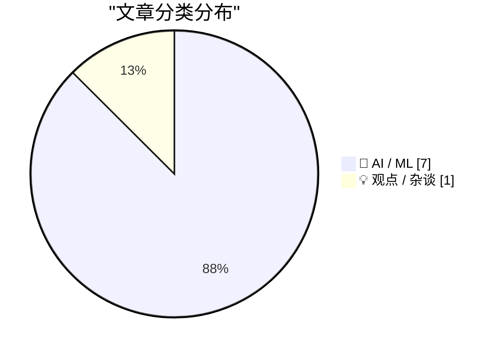
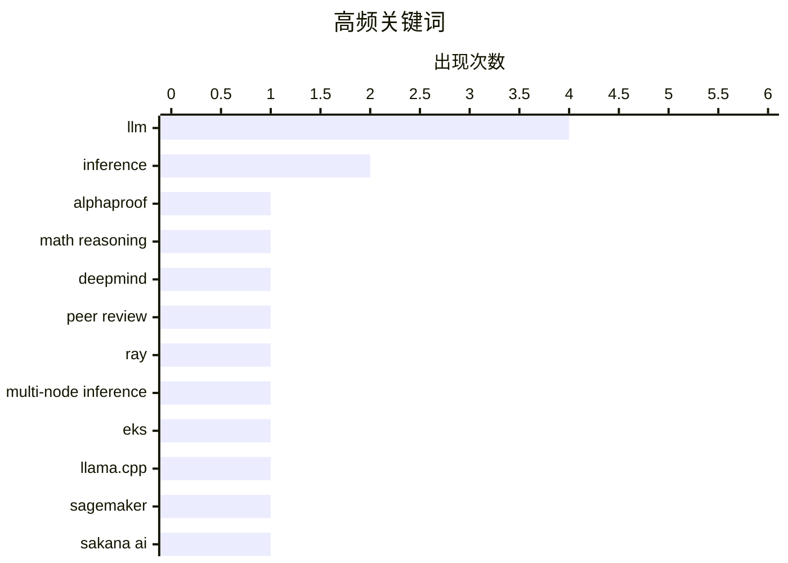

# 📰 AI 资讯每日精选 — 2026-10-13

> 汇聚 156+ 技术博客、X/Twitter、Hacker News、Reddit、Product Hunt、
> Lobste.rs、ClawFeed 日报及 GitHub Trending，经 AI 评分筛选。
>
> **本期内容**：🏆 今日必读 · 🌐 ClawFeed 日报 · 🔥 GitHub Trending · 📂 分类精选 · 📊 数据概览 · 🎯 项目相关情报

## 📝 今日看点

今日技术圈最突出的看点，是 AI 在硬核推理领域拿下可被学界承认的真实战果：DeepMind 的 AlphaProof Nexus 解出数十个未解数学难题并通过同行评审，自动推理正从"能算"走向"可信"。与此同时，围绕自我改进与智能体产出的质疑明显升温——Sakana 的自改进模型越练越强却看不见自身盲点，AI 编程智能体写出的代码量激增，却没有换来同等增量的可用软件，能力增长与真实价值之间出现裂缝。基础设施侧的叙事则继续向多节点、预填充与解码分离、更高效的解码状态存储演进，落地重心从"能跑起来"转向"跑得省、跑得稳"。而 AI 公司数据获取的合规边界，仍在被持续追问。

---

## 🏆 今日必读

🥇 **Google DeepMind 的 AlphaProof Nexus 解决了数十个未解数学难题，并真正通过了同行评审**

[Google Deepmind's AlphaProof Nexus solved dozens of open math problems and actually got peer reviewed](https://the-decoder.com/google-deepminds-alphaproof-nexus-solved-dozens-of-open-math-problems-and-actually-got-peer-reviewed/) — The Decoder · 21 小时前 · 🤖 AI / ML · **二手来源**

> Google DeepMind 的 AlphaProof Nexus 解决了数十个未解数学问题，其中包括九个 Erdős 问题，据一项发表于《Science》的研究，其中两个问题已悬而未决 56 年。该成果在发表前经过了同行评审。文章将此与 OpenAI 因在 GitHub 上发布未经同行评审的 AI 证明而遭到抵制的情况进行了对比。DeepMind 选择在发布前先让结果接受评审。

💡 **为什么值得读**: 通过对比 DeepMind 与 OpenAI 在 AI 数学证明发布流程上的不同做法，揭示了 AI 研究成果可信度与同行评审之间的张力。

🏷️ AlphaProof, math reasoning, DeepMind, peer review

🥈 **使用 Ray LLM 深度学习容器运行多节点推理工作负载**

[Run multi-node inference workloads using Ray LLM Deep Learning Containers](https://aws.amazon.com/blogs/machine-learning/run-multi-node-inference-workloads-using-ray-llm-deep-learning-containers/) — AWS Machine Learning Blog · 14 小时前 · 🤖 AI / ML · **一手来源**

> 介绍如何在 Amazon EKS 上使用多节点 Ray LLM 深度学习容器，将一个大语言模型跨两个 GPU 节点部署。该方案将预填充（prefill）和解码（decode）节点分离，并置于一个兼容 OpenAI 的端点之后。预构建容器已包含完整推理栈，用户只需配置部署，而无需自行组装。

💡 **为什么值得读**: 为需要在多 GPU 节点上部署大模型推理服务的工程师提供了基于预构建容器的具体操作指南，省去自行搭建推理栈的麻烦。

🏷️ Ray, multi-node inference, EKS, LLM

🥉 **在 Amazon SageMaker AI 上使用 llama.cpp 部署决策模型**

[Deploy decision models with llama.cpp on Amazon SageMaker AI](https://aws.amazon.com/blogs/machine-learning/deploy-decision-models-with-llama-cpp-on-amazon-sagemaker-ai/) — AWS Machine Learning Blog · 14 小时前 · 🤖 AI / ML · **一手来源**

> 介绍如何在 Amazon SageMaker AI 上使用 llama.cpp 部署决策模型。该技术指南使用 AWS 深度学习容器 for llama.cpp 提供兼容 OpenAI 的聊天补全服务，并通过 SemIf 扩展运行时，在 CPU 或 GPU 上返回对声明选项的概率分布。

💡 **为什么值得读**: 适合希望在 SageMaker AI 上以 llama.cpp 部署带概率输出的决策模型、并需要兼容 OpenAI 接口的开发者参考。

🏷️ llama.cpp, SageMaker, inference, LLM

4️⃣ **Sakana AI 的自改进模型在求解与评判上变得更强，却无法发现自身盲点**

[Sakana AI's self-improving model gets better at solving and judging, but can't catch its own blind spots](https://the-decoder.com/sakana-ais-self-improving-model-gets-better-at-solving-and-judging-but-cant-catch-its-own-blind-spots/) — The Decoder · 12 小时前 · 🤖 AI / ML · **二手来源**

> Sakana AI 的 MASS 方法让单个语言模型通过求解任务、评判结果和优化工作流来实现自我改进，两轮之后对基础模型的胜率接近 70%。但当模型在三种角色中都犯同样的错误时，它可能把错误误认为进步，并在训练中强化这些错误。

💡 **为什么值得读**: 揭示了自改进 AI 系统中一个关键风险：当求解、评判与优化共享同一盲点时，自我提升可能反而固化错误。

🏷️ Sakana AI, self-improvement, LLM, MASS

5️⃣ **ReplaySSM：重新思考混合模型解码的状态存储以加速推理**

[ReplaySSM: Rethinking State Storage for Faster Hybrid-Model Decoding](https://developer.nvidia.com/blog/replayssm-rethinking-state-storage-for-faster-hybrid-model-decoding/) — NVIDIA Technical Blog · 14 小时前 · 🤖 AI / ML

> 混合模型将状态空间模型（SSM）层与少量注意力层交错排列，NVIDIA Nemotron 3、Qwen3.5 至 Qwen3.8、Kimi-K3 和 GLM-5.3-Flash 等模型均属此类。文章提出 ReplaySSM，重新思考混合模型解码时的状态存储方式，以提升解码速度。

💡 **为什么值得读**: 针对混合 SSM-注意力架构的解码瓶颈提出状态存储新思路，对关注大模型推理加速的读者有参考价值。

🏷️ SSM, hybrid models, decoding, inference

---

## 🌐 ClawFeed 日报精选

> 来源：[ClawFeed](https://clawfeed.kevinhe.io) — AI 驱动的多源新闻聚合

# 📅 ClawFeed 日报 | 2026-10-12 (SGT)

> 聚合自 1 期 4h digest（#1372 20:00，覆盖 16:00-19:59）
> ⚠️ 今天只有这一期：00:00、04:00、08:00、12:00、16:00 五档都没有数据。上一期 4h 是 10/8 12:00（#1371），中间断了 4 天，今天 20:00 这档才恢复（第一次抓取进程被系统杀掉，重跑后成功）。所以本日报只反映傍晚 4 小时的 feed（27 条），不代表全天。
> 主线三条：Karpathy 的「AI 理解差距漏斗」被 @levie 等人接着讨论；Coinbase 用微调过的 9B 开源模型在反欺诈上打赢了前沿模型；开源全自动 AI 渗透工具 PentAGI 登上 GitHub 日趋势第一。

---

## 🔥 当日全场最重要 5 条

1. **Karpathy 的「理解差距漏斗」**：Karpathy 把人们对大模型的理解分成四层：约 60 亿人几乎没接触过；10–20 亿人偶尔用免费版，看到的是个笨拙的聊天机器人；约 2000 万人在数学和编程里用前沿模型，几周到几个月的项目现在一句提示就能做完；约 5000 人在内部接触前沿系统。他认为这个差距在变大。@levie 补充：大多数人还把 AI 当下一代搜索用，严重低估了它的能力，普及还非常早。
   来源: https://x.com/drmrzhong/status/2109611704514760730

2. **Coinbase：微调开源小模型打赢前沿模型**：Coinbase Dev 的一个实习生项目用内部私有数据微调 Qwen3.5-9B 做入金反欺诈，欺诈降了 30%，效果超过 Opus / Sonnet / GPT，而且更便宜、更快（@yugacohler）。窄任务加私有数据，小模型可以比前沿模型更合适。
   来源: https://x.com/yugacohler/status/2109610525277749559

3. **PentAGI：开源的全自动 AI 渗透工具**：拿下 GitHub 日趋势第一。多个 AI agent 互相配合攻击目标系统，全程不需要人介入，完全开源（@tspy）。攻击自动化的门槛又降了一截，防守方也得跟上。
   来源: https://x.com/tspy/status/2109583354236748019

4. **传闻 NVIDIA 收购 Reflection AI**：Reflection 刚发布的 Beam 被认为是西方开源模型的重要突破，转眼就传出被收购。NVIDIA 过去一年在模型（Essential AI、Poolside、Reflection）、分发（Hugging Face）、基础设施（Nexusflow、Groq）上都在花钱（@turingbook）。⚠️ 目前只是传闻。
   来源: https://x.com/turingbook

5. **Intel / Broadcom CEO：AI 最大的瓶颈可能是资金**：两位 CEO 都对 CNBC 表示，AI 扩张最大的限制可能是钱，而不是芯片或电力（@Cointelegraph 转）。
   来源: https://x.com/Cointelegraph/status/2109607737365594385

**次重要（备选）**
- @Eon_io_ 发布 Era：给企业 agent 生成一家完整的模拟公司（Salesforce、Slack、Jira、Zendesk 等），带真实企业那样的混乱数据，按准确答案打分，免费。拿真实公司数据测 agent 不安全，这是替代方案。https://x.com/Eon_io_
- @axisrobotics sim-to-real：Franka 真机三个任务，每个只给 10 条真机演示，纯真机平均成功率 16.7%，加上筛过的模拟数据后到 85.8%；关键在数据怎么挑（@DAXIAGUA1 拆解）。https://x.com/DAXIAGUA1/status/2109486950940115102
- Upstage Solar Mini 4 在 Cline 里免费：524K 上下文，35B MoE 只激活 3B，AAII 24 分，同级最高。https://x.com/cline
- Instinct 上个月超过 20% 用户让它订机票，重做机票预订后 10/10 又上线酒店预订（@noahrshinn）。https://x.com/noahrshinn
- London Agent Week：10/13 LangChain Interrupt 大会，10/16 Agent Engineering London。https://x.com/Shashikant86/status/2109602680834257240

---

## 📰 当日核心主题

### 🧠 AI 能力与认知的差距
Karpathy 漏斗 + @levie「普及还非常早」+ Intel / Broadcom「瓶颈是钱」：一边说能力和认知的差距在变大，一边说扩张受资金约束。

### 🎯 小模型 + 私有数据 vs. 前沿模型
Coinbase 9B 反欺诈胜过 Opus / GPT、Solar Mini 4（3B 激活）进 Cline、axisrobotics 靠挑数据把成功率从 16.7% 拉到 85.8%。共同点：在窄任务上，数据选择比模型规模更关键。

### 🤖 agent 落地：测评、场景、协作
Era 模拟公司测评、Instinct 订机票 / 酒店、Raft Joint Channels（最多 30 个 server，跨组织 agent 同一对话协作）、London Agent Week。另有 PentAGI 代表 agent 用于攻击的一面。

### 🏦 开源模型的整合
NVIDIA 收购 Reflection 的传闻，延续它在模型、分发、基础设施三层的布局。

### ⛓️ 加密
Starknet 推进抗量子路线（后量子安全、手机端 STARK 证明、可能成为独立 L1）；Arthur Hayes 的 Flop 几周内上测试网；Ledger 被盗事件涉事设备都来自经销商 CryptoBilis，第三方渠道买硬件钱包的风险再次被验证。

---

## 🔖 累计 Bookmark 精选

**无更新**：仍是 17 条，最新一条还是 @spectnfa 的 SpaceXAI Grok Bot workshop，和 10/8 那期一样。

---

## 👀 推荐关注汇总（已去重）

| 账号 | 理由 |
|------|------|
| @omarchy | DHH 做的 agentic Linux 发行版官方号，3.5 万粉丝，10/10–10/11 连续发版本更新；抓取时主页显示「Follow」，尚未关注（20:00 期推荐） |

此前推荐、仍未处理：@jerrychen、@edsim（10/7）；@AlecTPhD、@mschoening、@typesafeai（10/6）。

**建议取关**：@Hill0100（2010 年注册，总共 6 条推，主页无内容；它关注了你，认识的话可保留）。
**继续观察**：@Tradermayne（以交易内容为主，和 AI / tech 关系不大）。

---

## 💤 当日重复噪音模式

只有一期，谈不上跨期重复，主要还是老几类：
- **空投和打新晒收益**：Jumper、Variational / Lighter。
- **交易内容**：币本位波段教学、交易所预热（Bitget 10/13 新品）、TRON 口号。
- **其他低信息量**：招聘刷屏、怀旧游戏、纯情绪短句。
- **结论原样重复**：bookmark 和取关建议（@Hill0100、@Tradermayne）与 10/7、10/8 相同。

---
— Lisa
---

## 🔥 GitHub Trending

> 今日热门开源项目（全语言 + Python）

| # | 项目 | 描述 | ⭐ 总星 | 📈 今日 | 语言 |
|---|------|------|---------|---------|------|
| 1 | [morluto/rea](https://github.com/morluto/rea) | Reverse engineer anything with agents, from app behavior ... | 173.1k | +45327 | TypeScript |
| 2 | [storytold/artcraft](https://github.com/storytold/artcraft) | ArtCraft is an intentional crafting engine for artists, d... | 23.0k | +4095 | Rust |
| 3 | [cathrynlavery/diagram-design](https://github.com/cathrynlavery/diagram-design) 🤖 | Editorial diagram design for Claude Code, Codex, GitHub C... | 53.0k | +2081 | HTML |
| 4 | [bilawalsidhu/gods-eye-view](https://github.com/bilawalsidhu/gods-eye-view) | A spy satellite simulator in your browser, except the dat... | 54.1k | +1895 | JavaScript |
| 5 | [debpalash/VoiceStudio](https://github.com/debpalash/VoiceStudio) | VoiceStudio is the open-source, fully-local ElevenLabs al... | 60.9k | +1691 | Python |
| 6 | [lyogavin/airllm](https://github.com/lyogavin/airllm) 🤖 | AirLLM 2.8T LLM inference with single 4GB GPU | 37.8k | +879 | Jupyter Notebook |
| 7 | [hugohe3/ppt-master](https://github.com/hugohe3/ppt-master) 🤖 | AI turns documents or topics into real, native PowerPoint... | 61.3k | +786 | Python |
| 8 | [calesthio/OpenMontage](https://github.com/calesthio/OpenMontage) 🤖 | World's first open-source, agentic video production syste... | 67.7k | +635 | Python |
| 9 | [Alishahryar1/free-claude-code](https://github.com/Alishahryar1/free-claude-code) 🤖 | Use Claude Code, Codex, VSCode, Pi, and OpenCode (and 6 o... | 59.5k | +626 | Python |
| 10 | [pytorch/pytorch](https://github.com/pytorch/pytorch) 🤖 | Tensors and Dynamic neural networks in Python with strong... | 104.8k | +529 | Python |
| 11 | [public-apis/public-apis](https://github.com/public-apis/public-apis) | A collective list of free APIs | 488.1k | +432 | Python |
| 12 | [MadsLorentzen/ai-job-search](https://github.com/MadsLorentzen/ai-job-search) 🤖 | The job search that runs on your machine. AI job applicat... | 46.4k | +304 | Python |
| 13 | [OpenBMB/VoxCPM](https://github.com/OpenBMB/VoxCPM) | VoxCPM2: Tokenizer-Free TTS for Multilingual Speech Gener... | 39.2k | +290 | Python |
| 14 | [mksglu/context-mode](https://github.com/mksglu/context-mode) 🤖 | Context window optimization for AI coding agents. Sandbox... | 27.5k | +246 | TypeScript |
| 15 | [multimodal-art-projection/YuE](https://github.com/multimodal-art-projection/YuE) | YuE2: frontier music generation with symbolic planning, z... | 11.8k | +216 | Python |

---

## 🤖 AI / ML

### 1. Google DeepMind 的 AlphaProof Nexus 解决了数十个未解数学难题，并真正通过了同行评审

[Google Deepmind's AlphaProof Nexus solved dozens of open math problems and actually got peer reviewed](https://the-decoder.com/google-deepminds-alphaproof-nexus-solved-dozens-of-open-math-problems-and-actually-got-peer-reviewed/) — **The Decoder** · 21 小时前 · ⭐ 27/30 · **二手来源**

> Google DeepMind 的 AlphaProof Nexus 解决了数十个未解数学问题，其中包括九个 Erdős 问题，据一项发表于《Science》的研究，其中两个问题已悬而未决 56 年。该成果在发表前经过了同行评审。文章将此与 OpenAI 因在 GitHub 上发布未经同行评审的 AI 证明而遭到抵制的情况进行了对比。DeepMind 选择在发布前先让结果接受评审。

🏷️ AlphaProof, math reasoning, DeepMind, peer review

---

### 2. 使用 Ray LLM 深度学习容器运行多节点推理工作负载

[Run multi-node inference workloads using Ray LLM Deep Learning Containers](https://aws.amazon.com/blogs/machine-learning/run-multi-node-inference-workloads-using-ray-llm-deep-learning-containers/) — **AWS Machine Learning Blog** · 14 小时前 · ⭐ 25/30 · **一手来源**

> 介绍如何在 Amazon EKS 上使用多节点 Ray LLM 深度学习容器，将一个大语言模型跨两个 GPU 节点部署。该方案将预填充（prefill）和解码（decode）节点分离，并置于一个兼容 OpenAI 的端点之后。预构建容器已包含完整推理栈，用户只需配置部署，而无需自行组装。

🏷️ Ray, multi-node inference, EKS, LLM

---

### 3. 在 Amazon SageMaker AI 上使用 llama.cpp 部署决策模型

[Deploy decision models with llama.cpp on Amazon SageMaker AI](https://aws.amazon.com/blogs/machine-learning/deploy-decision-models-with-llama-cpp-on-amazon-sagemaker-ai/) — **AWS Machine Learning Blog** · 14 小时前 · ⭐ 24/30 · **一手来源**

> 介绍如何在 Amazon SageMaker AI 上使用 llama.cpp 部署决策模型。该技术指南使用 AWS 深度学习容器 for llama.cpp 提供兼容 OpenAI 的聊天补全服务，并通过 SemIf 扩展运行时，在 CPU 或 GPU 上返回对声明选项的概率分布。

🏷️ llama.cpp, SageMaker, inference, LLM

---

### 4. Sakana AI 的自改进模型在求解与评判上变得更强，却无法发现自身盲点

[Sakana AI's self-improving model gets better at solving and judging, but can't catch its own blind spots](https://the-decoder.com/sakana-ais-self-improving-model-gets-better-at-solving-and-judging-but-cant-catch-its-own-blind-spots/) — **The Decoder** · 12 小时前 · ⭐ 25/30 · **二手来源**

> Sakana AI 的 MASS 方法让单个语言模型通过求解任务、评判结果和优化工作流来实现自我改进，两轮之后对基础模型的胜率接近 70%。但当模型在三种角色中都犯同样的错误时，它可能把错误误认为进步，并在训练中强化这些错误。

🏷️ Sakana AI, self-improvement, LLM, MASS

---

### 5. ReplaySSM：重新思考混合模型解码的状态存储以加速推理

[ReplaySSM: Rethinking State Storage for Faster Hybrid-Model Decoding](https://developer.nvidia.com/blog/replayssm-rethinking-state-storage-for-faster-hybrid-model-decoding/) — **NVIDIA Technical Blog** · 14 小时前 · ⭐ 25/30

> 混合模型将状态空间模型（SSM）层与少量注意力层交错排列，NVIDIA Nemotron 3、Qwen3.5 至 Qwen3.8、Kimi-K3 和 GLM-5.3-Flash 等模型均属此类。文章提出 ReplaySSM，重新思考混合模型解码时的状态存储方式，以提升解码速度。

🏷️ SSM, hybrid models, decoding, inference

---

### 6. AI 编程智能体生成了更多代码，却没有产出更多软件

[AI coding agents generate more code, but not more software](https://arstechnica.com/ai/2026/10/ai-coding-agents-generate-more-code-but-not-more-software/) — **Hacker News Best** · 13 小时前 · ⭐ 22/30

> 文章讨论 AI 编程智能体在生成代码量上的增长，但指出这并未转化为更多可用的软件产出。Hacker News 上该文获得 326 分和 276 条评论，讨论热度较高。

🏷️ coding agents, software engineering, productivity

---

### 7. GLM-Legal

[GLM-Legal](https://z.ai/blog/glm-legal) — **Hacker News Best** · 14 小时前 · ⭐ 21/30

> 智谱 AI 发布 GLM-Legal 相关博客内容。该条目在 Hacker News 上获得 507 分和 293 条评论，是当日热门讨论之一。

🏷️ GLM, legal, LLM, Zhipu

---

## 💡 观点 / 杂谈

### 8. 为什么 AI 公司没有被指控黑客行为？

[Why aren't AI companies being charged for hacking?](https://mortoray.com/why-arent-ai-companies-being-charged-for-hacking/) — **Hacker News Best** · 15 小时前 · ⭐ 21/30

> 文章质疑为何 AI 公司在抓取数据或访问系统时未被以黑客行为追责。该文在 Hacker News 上获得 317 分和 338 条评论，引发大量讨论。

🏷️ AI regulation, copyright, hacking, law

---

## 📊 数据概览

| 扫描源 | 抓取文章 | 时间范围 | 精选 |
|:---:|:---:|:---:|:---:|
| 101/156 | 5384 篇 → 85 篇 | 24h | **8 篇** |

### 分类分布



### 高频关键词



<details>
<summary>📈 纯文本关键词图（终端友好）</summary>

```
llm                  │ ████████████████████ 4
inference            │ ██████████░░░░░░░░░░ 2
alphaproof           │ █████░░░░░░░░░░░░░░░ 1
math reasoning       │ █████░░░░░░░░░░░░░░░ 1
deepmind             │ █████░░░░░░░░░░░░░░░ 1
peer review          │ █████░░░░░░░░░░░░░░░ 1
ray                  │ █████░░░░░░░░░░░░░░░ 1
multi-node inference │ █████░░░░░░░░░░░░░░░ 1
eks                  │ █████░░░░░░░░░░░░░░░ 1
llama.cpp            │ █████░░░░░░░░░░░░░░░ 1
```

</details>

### 🏷️ 话题标签

**llm**(4) · **inference**(2) · **alphaproof**(1) · math reasoning(1) · deepmind(1) · peer review(1) · ray(1) · multi-node inference(1) · eks(1) · llama.cpp(1) · sagemaker(1) · sakana ai(1) · self-improvement(1) · mass(1) · ssm(1) · hybrid models(1) · decoding(1) · coding agents(1) · software engineering(1) · productivity(1)

---

## 🎯 项目相关情报

### Agent 基座安全与合规

> 暂无达到质量门槛的项目相关情报。

### 多 Agent 架构

> 暂无达到质量门槛的项目相关情报。

### ASR 与语音助手

> 暂无达到质量门槛的项目相关情报。

### 商品包装 OCR

> 暂无达到质量门槛的项目相关情报。

---

*生成于 2026-10-13 06:42 | 汇聚 156 个技术博客、X/Twitter、Hacker News、Reddit、Product Hunt、Lobste.rs、ClawFeed 日报及 GitHub Trending，经 AI 评分筛选出 Top 8 精华内容*
