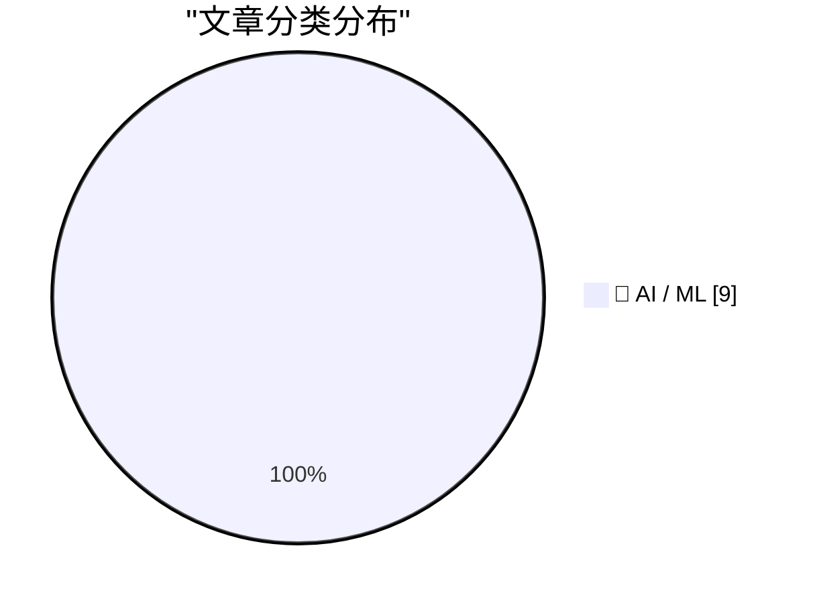
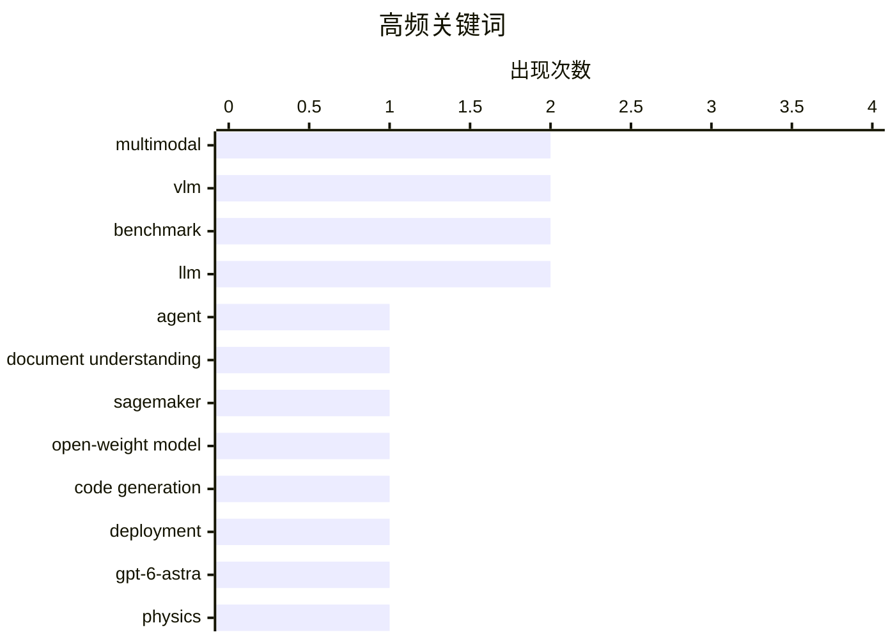

# 📰 AI 资讯每日精选 — 2026-10-16

> 汇聚 156+ 技术博客、X/Twitter、Hacker News、Reddit、Product Hunt、
> Lobste.rs、ClawFeed 日报及 GitHub Trending，经 AI 评分筛选。
>
> **本期内容**：🏆 今日必读 · 🌐 ClawFeed 日报 · 🔥 GitHub Trending · 📂 分类精选 · 📊 数据概览 · 🎯 项目相关情报

## 📝 今日看点

今日技术圈的核心看点集中在开放权重多模态大模型的持续升级：更高参数、更长上下文、编码优化，以及云平台与新一代 GPU 生态的联动，正把开源模型竞争推向企业级部署前线。与此同时，智能体正从“能做事”转向“可信地做事”，长文档交互、多智能体发现、实时环境评估与纵深信任框架共同聚焦延迟、可验证性和控制权。前沿模型在专业推理上继续逼近专家水平，AI for Science 的能力边界与成本效率同步突破；而证据锚定、选择性安全等新思路，则显示多模态与智能体落地的下一道门槛是可信与安全。

---

## 🏆 今日必读

🥇 **DocPilot：面向长视觉文档理解的交互式智能体编排与训练**

[DocPilot: Interactive Agent Orchestration and Training for Long Visual Document Understanding](https://arxiv.org/abs/2610.21327) — arXiv Artificial Intelligence · 22 分钟前 · 🤖 AI / ML · **一手来源**

> 多模态长文档问答要求模型跨页面和模态寻找稀疏证据、理解异构文档内容并对收集到的证据进行推理。即使先进的视觉语言模型（VLM）也可能忽略稀疏证据，且难以在单次推理中完成跨模态推理。现有文档智能体虽引入多步交互，但部分仍依赖预定义工作流或粗粒度引导。DocPilot 提出交互式智能体编排与训练方法，以应对长视觉文档理解中的上述挑战。

💡 **为什么值得读**: 关注长文档多模态问答与智能体编排的研究者可借此了解一种针对稀疏证据和跨模态推理的交互式训练方案。

🏷️ multimodal, agent, document understanding, VLM

🥈 **Meta 的 Muse Spark Open 现已在 Amazon SageMaker JumpStart 中提供**

[Meta’s Muse Spark Open now available in Amazon SageMaker JumpStart](https://aws.amazon.com/blogs/machine-learning/metas-muse-spark-open-now-available-in-amazon-sagemaker-jumpstart/) — AWS Machine Learning Blog · 10 小时前 · 🤖 AI / ML · **一手来源**

> Meta 的编码优化开放权重模型 Muse Spark Open 现已在 Amazon SageMaker JumpStart 中上线。用户可通过 SageMaker Studio 或 SageMaker Python SDK 将其部署到自有 AWS 账户中的 SageMaker AI 端点，并运行首次推理请求。

💡 **为什么值得读**: 为希望在 AWS 上快速部署 Muse Spark Open 进行编码任务的开发者提供直接的上手路径。

🏷️ SageMaker, open-weight model, code generation, deployment

🥉 **GPT-6-Astra 以每个问题 2.40 美元解决 50 道物理研究问题中的 49 道**

[GPT-6-Astra solves 49 of 50 physics research problems at $2.40 apiece](https://the-decoder.com/gpt-6-astra-solves-49-of-50-physics-research-problems-at-2-40-apiece/) — The Decoder · 12 小时前 · 🤖 AI / ML · **待核实**

> 在 TheoPhysEval 基准上，GPT-6-Astra 以与顶尖专家相当的准确率解决了 50 道未发表的理论物理计算题中的 49 道，单题成本约 2.40 美元。部分看似失败的案例中，专家自己的参考解答反而存在错误。研究人员指出，物理学尚未出现数学领域那样的突破，因为智能体缺乏“品味”，但他们认为自主的顶级 AI 研究可能很快到来，并已看到对年轻物理学家培养方式的影响。

💡 **为什么值得读**: 通过具体基准成绩、成本与专家对比，呈现 AI 智能体在理论物理研究中的能力边界与局限。

🏷️ GPT-6-Astra, benchmark, physics, reasoning

4️⃣ **Muse Spark Open 是 Meta 在开放权重竞赛中对 Qwen、GLM 和 Kimi 的回应**

[Muse Spark Open is Meta's answer to Qwen, GLM, and Kimi in the open-weight race](https://the-decoder.com/muse-spark-open-is-metas-answer-to-qwen-glm-and-kimi-in-the-open-weight-race/) — The Decoder · 9 小时前 · 🤖 AI / ML · **二手来源**

> Meta 推出开放权重模型 Muse Spark Open，拥有 8160 亿参数，可处理文本、图像、视频和音频，上下文长度最高达 100 万 token。据该报道，其在基准测试上的表现大致与最强的开放权重中国 AI 模型相当，并针对 Apple M5 Ultra 的本地运行进行了优化。

💡 **为什么值得读**: 帮助读者快速了解 Meta 新开放权重模型在参数规模、多模态能力与开放权重竞争格局中的定位。

🏷️ Meta, open-weight, multimodal, LLM

5️⃣ **在 NVIDIA GB300 NVL72 上利用 Meta 的 Muse Spark Open 扩展智能体编码工作流**

[Scale Agentic Coding Workflows with Meta’s Muse Spark Open on NVIDIA GB300 NVL72](https://developer.nvidia.com/blog/scale-agentic-coding-workflows-with-metas-muse-spark-open-on-nvidia-gb300-nvl72/) — NVIDIA Technical Blog · 10 小时前 · 🤖 AI / ML

> Meta 发布 Muse Spark Open，这是一个面向编码优化的 816B 混合专家（MoE）模型，拥有 42B 激活参数和 100 万 token 上下文窗口。该模型在 NVIDIA GB300 NVL72 平台上用于扩展智能体编码工作流。文章介绍如何借助该模型与硬件组合来扩展智能体编码任务。

💡 **为什么值得读**: 适合想了解大规模 MoE 编码模型与 NVIDIA GB300 NVL72 平台如何配合扩展智能体编码工作流的开发者。

🏷️ Muse Spark, MoE, coding, NVIDIA

---

## 🌐 ClawFeed 日报精选

> 来源：[ClawFeed](https://clawfeed.kevinhe.io) — AI 驱动的多源新闻聚合

# 📅 ClawFeed 日报 | 2026-10-13 (SGT)

> 聚合自 5 期 4h digest：#1375 00:00、#1379 04:00、#1380 08:00、#1381 12:00、#1382 16:00，覆盖 00:00-19:59。
> ⚠️ 20:00-23:59 这一档要到明天 00:00 才跑，不在本日报里。08:00 和 12:00 两档是补抓的（实际抓取时间 13:51、16:14），feed 里有一部分推文早于时间窗（最早到 10/11）。
> 主线：Meta 发布 Muse Wonder，全天霸屏（发布 → DeepSWE 登顶 → 扎克伯格访谈 → 配额 bug 修复）；SpaceXAI 把 X、Grok、Cursor、Grok Bot 合成一个订阅，马斯克亲自给 Grok Bot 站台；「模型吞掉 harness」的论文开始讨论 agent 架构的终局。

---

## 🔥 当日全场最重要 5 条

1. **Meta 发布 Muse Wonder / Muse Wonder Full，进入前沿梯队**：官方称是个人和职业 agentic 任务的 SOTA，为长时间、多步骤工作设计，今天起可在 Meta Model API 和 Muse Code 使用。@fkysly 称它超过 Fable 5.1、逼近 Opus 5.5；@cline 称它在 DeepSWE 排第一。@levie 的看法是，几家同时冲前沿，会加速能力进步、压低顶级能力 token 的价格。@alexandr_wang 当天修复了配额异常消耗，并重置了 Muse Code 额度。
   来源: https://x.com/shengjia_zhao/status/2109693249283821972 ｜ https://x.com/cline/status/2109755052227490281 ｜ https://x.com/levie/status/2109711062757216738

2. **扎克伯格 + Alexandr Wang 上 Cheeky Pint**：模型还没出，就先承诺 1000–2000 亿美元资本开支；小扎认为只要 AI 整体成功，算力可以转售，所以风险比账面上低。Muse 故意去掉了模型和 effort 选择器，他们认为真正的产品是模型的记忆、执行力和人格，而不是 UI。被问到为什么没出现赢家通吃，Wang 说原因之一是蒸馏。
   来源: https://x.com/collision/status/2109714250226905248 ｜ 要点: https://x.com/SpermCapital/status/2109796214619443435 ｜ https://x.com/XAngus/status/2109883925816283194

3. **「模型吞掉 harness」**：Pedro Domingos 发论文（arXiv 2609.35738），说模型已经能自己承担 harness 的作用。@levie 认为这必然是 agent 的最终架构：AI 看到任务后自己决定 harness，会比人提前设计得好。这直接挑战了现在的「harness engineering」路线。
   来源: https://x.com/levie/status/2109788979952558255

4. **SpaceXAI 推出 X 大一统订阅，马斯克给 Grok Bot 站台**：X、Grok、Cursor、Grok Bot 合成一个订阅，Plus $8 / Premium $30 / Super $100，首发五折。马斯克转发一位用户的帖子：Grok Bot 已经替代了他在 ChatGPT / Claude 上全部的搜索类提问，还接管了 Cursor 云端 agent，帮他 review、merge PR（130 万浏览）。Grok Bot 同日上线「记忆迁移」，可以把 Claude / ChatGPT 里的记忆搬过来。
   来源: https://x.com/xiaohu/status/2109777953001521239 ｜ https://x.com/elonmusk/status/2109809802889314556 ｜ https://x.com/wangray/status/2109882420699017425

5. **用 Codex 做逆向被封号**：有人用最近很火的 REA（Reverse Engineer Anything）让 Codex 做逆向，2022 年注册的 OpenAI 老号直接被封（31.8 万浏览）。用 agent 做反编译类任务，有封号风险。
   来源: https://x.com/Vincent_AINotes/status/2109533044407439607

**次重要（备选）**
- Musk 看过 Grok 强化学习阶段的推理轨迹后，表示部分认同 Anthropic 的观点（模型福利 / 对齐）。https://x.com/RoundtableSpace/status/2109732083094650970
- River AI（Igor Babuschkin）：帮企业构建自有定制模型的系统；和 10/12 Coinbase 用 9B 小模型打赢前沿模型的案例方向一致。https://x.com/AnjneyMidha/status/2109729522782462120
- Z.ai 发布 GLM-Legal（基于 GLM-5.3-Flash 的法律垂类模型），官方称在法律 benchmark 上追平前沿模型。https://x.com/Zai_org/status/2109678174468534511
- Sentient OS（YC、a16z speedrun scout fund 投资）：端侧 AI，用自己的光标在你电脑上接手任务。https://x.com/aditya_vellanki/status/2109699200682524921
- @Saccc_c 用 Opus 5.5 + Tripo + Blender 花 16 天把《小王子》做成可探索的 3D 游戏，说之后会开源制作流程。https://x.com/beefnoode/status/2109968465364930987

---

## 📰 当日核心主题

**① Meta Muse 全天霸屏（5 期里 4 期都有）**
发布（#1375）→ DeepSWE 登顶 + 配额 bug（#1379）→ 官方发布 + Cheeky Pint 访谈（#1380）→ 访谈后续「为什么没有赢家通吃：蒸馏」+ David Senra 长访谈（#1381）。还有周边：WSJ 报道各家都在用卡通形象做 AI 助手；Alexandr Wang 的长文《Why We're Building Muse》被收进书签。

**② 前沿实验室抢 agent 入口：订阅打包 + 记忆迁移**
SpaceXAI 把 Cursor 并进 X 订阅（#1379、#1380），马斯克给 Grok Bot 站台、Grok Bot 能迁移 Claude / ChatGPT 的记忆（#1381），Meta 把 Muse Code 和模型 API 一起放出来。竞争点从模型分数转到了「谁拿住用户的 agent 和记忆」。

**③ agent 架构：harness、Skills、多 agent 通信**
「模型吞掉 harness」论文（#1379）；@browserbase 讲用 Skills 让 computer-use 环境「可爬坡」（#1375）；Yobiru 解决多个 agent 之间互不通气的问题（#1380）；@shao__meng 拆 Grok Bot 这类常驻 agent 的「休眠-唤醒」机制（#1380）；@levie 说 agent swarm 会成为企业工作流的核心（#1375）。

**④ 企业 / 私有定制模型和垂类模型**
River AI 企业定制模型（#1375）、GLM-Legal 法律模型（#1381）、SubQ Snap 长上下文决策模型（#1379）、Eon Era 企业 agent 评测环境（#1379）；AI-native 落地案例：PE 投资的医院外包公司要求 90 天上线 3 个生产级 agent（#1382）。

**⑤ 中文圈 Claude Code / Codex 实操**
Codex Computer Use 封装成 MCP 给 Claude Code 用（#1380）、REA 逆向 + 封号警告（#1381）、Grok Bot 进阶用法长文（#1381）、Harvard CS2680 课程推荐（#1380）、yetone 的 magpie 让 AI 自己维护项目（#1380）。

**⑥ 加密：机构持仓和代币化**
Strategy + Strive 今年合计增持 19.7 万枚 BTC（#1375）、Bitmine 持有 603 万枚 ETH（#1379）、代币化国债（#1375）、OpenZeppelin 支撑的链上转账累计超 $38 万亿（#1382）、TOKEN2049 上 Justin Sun 说 agent 用加密支付会是最大用例（#1379）。

---

## 🔖 Bookmarks 精选

今天没有新加的书签（最新一条仍是 10/04 @spectnfa 的 Grok Bot 工作坊）。#1380 从收藏夹最新 20 条里补选了 8 条之前没列过的，值得回看的有：
- @tlxue 发布 Rene：多人优先的 iMessage agent，像朋友一样发短信使唤它。https://x.com/tlxue/status/2100288496170574284
- @AGTPinsights Assistant Benchmark：71 个 AI 个人助理并排打分，覆盖 15 个维度。https://x.com/AGTPinsights/status/2099783676661751974
- @alexandr_wang《Why We're Building Muse》。https://x.com/alexandr_wang/status/2103551714536439951
- @mardehaym《The Five Stages of AI-Native Engineering》。https://x.com/mardehaym/status/2070557674966573570
- @LimestoneHQ《How to Make a Company AI-Native》。https://x.com/LimestoneHQ/status/2074483555510448582

---

## 👀 推荐关注汇总（去重，都在浏览器里核实过「未关注」）

- @Xudong07452910（Xudong Han，1.35 万粉）：分享 AI 系统 / agent 课程，信息密度高。https://x.com/Xudong07452910
- @gengdaJ（逸尘，6.05 万粉）：中文圈 Claude Code / Codex 实操。https://x.com/gengdaJ
- @Vincent_AINotes（Vincent，6 万粉）：中文 AI 工具实操，一手踩坑经验。https://x.com/Vincent_AINotes
- @Saccc_c（Sac，3.6 万粉）：3D AI / AIGC builder，《小王子》3D 游戏作者。https://x.com/Saccc_c
- @aditya_vellanki（2,142 粉）：Sentient OS 创始人，有一手产品信息；粉丝少，按「有自己的产品」入选。https://x.com/aditya_vellanki
- @liangzhu_AI（6,422 粉）：独立开发 / 小产品需求洞察；粉丝少，按原创质量入选。https://x.com/liangzhu_AI
- @jestonlu（2,831 粉）：动手做 agent 的 builder；粉丝少，建议先看主页再决定。https://x.com/jestonlu

**建议取关**：@0xJasonBateman（最近一条 4/10，内容和领域无关，两期都抽到）；@Hill0100（只有 6 条帖子、主页抓不到内容，三期都抽到）。两个都回关了 Kevin，是熟人的话请忽略。

---

## 💤 当日重复噪音模式

- **加密喊单和营销**：赌场推广、付费合作稿、交易所 / 钱包活动、NFT mint 和借贷广告，每一档都有。
- **同一事件反复转发**：Cheeky Pint 访谈、Cursor 并入 X 订阅、订阅价格对比，一天里被不同账号转了 3-4 轮。
- **只有标题没内容**：股票回报表没有数据（@FinanceYF5 连续两期）、一句话评论（@alacheng 等）。
- **八卦和吵架**：交易所老板吵架、个人恩怨续集、人事和政经八卦。
- **领域外的生活 / 鸡汤帖**：早安帖、养生、超马、金句、扑克和交易公开课。
---

## 🔥 GitHub Trending

> 今日热门开源项目（全语言 + Python）

| # | 项目 | 描述 | ⭐ 总星 | 📈 今日 | 语言 |
|---|------|------|---------|---------|------|
| 1 | [morluto/rea](https://github.com/morluto/rea) | Reverse engineer anything with agents, from app behavior ... | 274.9k | +32314 | TypeScript |
| 2 | [debpalash/VoiceStudio](https://github.com/debpalash/VoiceStudio) | VoiceStudio is the open-source, fully-local ElevenLabs al... | 69.4k | +3024 | Python |
| 3 | [ifixai-ai/iFixAi](https://github.com/ifixai-ai/iFixAi) 🤖 | Independent Auditing of AI Agents. Run by human or the ag... | 28.4k | +1587 | Python |
| 4 | [NationalSecurityAgency/ghidra](https://github.com/NationalSecurityAgency/ghidra) | Ghidra is a software reverse engineering (SRE) framework | 88.9k | +1369 | Java |
| 5 | [K-Dense-AI/scientific-agent-skills](https://github.com/K-Dense-AI/scientific-agent-skills) 🤖 | Turn any AI agent into an AI Scientist. The #1 Agent Skil... | 50.7k | +1091 | Python |
| 6 | [affaan-m/ECC](https://github.com/affaan-m/ECC) 🤖 | The agent harness performance optimization system. Skills... | 280.6k | +1013 | JavaScript |
| 7 | [LibreSpark/LibreTV](https://github.com/LibreSpark/LibreTV) | 一分钟搭建影视站，支持Docker等部署方式 | 18.2k | +978 | TypeScript |
| 8 | [mksglu/context-mode](https://github.com/mksglu/context-mode) 🤖 | Context window optimization for AI coding agents. Sandbox... | 29.9k | +904 | TypeScript |
| 9 | [HKUDS/CLI-Anything](https://github.com/HKUDS/CLI-Anything) 🤖 | "CLI-Anything: Making ALL Software Agent-Native" -- CLI-H... | 53.1k | +716 | Python |
| 10 | [xerj-org/xerj](https://github.com/xerj-org/xerj) 🤖 | XERJ is the new way for AI to search data. Its autoindex ... | 5.9k | +715 | Rust |
| 11 | [harry0703/MoneyPrinterTurbo](https://github.com/harry0703/MoneyPrinterTurbo) 🤖 | 利用 AI 大模型和自动化工作流，根据主题或关键词一键生成高清短视频。Generate HD short vide... | 131.7k | +604 | Python |
| 12 | [obra/superpowers](https://github.com/obra/superpowers) | An agentic skills framework & software development method... | 300.1k | +582 | Shell |
| 13 | [JuliusBrussee/caveman](https://github.com/JuliusBrussee/caveman) | 🪨 why use many token when few token do trick. Viral skil... | 112.7k | +433 | Go |
| 14 | [anthropics/claude-plugins-official](https://github.com/anthropics/claude-plugins-official) 🤖 | Official, Anthropic-managed directory of high quality Cla... | 39.3k | +307 | Python |
| 15 | [bojieli/ai-agent-book](https://github.com/bojieli/ai-agent-book) 🤖 | 《深入理解 AI Agent：设计原理与工程实践》（李博杰 著）开源主仓库：全书正文、编译版 PDF 与按章配套代码 | 54.5k | +204 | Python |

---

## 🤖 AI / ML

### 1. DocPilot：面向长视觉文档理解的交互式智能体编排与训练

[DocPilot: Interactive Agent Orchestration and Training for Long Visual Document Understanding](https://arxiv.org/abs/2610.21327) — **arXiv Artificial Intelligence** · 22 分钟前 · ⭐ 22/30 · **一手来源**

> 多模态长文档问答要求模型跨页面和模态寻找稀疏证据、理解异构文档内容并对收集到的证据进行推理。即使先进的视觉语言模型（VLM）也可能忽略稀疏证据，且难以在单次推理中完成跨模态推理。现有文档智能体虽引入多步交互，但部分仍依赖预定义工作流或粗粒度引导。DocPilot 提出交互式智能体编排与训练方法，以应对长视觉文档理解中的上述挑战。

🏷️ multimodal, agent, document understanding, VLM

---

### 2. Meta 的 Muse Spark Open 现已在 Amazon SageMaker JumpStart 中提供

[Meta’s Muse Spark Open now available in Amazon SageMaker JumpStart](https://aws.amazon.com/blogs/machine-learning/metas-muse-spark-open-now-available-in-amazon-sagemaker-jumpstart/) — **AWS Machine Learning Blog** · 10 小时前 · ⭐ 24/30 · **一手来源**

> Meta 的编码优化开放权重模型 Muse Spark Open 现已在 Amazon SageMaker JumpStart 中上线。用户可通过 SageMaker Studio 或 SageMaker Python SDK 将其部署到自有 AWS 账户中的 SageMaker AI 端点，并运行首次推理请求。

🏷️ SageMaker, open-weight model, code generation, deployment

---

### 3. GPT-6-Astra 以每个问题 2.40 美元解决 50 道物理研究问题中的 49 道

[GPT-6-Astra solves 49 of 50 physics research problems at $2.40 apiece](https://the-decoder.com/gpt-6-astra-solves-49-of-50-physics-research-problems-at-2-40-apiece/) — **The Decoder** · 12 小时前 · ⭐ 27/30 · **待核实**

> 在 TheoPhysEval 基准上，GPT-6-Astra 以与顶尖专家相当的准确率解决了 50 道未发表的理论物理计算题中的 49 道，单题成本约 2.40 美元。部分看似失败的案例中，专家自己的参考解答反而存在错误。研究人员指出，物理学尚未出现数学领域那样的突破，因为智能体缺乏“品味”，但他们认为自主的顶级 AI 研究可能很快到来，并已看到对年轻物理学家培养方式的影响。

🏷️ GPT-6-Astra, benchmark, physics, reasoning

---

### 4. Muse Spark Open 是 Meta 在开放权重竞赛中对 Qwen、GLM 和 Kimi 的回应

[Muse Spark Open is Meta's answer to Qwen, GLM, and Kimi in the open-weight race](https://the-decoder.com/muse-spark-open-is-metas-answer-to-qwen-glm-and-kimi-in-the-open-weight-race/) — **The Decoder** · 9 小时前 · ⭐ 25/30 · **二手来源**

> Meta 推出开放权重模型 Muse Spark Open，拥有 8160 亿参数，可处理文本、图像、视频和音频，上下文长度最高达 100 万 token。据该报道，其在基准测试上的表现大致与最强的开放权重中国 AI 模型相当，并针对 Apple M5 Ultra 的本地运行进行了优化。

🏷️ Meta, open-weight, multimodal, LLM

---

### 5. 在 NVIDIA GB300 NVL72 上利用 Meta 的 Muse Spark Open 扩展智能体编码工作流

[Scale Agentic Coding Workflows with Meta’s Muse Spark Open on NVIDIA GB300 NVL72](https://developer.nvidia.com/blog/scale-agentic-coding-workflows-with-metas-muse-spark-open-on-nvidia-gb300-nvl72/) — **NVIDIA Technical Blog** · 10 小时前 · ⭐ 24/30

> Meta 发布 Muse Spark Open，这是一个面向编码优化的 816B 混合专家（MoE）模型，拥有 42B 激活参数和 100 万 token 上下文窗口。该模型在 NVIDIA GB300 NVL72 平台上用于扩展智能体编码工作流。文章介绍如何借助该模型与硬件组合来扩展智能体编码任务。

🏷️ Muse Spark, MoE, coding, NVIDIA

---

### 6. 纵深信任：在不让渡控制权的前提下赋予智能体更多自主性

[Trust in Depth: Giving agents more autonomy without losing control](https://aws.amazon.com/blogs/machine-learning/trust-in-depth-giving-agents-more-autonomy-without-losing-control/) — **AWS Machine Learning Blog** · 13 小时前 · ⭐ 22/30 · **一手来源**

> 企业领导者希望 AI 智能体承担更多工作，但并不完全信任它们每次都能正确行动。AWS 提出“Trust in Depth”分层方法，包括范围界定、了解、约束、观察和证明五个环节，让智能体在行动可被验证时自主执行，而将需要人类判断的决策保留给人工。

🏷️ agents, autonomy, trust, AWS

---

### 7. SSR：用于 LLM 编排多智能体系统中可扩展智能体发现的结构信号检索器

[SSR: Structural Signal Retriever for Scalable Agent Discovery in LLM-Orchestrated Multi-Agent Systems](https://arxiv.org/abs/2610.21113) — **arXiv Multiagent Systems** · 22 分钟前 · ⭐ 22/30 · **一手来源**

> 大规模多智能体生态需要在不向 LLM 编排器暴露整个注册表的情况下发现合适智能体。挑战不仅在于从不断增长的注册表中检索相关 Agent Card，还在于保持紧凑的候选上下文，因为每增加一个候选都会增加提示长度、推理成本、延迟以及超出模型上下文窗口的风险。SSR 提出结构信号检索器来应对这一可扩展智能体发现问题。

🏷️ LLM, agent-discovery, retrieval, multi-agent

---

### 8. 世界不会等待：在实时时钟下评估与训练智能体

[The World Won't Wait: Evaluating and Teaching Agents Under a Live Clock](https://arxiv.org/abs/2610.20665) — **arXiv Artificial Intelligence** · 22 分钟前 · ⭐ 22/30 · **一手来源**

> LLM 智能体虽能解决复杂交互任务，但推理和工具调用需要时间，在持续变化的环境中，原本正确的动作可能因到达太晚而失效。作者提出 RealtimeBench，包含六类游戏共 180 项任务，在游戏持续运行的同时评估智能体。配对评估显示，GPT-6.1-sol 在游戏暂停时优于更快的 Jev，但在游戏持续运行时落后。

🏷️ LLM-agents, benchmark, real-time, evaluation

---

### 9. 反事实邻域风险场：面向视觉语言模型的证据锚定选择性安全

[Counterfactual Neighborhood Risk Fields: Evidence-Grounded Selective Safety for Vision-Language Models](https://arxiv.org/abs/2610.20679) — **arXiv Artificial Intelligence** · 22 分钟前 · ⭐ 22/30 · **一手来源**

> 基于表示的视觉语言模型（VLM）安全防御通常学习区分有害与良性输入，但仅靠分离并不能说明风险分数的含义或何时应被信任。CNRF 提出一种证据锚定的选择性 VLM 安全框架，构建上下文匹配的良性-有害反事实对，并利用其表示差异作为能力信号。该框架旨在为选择性安全提供可解释、可依据的风险评估。

🏷️ VLM, safety, risk, vision-language

---

## 📊 数据概览

| 扫描源 | 抓取文章 | 时间范围 | 精选 |
|:---:|:---:|:---:|:---:|
| 109/156 | 6994 篇 → 1681 篇 | 24h | **9 篇** |

### 分类分布



### 高频关键词



<details>
<summary>📈 纯文本关键词图（终端友好）</summary>

```
multimodal             │ ████████████████████ 2
vlm                    │ ████████████████████ 2
benchmark              │ ████████████████████ 2
llm                    │ ████████████████████ 2
agent                  │ ██████████░░░░░░░░░░ 1
document understanding │ ██████████░░░░░░░░░░ 1
sagemaker              │ ██████████░░░░░░░░░░ 1
open-weight model      │ ██████████░░░░░░░░░░ 1
code generation        │ ██████████░░░░░░░░░░ 1
deployment             │ ██████████░░░░░░░░░░ 1
```

</details>

### 🏷️ 话题标签

**multimodal**(2) · **vlm**(2) · **benchmark**(2) · llm(2) · agent(1) · document understanding(1) · sagemaker(1) · open-weight model(1) · code generation(1) · deployment(1) · gpt-6-astra(1) · physics(1) · reasoning(1) · meta(1) · open-weight(1) · muse spark(1) · moe(1) · coding(1) · nvidia(1) · agents(1)

---

## 🎯 项目相关情报

### Agent 基座安全与合规

> 暂无达到质量门槛的项目相关情报。

### 多 Agent 架构

> 暂无达到质量门槛的项目相关情报。

### ASR 与语音助手

> 暂无达到质量门槛的项目相关情报。

### 商品包装 OCR

#### [DocPilot：面向长视觉文档理解的交互式智能体编排与训练](https://arxiv.org/abs/2610.21327)

> **状态**：本期 Top 9 已收录

- **匹配类型**：可迁移参考
- **项目相关性**：7/10
- **可落地性**：5/10
- **为什么相关**：面向长视觉文档理解的多模态证据检索与推理，其跨页跨模态文档理解与编排方法可迁移到商品包装图文证据抽取与结构化。
- **建议动作**：参考其文档证据定位与 Agent 编排训练方案，评估迁移至包装图像字段抽取流程的可行性。
- **来源**：arXiv Artificial Intelligence · 一手来源

---

*生成于 2026-10-16 04:22 | 汇聚 156 个技术博客、X/Twitter、Hacker News、Reddit、Product Hunt、Lobste.rs、ClawFeed 日报及 GitHub Trending，经 AI 评分筛选出 Top 9 精华内容*
