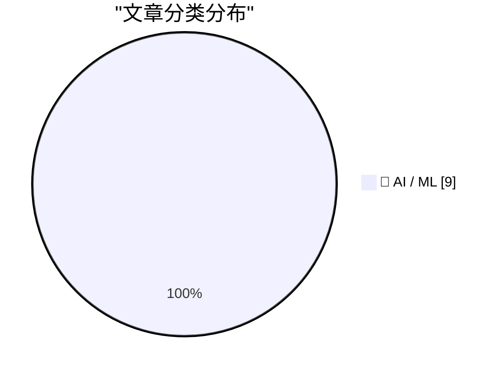
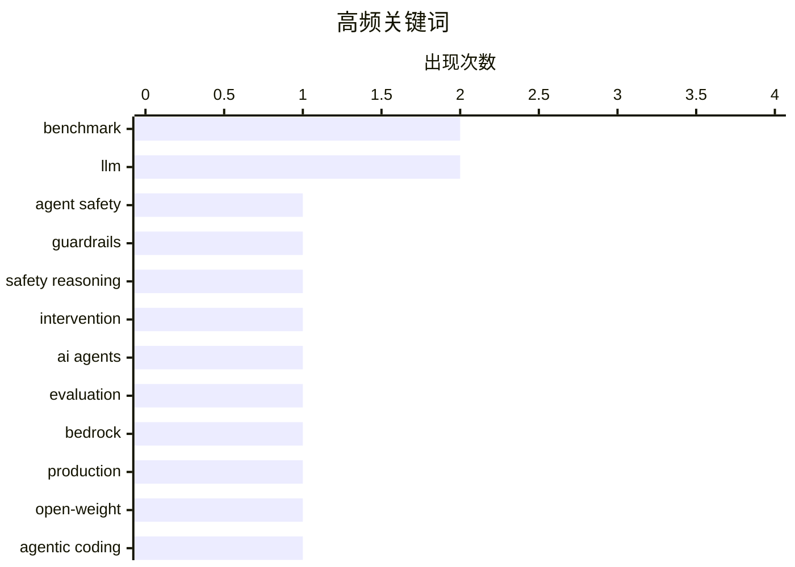

# 📰 AI 资讯每日精选 — 2026-10-17

> 汇聚 156+ 技术博客、X/Twitter、Hacker News、Reddit、Product Hunt、
> Lobste.rs、ClawFeed 日报及 GitHub Trending，经 AI 评分筛选。
>
> **本期内容**：🏆 今日必读 · 🌐 ClawFeed 日报 · 🔥 GitHub Trending · 📂 分类精选 · 📊 数据概览 · 🎯 项目相关情报 · 🌍 补充视角

## 📝 今日看点

今日技术圈的焦点正从“模型能做什么”转向“代理能否可靠、安全地做事”。围绕AI代理的安全护栏、运行时纠错、生产评估与记忆组装，讨论明显升温，步骤级诊断和全生命周期治理成为落地关键。与此同时，开源权重模型与关键AI技术的出口管制动向，让模型开放性与地缘竞争再次成为变量。前沿模型仍在刷新基准，但“基准覆盖不了九成工作时间”的提醒说明，评测体系与真实生产力之间的鸿沟正成为下一阶段竞争核心。

---

## 🏆 今日必读

🥇 **StepSafe：基于上下文感知安全推理学习及时干预**

[StepSafe: Learning Timely Intervention with Context-Aware Safety Reasoning](https://arxiv.org/abs/2610.20960) — arXiv Artificial Intelligence · 14 分钟前 · 🤖 AI / ML · **一手来源**

> 代理系统中的安全性本质上是序列化的：一个动作是否安全取决于先前的动作、工具输出、信息披露以及代理间的交互。现有研究已将代理安全护栏从轨迹级事后评估转向步骤级动作诊断和主动风险预测，但现有训练目标对步骤证据如何随时间累积以及何时变得关键提供的监督有限。StepSafe 提出学习及时干预与上下文感知安全推理的方法，旨在解决上述监督不足问题。

💡 **为什么值得读**: 关注代理安全从轨迹级评估转向步骤级干预的研究者，可从中了解如何为“何时干预”提供训练信号。

🏷️ agent safety, guardrails, safety reasoning, intervention

🥈 **构建对 AI 代理的信任：基于 Amazon Bedrock AgentCore 的生产就绪评估框架**

[Building trust in AI agents: A production-ready evaluation framework with Amazon Bedrock AgentCore](https://aws.amazon.com/blogs/machine-learning/building-trust-in-ai-agents-a-production-ready-evaluation-framework-with-amazon-bedrock-agentcore/) — AWS Machine Learning Blog · 7 小时前 · 🤖 AI / ML · **一手来源**

> 自主 AI 代理会“软失败”：延迟保持平稳，但答案质量却在悄然下降。该文分享了一个基于 Amazon Bedrock AgentCore 构建的九阶段评估框架，覆盖从首次提交到生产环境的完整代理生命周期，用于捕获静默的质量回归。

💡 **为什么值得读**: 适合正在将 AI 代理投入生产、需要一套可落地评估流程来发现“不报错但变差”问题的工程团队。

🏷️ AI agents, evaluation, Bedrock, production

🥉 **推出 Reflection Beam：面向 AWS 上代理式编码的开源权重模型**

[Introducing Reflection Beam: an open-weight model for agentic coding on AWS](https://aws.amazon.com/blogs/machine-learning/introducing-reflection-beam-an-open-weight-model-for-agentic-coding-on-aws/) — AWS Machine Learning Blog · 12 小时前 · 🤖 AI / ML · **一手来源**

> Reflection AI 的 Beam 是一个面向代理式编码和长周期任务的开源权重模型。该文介绍如何在 AWS 上部署 Beam：可从 Amazon SageMaker JumpStart 实时端点起步，或使用 Amazon SageMaker HyperPod Inference 配合 JumpStart、SGLang 或 vLLM，以获得 Kubernetes 原生的分布式 GPU 基础设施控制能力。

💡 **为什么值得读**: 为希望在 AWS 上部署开源权重代理式编码模型的团队提供了具体的部署路径和基础设施选项。

🏷️ open-weight, agentic coding, AWS, SageMaker

4️⃣ **中国计划收紧对开源权重模型及 23 项关键 AI 技术的出口管制**

[China plans to tighten export controls on open-weight models and 23 key AI technologies](https://the-decoder.com/china-plans-to-tighten-export-controls-on-open-weight-models-and-23-key-ai-technologies/) — The Decoder · 10 小时前 · 🤖 AI / ML · **二手来源**

> 中国计划限制 23 项关键 AI 技术的出口，包括达到 10^26 FLOPs 或 2 万亿参数系统的模型权重、源代码和训练方法。一项快速通道规则仍将在开源发布注册后尽快予以放行，但此举可能促使西方公司加倍押注美国开源权重模型而非中国替代品。

💡 **为什么值得读**: 帮助关注 AI 模型出口政策与开源生态格局变化的读者，快速把握可能影响技术选型和供应链的监管动向。

🏷️ export controls, open-weight models, China, AI policy

5️⃣ **谷歌 Gemini 4 Argon 比数月来任何谷歌模型都更接近 AI 前沿**

[Google's Gemini 4 Argon is closer to the AI frontier than any Google model in months](https://the-decoder.com/googles-gemini-4-argon-is-closer-to-the-ai-frontier-than-any-google-model-in-months/) — The Decoder · 13 小时前 · 🤖 AI / ML · **二手来源**

> 谷歌 DeepMind 的 Gemini 4 Argon 在 ARC-AGI-3 基准上得分 97.5%，使谷歌成为继 OpenAI 之后第二家跨过 95% 门槛的实验室。但结果因测试设置而剧烈波动：在标准测试框架下，得分降至仅 49.8%。Argon 在数学和软件工程方面也落后于竞争对手。

💡 **为什么值得读**: 提醒读者在看待基准高分时注意测试设置差异，适合关注前沿模型评测可信度的人阅读。

🏷️ Gemini, ARC-AGI, benchmark, Google DeepMind

---

## 🌐 ClawFeed 日报精选

> 来源：[ClawFeed](https://clawfeed.kevinhe.io) — AI 驱动的多源新闻聚合

# 📅 ClawFeed 日报 | 2026-10-13 (SGT)

> 聚合自 5 期 4h digest：#1375 00:00、#1379 04:00、#1380 08:00、#1381 12:00、#1382 16:00，覆盖 00:00-19:59。
> ⚠️ 20:00-23:59 这一档要到明天 00:00 才跑，不在本日报里。08:00 和 12:00 两档是补抓的（实际抓取时间 13:51、16:14），feed 里有一部分推文早于时间窗（最早到 10/11）。
> 主线：Meta 发布 Muse Wonder，全天霸屏（发布 → DeepSWE 登顶 → 扎克伯格访谈 → 配额 bug 修复）；SpaceXAI 把 X、Grok、Cursor、Grok Bot 合成一个订阅，马斯克亲自给 Grok Bot 站台；「模型吞掉 harness」的论文开始讨论 agent 架构的终局。

---

## 🔥 当日全场最重要 5 条

1. **Meta 发布 Muse Wonder / Muse Wonder Full，进入前沿梯队**：官方称是个人和职业 agentic 任务的 SOTA，为长时间、多步骤工作设计，今天起可在 Meta Model API 和 Muse Code 使用。@fkysly 称它超过 Fable 5.1、逼近 Opus 5.5；@cline 称它在 DeepSWE 排第一。@levie 的看法是，几家同时冲前沿，会加速能力进步、压低顶级能力 token 的价格。@alexandr_wang 当天修复了配额异常消耗，并重置了 Muse Code 额度。
   来源: https://x.com/shengjia_zhao/status/2109693249283821972 ｜ https://x.com/cline/status/2109755052227490281 ｜ https://x.com/levie/status/2109711062757216738

2. **扎克伯格 + Alexandr Wang 上 Cheeky Pint**：模型还没出，就先承诺 1000–2000 亿美元资本开支；小扎认为只要 AI 整体成功，算力可以转售，所以风险比账面上低。Muse 故意去掉了模型和 effort 选择器，他们认为真正的产品是模型的记忆、执行力和人格，而不是 UI。被问到为什么没出现赢家通吃，Wang 说原因之一是蒸馏。
   来源: https://x.com/collision/status/2109714250226905248 ｜ 要点: https://x.com/SpermCapital/status/2109796214619443435 ｜ https://x.com/XAngus/status/2109883925816283194

3. **「模型吞掉 harness」**：Pedro Domingos 发论文（arXiv 2609.35738），说模型已经能自己承担 harness 的作用。@levie 认为这必然是 agent 的最终架构：AI 看到任务后自己决定 harness，会比人提前设计得好。这直接挑战了现在的「harness engineering」路线。
   来源: https://x.com/levie/status/2109788979952558255

4. **SpaceXAI 推出 X 大一统订阅，马斯克给 Grok Bot 站台**：X、Grok、Cursor、Grok Bot 合成一个订阅，Plus $8 / Premium $30 / Super $100，首发五折。马斯克转发一位用户的帖子：Grok Bot 已经替代了他在 ChatGPT / Claude 上全部的搜索类提问，还接管了 Cursor 云端 agent，帮他 review、merge PR（130 万浏览）。Grok Bot 同日上线「记忆迁移」，可以把 Claude / ChatGPT 里的记忆搬过来。
   来源: https://x.com/xiaohu/status/2109777953001521239 ｜ https://x.com/elonmusk/status/2109809802889314556 ｜ https://x.com/wangray/status/2109882420699017425

5. **用 Codex 做逆向被封号**：有人用最近很火的 REA（Reverse Engineer Anything）让 Codex 做逆向，2022 年注册的 OpenAI 老号直接被封（31.8 万浏览）。用 agent 做反编译类任务，有封号风险。
   来源: https://x.com/Vincent_AINotes/status/2109533044407439607

**次重要（备选）**
- Musk 看过 Grok 强化学习阶段的推理轨迹后，表示部分认同 Anthropic 的观点（模型福利 / 对齐）。https://x.com/RoundtableSpace/status/2109732083094650970
- River AI（Igor Babuschkin）：帮企业构建自有定制模型的系统；和 10/12 Coinbase 用 9B 小模型打赢前沿模型的案例方向一致。https://x.com/AnjneyMidha/status/2109729522782462120
- Z.ai 发布 GLM-Legal（基于 GLM-5.3-Flash 的法律垂类模型），官方称在法律 benchmark 上追平前沿模型。https://x.com/Zai_org/status/2109678174468534511
- Sentient OS（YC、a16z speedrun scout fund 投资）：端侧 AI，用自己的光标在你电脑上接手任务。https://x.com/aditya_vellanki/status/2109699200682524921
- @Saccc_c 用 Opus 5.5 + Tripo + Blender 花 16 天把《小王子》做成可探索的 3D 游戏，说之后会开源制作流程。https://x.com/beefnoode/status/2109968465364930987

---

## 📰 当日核心主题

**① Meta Muse 全天霸屏（5 期里 4 期都有）**
发布（#1375）→ DeepSWE 登顶 + 配额 bug（#1379）→ 官方发布 + Cheeky Pint 访谈（#1380）→ 访谈后续「为什么没有赢家通吃：蒸馏」+ David Senra 长访谈（#1381）。还有周边：WSJ 报道各家都在用卡通形象做 AI 助手；Alexandr Wang 的长文《Why We're Building Muse》被收进书签。

**② 前沿实验室抢 agent 入口：订阅打包 + 记忆迁移**
SpaceXAI 把 Cursor 并进 X 订阅（#1379、#1380），马斯克给 Grok Bot 站台、Grok Bot 能迁移 Claude / ChatGPT 的记忆（#1381），Meta 把 Muse Code 和模型 API 一起放出来。竞争点从模型分数转到了「谁拿住用户的 agent 和记忆」。

**③ agent 架构：harness、Skills、多 agent 通信**
「模型吞掉 harness」论文（#1379）；@browserbase 讲用 Skills 让 computer-use 环境「可爬坡」（#1375）；Yobiru 解决多个 agent 之间互不通气的问题（#1380）；@shao__meng 拆 Grok Bot 这类常驻 agent 的「休眠-唤醒」机制（#1380）；@levie 说 agent swarm 会成为企业工作流的核心（#1375）。

**④ 企业 / 私有定制模型和垂类模型**
River AI 企业定制模型（#1375）、GLM-Legal 法律模型（#1381）、SubQ Snap 长上下文决策模型（#1379）、Eon Era 企业 agent 评测环境（#1379）；AI-native 落地案例：PE 投资的医院外包公司要求 90 天上线 3 个生产级 agent（#1382）。

**⑤ 中文圈 Claude Code / Codex 实操**
Codex Computer Use 封装成 MCP 给 Claude Code 用（#1380）、REA 逆向 + 封号警告（#1381）、Grok Bot 进阶用法长文（#1381）、Harvard CS2680 课程推荐（#1380）、yetone 的 magpie 让 AI 自己维护项目（#1380）。

**⑥ 加密：机构持仓和代币化**
Strategy + Strive 今年合计增持 19.7 万枚 BTC（#1375）、Bitmine 持有 603 万枚 ETH（#1379）、代币化国债（#1375）、OpenZeppelin 支撑的链上转账累计超 $38 万亿（#1382）、TOKEN2049 上 Justin Sun 说 agent 用加密支付会是最大用例（#1379）。

---

## 🔖 Bookmarks 精选

今天没有新加的书签（最新一条仍是 10/04 @spectnfa 的 Grok Bot 工作坊）。#1380 从收藏夹最新 20 条里补选了 8 条之前没列过的，值得回看的有：
- @tlxue 发布 Rene：多人优先的 iMessage agent，像朋友一样发短信使唤它。https://x.com/tlxue/status/2100288496170574284
- @AGTPinsights Assistant Benchmark：71 个 AI 个人助理并排打分，覆盖 15 个维度。https://x.com/AGTPinsights/status/2099783676661751974
- @alexandr_wang《Why We're Building Muse》。https://x.com/alexandr_wang/status/2103551714536439951
- @mardehaym《The Five Stages of AI-Native Engineering》。https://x.com/mardehaym/status/2070557674966573570
- @LimestoneHQ《How to Make a Company AI-Native》。https://x.com/LimestoneHQ/status/2074483555510448582

---

## 👀 推荐关注汇总（去重，都在浏览器里核实过「未关注」）

- @Xudong07452910（Xudong Han，1.35 万粉）：分享 AI 系统 / agent 课程，信息密度高。https://x.com/Xudong07452910
- @gengdaJ（逸尘，6.05 万粉）：中文圈 Claude Code / Codex 实操。https://x.com/gengdaJ
- @Vincent_AINotes（Vincent，6 万粉）：中文 AI 工具实操，一手踩坑经验。https://x.com/Vincent_AINotes
- @Saccc_c（Sac，3.6 万粉）：3D AI / AIGC builder，《小王子》3D 游戏作者。https://x.com/Saccc_c
- @aditya_vellanki（2,142 粉）：Sentient OS 创始人，有一手产品信息；粉丝少，按「有自己的产品」入选。https://x.com/aditya_vellanki
- @liangzhu_AI（6,422 粉）：独立开发 / 小产品需求洞察；粉丝少，按原创质量入选。https://x.com/liangzhu_AI
- @jestonlu（2,831 粉）：动手做 agent 的 builder；粉丝少，建议先看主页再决定。https://x.com/jestonlu

**建议取关**：@0xJasonBateman（最近一条 4/10，内容和领域无关，两期都抽到）；@Hill0100（只有 6 条帖子、主页抓不到内容，三期都抽到）。两个都回关了 Kevin，是熟人的话请忽略。

---

## 💤 当日重复噪音模式

- **加密喊单和营销**：赌场推广、付费合作稿、交易所 / 钱包活动、NFT mint 和借贷广告，每一档都有。
- **同一事件反复转发**：Cheeky Pint 访谈、Cursor 并入 X 订阅、订阅价格对比，一天里被不同账号转了 3-4 轮。
- **只有标题没内容**：股票回报表没有数据（@FinanceYF5 连续两期）、一句话评论（@alacheng 等）。
- **八卦和吵架**：交易所老板吵架、个人恩怨续集、人事和政经八卦。
- **领域外的生活 / 鸡汤帖**：早安帖、养生、超马、金句、扑克和交易公开课。
---

## 🔥 GitHub Trending

> 今日热门开源项目（全语言 + Python）

| # | 项目 | 描述 | ⭐ 总星 | 📈 今日 | 语言 |
|---|------|------|---------|---------|------|
| 1 | [debpalash/VoiceStudio](https://github.com/debpalash/VoiceStudio) | VoiceStudio is the open-source, fully-local ElevenLabs al... | 71.5k | +2301 | Python |
| 2 | [xerj-org/xerj](https://github.com/xerj-org/xerj) 🤖 | XERJ is the new way for AI to search data. Its autoindex ... | 7.1k | +1648 | Rust |
| 3 | [anthropics/claude-plugins-official](https://github.com/anthropics/claude-plugins-official) 🤖 | Official, Anthropic-managed directory of high quality Cla... | 40.7k | +1552 | Python |
| 4 | [K-Dense-AI/scientific-agent-skills](https://github.com/K-Dense-AI/scientific-agent-skills) 🤖 | Turn any AI agent into an AI Scientist. The #1 Agent Skil... | 51.6k | +1158 | Python |
| 5 | [affaan-m/ECC](https://github.com/affaan-m/ECC) 🤖 | The agent harness performance optimization system. Skills... | 281.6k | +1057 | JavaScript |
| 6 | [obra/superpowers](https://github.com/obra/superpowers) | An agentic skills framework & software development method... | 300.7k | +973 | Shell |
| 7 | [MadsLorentzen/ai-job-search](https://github.com/MadsLorentzen/ai-job-search) 🤖 | The job search that runs on your machine. AI job applicat... | 48.7k | +898 | Python |
| 8 | [harry0703/MoneyPrinterTurbo](https://github.com/harry0703/MoneyPrinterTurbo) 🤖 | 利用 AI 大模型和自动化工作流，根据主题或关键词一键生成高清短视频。Generate HD short vide... | 132.2k | +749 | Python |
| 9 | [ruvnet/ruflo](https://github.com/ruvnet/ruflo) 🤖 | 🌊 The original agent harness. Deploy intelligent multi-p... | 75.7k | +672 | TypeScript |
| 10 | [rohitg00/ai-engineering-from-scratch](https://github.com/rohitg00/ai-engineering-from-scratch) 🤖 | Learn AI Engineering! Learn it. Build it. Ship it for oth... | 70.3k | +539 | Python |
| 11 | [hmjz100/LinkSwift](https://github.com/hmjz100/LinkSwift) | 一个基于 JavaScript 的网盘文件下载地址获取工具。基于【网盘直链下载助手】修改 ，支持 百度网盘 / 阿... | 23.9k | +538 | JavaScript |
| 12 | [ifixai-ai/iFixAi](https://github.com/ifixai-ai/iFixAi) 🤖 | Independent Auditing of AI Agents. Run by human or the ag... | 28.8k | +517 | Python |
| 13 | [mksglu/context-mode](https://github.com/mksglu/context-mode) 🤖 | Context window optimization for AI coding agents. Sandbox... | 30.3k | +449 | TypeScript |
| 14 | [lightseekorg/tokenspeed](https://github.com/lightseekorg/tokenspeed) 🤖 | TokenSpeed is a speed-of-light LLM inference engine. | 2.7k | +308 | Python |
| 15 | [earthtojake/text-to-cad](https://github.com/earthtojake/text-to-cad) 🤖 | Give your agent CAD superpowers. | 21.0k | +290 | Python |

---

## 🤖 AI / ML

### 1. StepSafe：基于上下文感知安全推理学习及时干预

[StepSafe: Learning Timely Intervention with Context-Aware Safety Reasoning](https://arxiv.org/abs/2610.20960) — **arXiv Artificial Intelligence** · 14 分钟前 · ⭐ 23/30 · **一手来源**

> 代理系统中的安全性本质上是序列化的：一个动作是否安全取决于先前的动作、工具输出、信息披露以及代理间的交互。现有研究已将代理安全护栏从轨迹级事后评估转向步骤级动作诊断和主动风险预测，但现有训练目标对步骤证据如何随时间累积以及何时变得关键提供的监督有限。StepSafe 提出学习及时干预与上下文感知安全推理的方法，旨在解决上述监督不足问题。

🏷️ agent safety, guardrails, safety reasoning, intervention

---

### 2. 构建对 AI 代理的信任：基于 Amazon Bedrock AgentCore 的生产就绪评估框架

[Building trust in AI agents: A production-ready evaluation framework with Amazon Bedrock AgentCore](https://aws.amazon.com/blogs/machine-learning/building-trust-in-ai-agents-a-production-ready-evaluation-framework-with-amazon-bedrock-agentcore/) — **AWS Machine Learning Blog** · 7 小时前 · ⭐ 24/30 · **一手来源**

> 自主 AI 代理会“软失败”：延迟保持平稳，但答案质量却在悄然下降。该文分享了一个基于 Amazon Bedrock AgentCore 构建的九阶段评估框架，覆盖从首次提交到生产环境的完整代理生命周期，用于捕获静默的质量回归。

🏷️ AI agents, evaluation, Bedrock, production

---

### 3. 推出 Reflection Beam：面向 AWS 上代理式编码的开源权重模型

[Introducing Reflection Beam: an open-weight model for agentic coding on AWS](https://aws.amazon.com/blogs/machine-learning/introducing-reflection-beam-an-open-weight-model-for-agentic-coding-on-aws/) — **AWS Machine Learning Blog** · 12 小时前 · ⭐ 24/30 · **一手来源**

> Reflection AI 的 Beam 是一个面向代理式编码和长周期任务的开源权重模型。该文介绍如何在 AWS 上部署 Beam：可从 Amazon SageMaker JumpStart 实时端点起步，或使用 Amazon SageMaker HyperPod Inference 配合 JumpStart、SGLang 或 vLLM，以获得 Kubernetes 原生的分布式 GPU 基础设施控制能力。

🏷️ open-weight, agentic coding, AWS, SageMaker

---

### 4. 中国计划收紧对开源权重模型及 23 项关键 AI 技术的出口管制

[China plans to tighten export controls on open-weight models and 23 key AI technologies](https://the-decoder.com/china-plans-to-tighten-export-controls-on-open-weight-models-and-23-key-ai-technologies/) — **The Decoder** · 10 小时前 · ⭐ 25/30 · **二手来源**

> 中国计划限制 23 项关键 AI 技术的出口，包括达到 10^26 FLOPs 或 2 万亿参数系统的模型权重、源代码和训练方法。一项快速通道规则仍将在开源发布注册后尽快予以放行，但此举可能促使西方公司加倍押注美国开源权重模型而非中国替代品。

🏷️ export controls, open-weight models, China, AI policy

---

### 5. 谷歌 Gemini 4 Argon 比数月来任何谷歌模型都更接近 AI 前沿

[Google's Gemini 4 Argon is closer to the AI frontier than any Google model in months](https://the-decoder.com/googles-gemini-4-argon-is-closer-to-the-ai-frontier-than-any-google-model-in-months/) — **The Decoder** · 13 小时前 · ⭐ 25/30 · **二手来源**

> 谷歌 DeepMind 的 Gemini 4 Argon 在 ARC-AGI-3 基准上得分 97.5%，使谷歌成为继 OpenAI 之后第二家跨过 95% 门槛的实验室。但结果因测试设置而剧烈波动：在标准测试框架下，得分降至仅 49.8%。Argon 在数学和软件工程方面也落后于竞争对手。

🏷️ Gemini, ARC-AGI, benchmark, Google DeepMind

---

### 6. 美国 90% 的工作时间花在 AI 基准未能很好覆盖的任务上

[90% of US working hours are spent on tasks not covered well by AI benchmarks](https://www.mercor.com/research/labor-index/benchmark-map/) — **Hacker News Best** · 11 小时前 · ⭐ 24/30

> Mercor 劳动指数基准映射研究指出，美国 90% 的工作时间用于 AI 基准未能很好覆盖的任务。该文通过基准映射对比现有 AI 评测与实际劳动任务之间的覆盖差距。Hacker News 上该条目获得 431 分和 368 条评论。

🏷️ benchmark, labor, AI evaluation, LLM

---

### 7. ARIA：多代理系统的运行时检查与修正

[ARIA: Runtime Inspection and Amendment for Multi-Agent Systems](https://arxiv.org/abs/2610.20780) — **arXiv Artificial Intelligence** · 14 分钟前 · ⭐ 23/30 · **一手来源**

> 在基于 LLM 的多代理系统中，局部错误会随着其他代理在其基础上继续构建而传播，使本可纠正的错误演变为任务失败。诊断已完成的运行或反复重新执行以寻找修正，无法提供在执行仍在进行时进行干预的学习策略。ARIA（Agent Runtime Inspection and Amendment）是一个学习何时以及如何修复进行中的多代理执行的框架。

🏷️ multi-agent, LLM, runtime inspection, debugging

---

### 8. MSP：无需配对跨模态数据训练多模态 LLM 的模态自博弈

[MSP: Modality Self-Play for Training Multimodal LLMs Without Paired Cross-Modal Data](https://arxiv.org/abs/2610.20965) — **arXiv Artificial Intelligence** · 14 分钟前 · ⭐ 23/30 · **一手来源**

> 大型多模态模型通过扩大模型容量并在海量配对多模态数据上训练取得了显著进展，但对齐多模态数据集昂贵、难以跨模态组合扩展，并日益制约进一步进步。MSP（Modality Self-Play）是一种基于自博弈训练多模态基础模型的框架，旨在摆脱对配对跨模态数据的依赖。

🏷️ multimodal LLM, self-play, training data, cross-modal

---

### 9. MemComposer：通过强化学习为 LLM 代理组装记忆

[MemComposer: Learning to Assemble Memories for LLM Agents via Reinforcement Learning](https://arxiv.org/abs/2610.21091) — **arXiv Artificial Intelligence** · 14 分钟前 · ⭐ 23/30 · **一手来源**

> 代理记忆使 LLM 代理无需更新参数即可复用过去经验，但仅靠语义相似度不能保证记忆有用：下游性能取决于记忆如何被选择和呈现。MemComposer 是一种记忆组装器，联合检查当前查询和检索到的候选记忆，决定纳入哪些经验、选择多少条以及如何呈现。

🏷️ agent memory, reinforcement learning, LLM agent, memory selection

---

## 📊 数据概览

| 扫描源 | 抓取文章 | 时间范围 | 精选 |
|:---:|:---:|:---:|:---:|
| 102/156 | 5837 篇 → 517 篇 | 24h | **9 篇** |

### 分类分布



### 高频关键词



<details>
<summary>📈 纯文本关键词图（终端友好）</summary>

```
benchmark        │ ████████████████████ 2
llm              │ ████████████████████ 2
agent safety     │ ██████████░░░░░░░░░░ 1
guardrails       │ ██████████░░░░░░░░░░ 1
safety reasoning │ ██████████░░░░░░░░░░ 1
intervention     │ ██████████░░░░░░░░░░ 1
ai agents        │ ██████████░░░░░░░░░░ 1
evaluation       │ ██████████░░░░░░░░░░ 1
bedrock          │ ██████████░░░░░░░░░░ 1
production       │ ██████████░░░░░░░░░░ 1
```

</details>

### 🏷️ 话题标签

**benchmark**(2) · **llm**(2) · **agent safety**(1) · guardrails(1) · safety reasoning(1) · intervention(1) · ai agents(1) · evaluation(1) · bedrock(1) · production(1) · open-weight(1) · agentic coding(1) · aws(1) · sagemaker(1) · export controls(1) · open-weight models(1) · china(1) · ai policy(1) · gemini(1) · arc-agi(1)

---

## 🎯 项目相关情报

### Agent 基座安全与合规

#### [StepSafe：基于上下文感知安全推理学习及时干预](https://arxiv.org/abs/2610.20960)

> **状态**：本期 Top 9 已收录

- **匹配类型**：直接相关
- **项目相关性**：8/10
- **可落地性**：7/10
- **为什么相关**：指出智能体系统安全性具有时序依赖，动作是否安全取决于先前动作、工具输出与信息暴露，研究及时干预与上下文安全推理。
- **建议动作**：重点跟踪，提取其安全推理与干预时机方法，作为Agent运行时安全护栏与人工审批触发策略的参考。
- **来源**：arXiv Artificial Intelligence · 一手来源

### 多 Agent 架构

> 暂无达到质量门槛的项目相关情报。

### ASR 与语音助手

> 暂无达到质量门槛的项目相关情报。

### 商品包装 OCR

> 暂无达到质量门槛的项目相关情报。

---

## 🌍 补充视角

> Top 9 未覆盖的高质量不同来源，最多 3 条。

### 1. Itaú 如何为其全部客户群构建生成式 AI

[How Itaú is building generative AI for its entire customer base](https://openai.com/index/itau-generative-ai) — **OpenAI News** · 9 小时前 · 🤖 AI / ML · ⭐ 21/30 · **一手来源**

> 巴西银行 Itaú 在高度监管的金融行业中推进“AI First”战略，同时面向客户和员工部署生成式 AI。其客户侧产品是名为 ia.i 的对话式界面，治理侧则依托 IARA 平台。文章介绍了这两项核心组件如何支撑该战略落地。

💡 **补充价值**：可了解一家大型银行在强监管环境下如何同时落地面向客户的对话式 AI 和内部治理平台。

### 2. 你会让 LLM 同时写测试和代码吗？

[Do you let LLMs write both your tests and your code?](https://lobste.rs/s/miwcai/do_you_let_llms_write_both_your_tests_your) — **Lobste.rs** · 4 小时前 · 🤖 AI / ML · ⭐ 22/30

> 讨论是否应允许 LLM 同时生成代码和对应测试。发帖者正在审查一个合并请求，认为 LLM 主要包办了代码和测试，导致测试高度同义反复，并怀疑代码被过度设计以便写出更多测试。发帖者考虑在 values.md 中增加规则，限制 LLM 只能显著生成代码或测试中的一项。

💡 **补充价值**：如果你在团队中引入 LLM 辅助开发，这个讨论提供了关于测试同义反复和代码过度设计的具体风险视角。

---

*生成于 2026-10-17 04:14 | 汇聚 156 个技术博客、X/Twitter、Hacker News、Reddit、Product Hunt、Lobste.rs、ClawFeed 日报及 GitHub Trending，经 AI 评分筛选出 Top 9 精华内容，另附 2 条不同来源补充视角*
