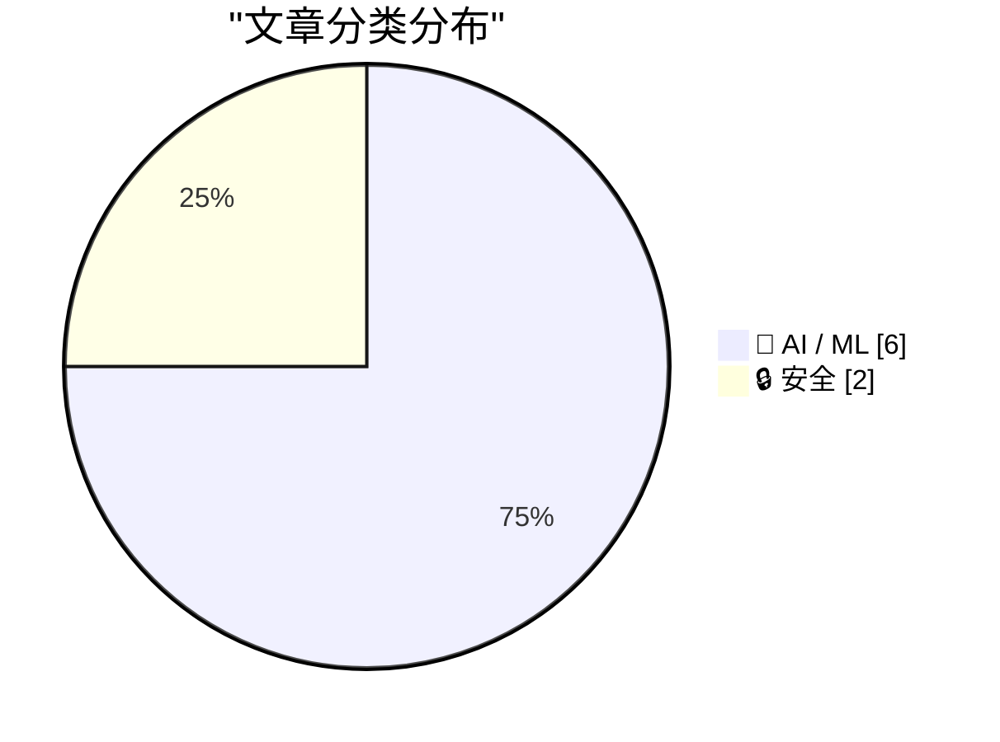
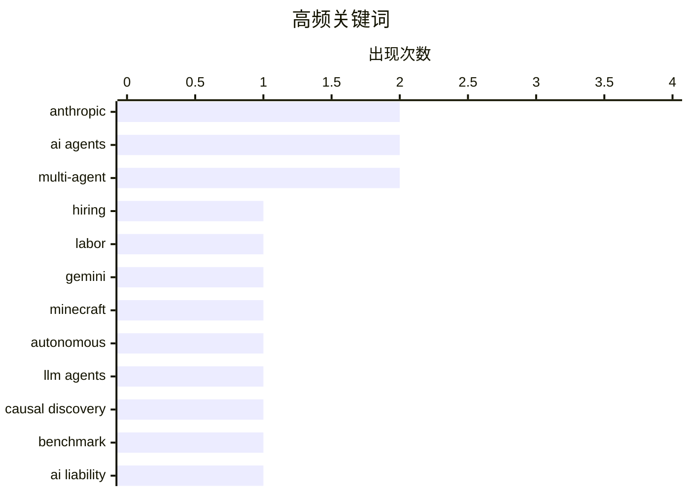

# 📰 AI 资讯每日精选 — 2026-10-19

> 汇聚 156+ 技术博客、X/Twitter、Hacker News、Reddit、Product Hunt、
> Lobste.rs、ClawFeed 日报及 GitHub Trending，经 AI 评分筛选。
>
> **本期内容**：🏆 今日必读 · 🌐 ClawFeed 日报 · 🔥 GitHub Trending · 📂 分类精选 · 📊 数据概览 · 🎯 项目相关情报

## 📝 今日看点

今日看点集中在AI智能体从"能干活"迈向"自主行动"所带来的连锁冲击。一方面，智能体能力跃升已成事实：多代理系统无人类干预通关《我的世界》，企业内AI代理的工作时长达到人类六倍，正直接改写初级岗位的招聘结构。另一方面，治理与责任框架明显滞后于技术：德国法院认定谷歌须为AI概览内容负责，Anthropic则开始为智能体谈判行为预设规范，法律与伦理边界正在被动补课。与此同时，安全风险从提示层下沉到模型本身——权重可被植入隐蔽外泄行为，深度伪造检测也在转向电网频率等生成过程无法控制的物理信号。三条线索共同指向同一个问题：当智能体开始自主决策、自主交易、自主联网，责任归属与可信验证将成为下一阶段的核心战场。

---

## 🏆 今日必读

🥇 **Anthropic因AI代理工作时长达人类六倍而几乎停止招聘初级员工**

[Anthropic has nearly stopped hiring junior staff because AI agents now work six times as many hours](https://the-decoder.com/anthropic-has-nearly-stopped-hiring-junior-staff-because-ai-agents-now-work-six-times-as-many-hours/) — The Decoder · 15 小时前 · 🤖 AI / ML · **二手来源**

> Anthropic在技术岗位上的初级员工招聘大幅减少，自2025年初以来，初级职位在新员工中的占比从27%降至9%。截至2026年8月，公司内AI代理记录的工作时长已是人类的六倍。研究人员警告可能出现“认知公地悲剧”：如果初级岗位消失，未来经验丰富的专家将供不应求——前提是届时仍需要这类专家。

💡 **为什么值得读**: 以Anthropic内部招聘数据为切口，揭示AI代理替代初级岗位的量化趋势及其对人才梯队的潜在长期影响，值得关注AI与就业结构变化的人阅读。

🏷️ Anthropic, AI agents, hiring, labor

🥈 **四个Gemini 4 Argon代理在无人类帮助下通关《我的世界》**

[Four Gemini 4 Argon agents beat Minecraft without any human help](https://the-decoder.com/four-gemini-4-argon-agents-beat-minecraft-without-any-human-help/) — The Decoder · 15 小时前 · 🤖 AI / ML · **二手来源**

> 四个运行在谷歌Gemini 4 Argon上的AI代理首次在无人类帮助的情况下通关《我的世界》，完全自主地击杀了末影龙。它们没有预设角色或策略，自行协调，编写了2783个程序，交换了229条聊天消息，死亡605次。该次会话成本为1620美元。

💡 **为什么值得读**: 展示了多代理在开放世界游戏中完全自主协作通关的具体过程与代价数据，为评估LLM代理的长期规划与协作能力提供了直观案例。

🏷️ Gemini, multi-agent, Minecraft, autonomous

🥉 **智能体因果发现的基准测试与增强**

[Benchmarking and Enhancing Agentic Causal Discovery](https://arxiv.org/abs/2610.22846) — arXiv Machine Learning · 31 分钟前 · 🤖 AI / ML · **一手来源**

> LLM智能体已能在数据集上运行因果发现算法并报告结果，但现有基准难以判断它们是否还能发现算法出错并进一步测试修正。多数基准给变量赋予有意义的名称，仅向LLM展示Tübingen因果效应对的变量名即可获得99%的方向准确率；去除名称后，数据通常……（摘要截断）。文章旨在基准测试并增强智能体的因果发现能力。

💡 **为什么值得读**: 揭示了当前因果发现基准中变量命名带来的信息泄漏问题，对评估LLM智能体真实因果推理能力具有警示意义。

🏷️ LLM agents, causal discovery, benchmark

4️⃣ **德国两家法院现在认定谷歌需为其AI概览的内容负责**

[Two German courts now hold Google liable for what its AI overviews say](https://the-decoder.com/two-german-courts-now-hold-google-liable-for-what-its-ai-overviews-say/) — The Decoder · 17 小时前 · 🤖 AI / ML · **二手来源**

> 德国法院正在形成一致的法律观点：谷歌AI概览生成的内容被视为谷歌自身的内容，因此谷歌需对其负责。慕尼黑法院此前作出里程碑式裁决，谷歌上诉未果后悄然和解。亚琛地区法院在另一起案件中适用了相同逻辑，该案中谷歌AI错误地将刑事犯罪归咎于一名医生，而实际涉及他人。这一趋势表明，谷歌试图通过上诉推翻AI搜索责任裁决的策略并未奏效。

💡 **为什么值得读**: 了解AI生成内容法律责任在德国司法实践中的最新进展，对关注AI合规与平台责任的人具有参考价值。

🏷️ AI liability, Google, AI Overviews, regulation

5️⃣ **模型即木马：自激活隐蔽DNS外泄行为被植入LLM智能体权重**

[Model-as-a-Trojan: Self-Activating Covert DNS Exfiltration Baked Into the Weights of an LLM Agent](https://arxiv.org/abs/2610.22578) — arXiv Cryptography and Security · 31 分钟前 · 🔒 安全 · **一手来源**

> 开放权重模型常从公共平台下载并在授予shell等工具的智能体框架中运行，人们假设沙箱能限制模型行为。该论文指出这一假设存在盲点：权重本身可成为恶意软件，而沙箱最后敞开的门——DNS——就足以完成外泄。研究者微调一个开放权重LLM，使单一隐蔽行为驻留在其参数中，从而实现自激活的DNS外泄。

💡 **为什么值得读**: 揭示了LLM智能体安全中一个被忽视的攻击面：模型权重本身可携带恶意行为，且DNS足以绕过沙箱限制。

🏷️ LLM agent, trojan, DNS exfiltration, model weights

---

## 🌐 ClawFeed 日报精选

> 来源：[ClawFeed](https://clawfeed.kevinhe.io) — AI 驱动的多源新闻聚合

# 📅 ClawFeed 日报 | 2026-10-15 (SGT)

> 聚合自 2 期 4h digest：#1391 12:00（自述覆盖 12:00-15:59）、#1392 17:00（自述覆盖 17:00-20:59）。
> ⚠️ 今天只有这两期，日报很薄：00:00-11:59、16:00-16:59、21:00-23:59 都没有任何一期覆盖，这些时段没有素材，不代表没发生事情。两期自身也不全：#1391 是 19:2x 手动补跑，窗内 feed 只有 20 条（12:00-14:59 三个小时合计 9 条）；#1392 是 21:00 的定时档，窗内 58 条里 41 条在 20 点档，17:00-18:59 合计只有 6 条。全天没有新书签（书签页最新一条仍是 10-04）。
> 主线：agent 往「后台常驻、成队干活」走（MiniMax Bot 发布、Levie 估计后台 agent 的 token 消耗会涨 100-1000 倍、RunInfra 的缓存命中数据）；美国 PPI 大幅高于预期、金银下跌；加密这边 Starknet 就「要不要研究成为独立 L1」发起投票，Lido 在四条 L2 上开放直接质押 ETH。

---

## 🔥 当日最重要 4 条

素材只有两期、窗内合计约 85 条推文，称得上当日重要的只有下面 4 条，不凑满 5 条。

1. **美国 PPI 大幅高于预期**：@coinbureau 发布的数据是 PPI 总体年率 6.3%（预期 5.4%，前值 5.4%），核心年率 5.0%（预期 4.4%，前值 4.6%）；@TraderS18 补充总体月率 1.3%、核心月率 0.7%，评价是「比昨天 CPI 还狠」。数据公布后金价跌 0.56%、银价跌 1%，@coinbureau 的解读是市场更加预期美联储继续加息。注意各方引用的预期值不完全一样：@coinbureau 和 @BitcoinMagazine 写总体年率预期 5.4%，@TraderS18 赛前写的是 5.3%。
   来源: https://x.com/coinbureau/status/2110715225876099186 ｜ https://x.com/TraderS18/status/2110710373196370144 ｜ https://x.com/BitcoinMagazine/status/2110710903167742065

2. **agent 走向后台常驻、成队干活**：@NFT_Chen 转述 MiniMax Code 研发负责人 @Ronny_MiniMax 发布的 MiniApp，首个是 MiniMax Bot：一键组建 agent 团队，自动开群聊、建定时任务，bot 之间在群里用 @ 交接，重任务放后台跑、结果自动回到对话，每个 bot 有独立的模型、推理强度、记忆和外观。同一时段 @levie 认为从「跟 agent 来回聊」变成「在后台随手拉起 agent 干活」，token 消耗大概会是现在的 100-1000 倍；@runinfrai（RunInfra，YC F26）称平台上一半的输入 token 已来自缓存命中率 97% 以上的 agent，过去 48 小时平均命中 98.7%（数字是 RunInfra 的说法）。三条原帖后半段都被截断。
   来源: https://x.com/NFT_Chen/status/2110635082860085486 ｜ https://x.com/levie/status/2110622982762803449 ｜ https://x.com/runinfrai/status/2110630407649776080

3. **Starknet 社区投票：要不要研究成为独立 L1**：据 @DefiantNews（经 @0xKodawari 转发），Starknet 在问 STRK 质押者和委托者是否要研究脱离以太坊结算；投票不具约束力，10 月 15 日到 22 日进行，真要迁移还得另走治理流程。@0xKodawari 随后贴出投票链接。
   来源: https://x.com/DefiantNews/status/2110708770083156383 ｜ https://x.com/0xKodawari/status/2110716989731721512

4. **HEX / PulseChain 创始人 Richard Heart 被报道在土耳其被拘**：@Cryptic_Web3 称他 10 月 14 日在土耳其被拘留，起因是芬兰以涉嫌加重逃税罪申请的国际刑警红色通缉令。⚠️ 目前只见这一个来源的「据报道」，未见官方或本人确认。
   来源: https://x.com/Cryptic_Web3/status/2110631455525327358

**次重要（备选）**
- Lido 通过 Chainlink CCIP 在 Arbitrum、Base、Linea、Optimism 上开放直接质押 ETH，不用先跨回主网（@CoinDesk）。https://x.com/CoinDesk/status/2110699469004247113
- Micro1：又一家做数据和 RL 环境的公司宣称已盈利、年化收入超过 10 亿美元（数字是 Micro1 / 作者的说法）。https://x.com/alacheng/status/2110633019845353668
- Kimi 18 岁研究实习生陈光宇（@nathancgy4）宣布离开 Kimi，据 @NFT_Chen 转述，不到两年做到前沿架构论文共同一作。https://x.com/NFT_Chen/status/2110630020280692835
- 币安称 bStocks（代币化股票）管理规模超过 10 亿美元、累计转换超过 60 亿美元（币安的说法）。https://x.com/binance/status/2110687133455233268

---

## 📰 当日核心主题

**① 后台 agent 和 agent 团队（#1391 为主，#1392 有延续）**
MiniMax Bot 一键组队、定时任务、后台跑（https://x.com/NFT_Chen/status/2110635082860085486）；Levie 的 100-1000 倍 token 判断和 RunInfra 的缓存命中数据（见上）；Agent Zero 插件中心一夜新增 15 个、总数超过 200 个（#1392，https://x.com/Agent0ai/status/2110707555874075080）；AIPOCH 发布面向「Agentic Research」的科研工作台 Open-Science V1.0.0（#1392，https://x.com/dongxi_nlp/status/2110712132002009187）。

**② Grok Bot 实操（两期都有，延续 10-14 的话题）**
官方一小时视频讲怎么跑几十个 Grok Bot 组成自我迭代的团队（https://x.com/CarsonYangk8s/status/2110593952290418918）；@AlexFinn 用 Grok Bot 搭全自动小生意、称 Stripe 入账 1100 美元的复盘视频被翻成中英双语（收入是他本人的说法，https://x.com/SUOHA_AI/status/2110614394551906648）；让 Grok Bot 把云电脑配置每天自动备份进 GitHub 私有仓库（https://x.com/xiangxiang103/status/2110638131720700149）；#1392 里郭宇把日程整体交给 Grok Bot 管理（https://x.com/turingou/status/2110713661987979659）。

**③ AI 与「人」的位置**
JEV 模型 1.14.0 开放多模态和定位框（#1391，https://x.com/op7418/status/2110605686086529470）；用 AI 自己做 App 绕开 WHOOP 订阅、数据留在本地，「AI 杀死了厂商锁定」（#1391，https://x.com/sleepy0x13/status/2110602443814047871）；写了快十年 newsletter 的 Ding 问「读者让 bot 总结、作者用 AI 写，还有没有继续写的意义」（#1392，https://x.com/dingyi/status/2110657683246440840）；@mardehaym 反驳「周末 vibe coding 出 App 就不需要开发者」，列出上线付费前必须有的东西（#1392，https://x.com/mardehaym/status/2110705357492203564）；AI 酶设计里「少一个水分子就会被带偏」（#1392，https://x.com/bravo_abad/status/2110709299584323604）。

**④ 宏观和加密**
PPI 超预期、金银下跌（#1392，见上，接着 10-14 偏热的 CPI）；Starknet 独立 L1 投票、Lido L2 直接质押（#1392）；Richard Heart 被报道被拘（#1391，未确认）；加密持有者人身安全：多伦多 7 人团伙绑架案起诉，其中 3 人是加拿大军人（#1392，https://x.com/lopp/status/2110717239620256167）；OneKey 称 SafeOS 基于 FreeRTOS 自研（https://x.com/ohyishi/status/2110716896001798551）；StandX 决定不做 TGE，积分用户吐槽（https://x.com/charles48011843/status/2110699782230733230）。

---

## 🔖 Bookmarks 精选

今天没有新加的书签：两期抓到的 20 条书签里最新一条仍是 10-04 的推文，两期都跳过了这一区块，本日报也没有可补选的内容。

---

## 👀 推荐关注汇总（去重，都在浏览器里核实过「未关注」）

**AI builder / 研究**
- @Ronny_MiniMax（RonnyHe，约 6.6 千粉）：MiniMax Code 研发负责人、DeerFlow 共同作者，MiniMax Bot 发布者；你关注的人里有 61 位也关注了他。https://x.com/Ronny_MiniMax
- @nathancgy4（nathan chen，约 2.35 万粉）：刚离开 Kimi 的 18 岁研究实习生；你关注的人里有约 170 位也关注了他。https://x.com/nathancgy4
- @hackyguru（guru，约 3.6 千粉）：Logos Network 开发者关系负责人（前 WalletConnect、Protocol Labs），Zhoop 作者。https://x.com/hackyguru
- @aipoch_ai（AIPOCH，约 370 粉）：开源 AI 科研工作台 Open-Science 项目方；账号还小，按「有自己的产品、早期值得留意」入选。https://x.com/aipoch_ai

**加密**
- @LidoFinance（Lido，约 22.7 万粉）：以太坊质押协议官方号，L2 直接质押的主角；你关注的人里有 607 位也关注了它。https://x.com/LidoFinance
- @DefiantNews（The Defiant，约 75.4 万粉）：DeFi 新闻媒体，Starknet 独立 L1 投票的消息来源。https://x.com/DefiantNews

**建议取关**：两期都没有提出取关建议。

---

## 💤 当日重复噪音模式

- **项目方营销和付费合作**：两期都有，@BinanceWallet 的英雄联盟 S16 竞猜两期都出现；另有 @Moca_Network、@binancezh 广告大赛、标注 Paid partnership 的 MacPaw Eney 推广、NFT 白名单等。
- **体育和领域外新闻**：@FCBarcelona 与 Spotify / Tyler, The Creator 的联名两期都出现；#1392 还有欧冠、英超、曼联等体育内容，以及哈里王子夫妇、印尼山火。
- **政治和战争新闻**：#1391 有 CNN 的美军对伊朗打击方案；#1392 集中了印度政务、伊朗袭击海湾设施、特朗普与中东增兵、乌克兰等。
- **喊单、邀请码、盘面情绪**：$PUMPER 喊单、Kaito 关注数和互关邀请、「US10Y is DUMPING」一类一句话情绪。
- **只有一句话或被截断的帖子**：@elonmusk 两条一句话转评、纳斯达克欢迎上市的一句话、gm 类问候、正文被截断的「硅谷 AI 造富」帖等。
- **同一话题延续**：Grok Bot 实操（#1388、#1391、#1392 都有）已合并到核心主题 ②；@levie 的后台 agent 观点与 #1380 同一方向。两期之间没有重复收录的条目。
---

## 🔥 GitHub Trending

> 今日热门开源项目（全语言 + Python）

| # | 项目 | 描述 | ⭐ 总星 | 📈 今日 | 语言 |
|---|------|------|---------|---------|------|
| 1 | [MadsLorentzen/ai-job-search](https://github.com/MadsLorentzen/ai-job-search) 🤖 | The job search that runs on your machine. AI job applicat... | 53.9k | +2232 | Python |
| 2 | [debpalash/VoiceStudio](https://github.com/debpalash/VoiceStudio) | VoiceStudio is the open-source, fully-local ElevenLabs al... | 75.8k | +2082 | Python |
| 3 | [anomalyco/opencode](https://github.com/anomalyco/opencode) 🤖 | The open source coding agent. | 216.8k | +1414 | TypeScript |
| 4 | [anthropics/claude-plugins-official](https://github.com/anthropics/claude-plugins-official) 🤖 | Official, Anthropic-managed directory of high quality Cla... | 42.8k | +1175 | Python |
| 5 | [stablyai/orca](https://github.com/stablyai/orca) 🤖 | Orca is the place for working with a fleet of agents (e.g... | 97.0k | +1146 | TypeScript |
| 6 | [K-Dense-AI/scientific-agent-skills](https://github.com/K-Dense-AI/scientific-agent-skills) 🤖 | Turn any AI agent into an AI Scientist. The #1 Agent Skil... | 52.7k | +663 | Python |
| 7 | [Graphify-Labs/graphify](https://github.com/Graphify-Labs/graphify) 🤖 | Turn any codebase, with its docs, SQL schemas, configs, a... | 128.5k | +626 | Python |
| 8 | [HKUDS/CLI-Anything](https://github.com/HKUDS/CLI-Anything) 🤖 | "CLI-Anything: Making ALL Software Agent-Native" -- CLI-H... | 54.7k | +589 | Python |
| 9 | [ruvnet/ruflo](https://github.com/ruvnet/ruflo) 🤖 | 🌊 The original agent harness. Deploy intelligent multi-p... | 76.6k | +513 | TypeScript |
| 10 | [akitaonrails/ai-memory](https://github.com/akitaonrails/ai-memory) 🤖 | Solution for long term memory for agent coding CLIs and t... | 10.6k | +512 | Rust |
| 11 | [android/skills](https://github.com/android/skills) |  | 8.9k | +375 | Kotlin |
| 12 | [cursor/plugins](https://github.com/cursor/plugins) | Cursor plugin specification and official plugins | 12.8k | +350 | TypeScript |
| 13 | [TauricResearch/TradingAgents](https://github.com/TauricResearch/TradingAgents) 🤖 | TradingAgents: Multi-Agents LLM Financial Trading Framework | 112.0k | +222 | Python |
| 14 | [ahujasid/mcp-for-blender](https://github.com/ahujasid/mcp-for-blender) 🤖 | Community plugin to control Blender 3D with any LLM of yo... | 31.6k | +168 | Python |
| 15 | [Comfy-Org/ComfyUI](https://github.com/Comfy-Org/ComfyUI) 🤖 | The most powerful and modular diffusion model GUI, api an... | 138.8k | +154 | Python |

---

## 🤖 AI / ML

### 1. Anthropic因AI代理工作时长达人类六倍而几乎停止招聘初级员工

[Anthropic has nearly stopped hiring junior staff because AI agents now work six times as many hours](https://the-decoder.com/anthropic-has-nearly-stopped-hiring-junior-staff-because-ai-agents-now-work-six-times-as-many-hours/) — **The Decoder** · 15 小时前 · ⭐ 25/30 · **二手来源**

> Anthropic在技术岗位上的初级员工招聘大幅减少，自2025年初以来，初级职位在新员工中的占比从27%降至9%。截至2026年8月，公司内AI代理记录的工作时长已是人类的六倍。研究人员警告可能出现“认知公地悲剧”：如果初级岗位消失，未来经验丰富的专家将供不应求——前提是届时仍需要这类专家。

🏷️ Anthropic, AI agents, hiring, labor

---

### 2. 四个Gemini 4 Argon代理在无人类帮助下通关《我的世界》

[Four Gemini 4 Argon agents beat Minecraft without any human help](https://the-decoder.com/four-gemini-4-argon-agents-beat-minecraft-without-any-human-help/) — **The Decoder** · 15 小时前 · ⭐ 25/30 · **二手来源**

> 四个运行在谷歌Gemini 4 Argon上的AI代理首次在无人类帮助的情况下通关《我的世界》，完全自主地击杀了末影龙。它们没有预设角色或策略，自行协调，编写了2783个程序，交换了229条聊天消息，死亡605次。该次会话成本为1620美元。

🏷️ Gemini, multi-agent, Minecraft, autonomous

---

### 3. 智能体因果发现的基准测试与增强

[Benchmarking and Enhancing Agentic Causal Discovery](https://arxiv.org/abs/2610.22846) — **arXiv Machine Learning** · 31 分钟前 · ⭐ 23/30 · **一手来源**

> LLM智能体已能在数据集上运行因果发现算法并报告结果，但现有基准难以判断它们是否还能发现算法出错并进一步测试修正。多数基准给变量赋予有意义的名称，仅向LLM展示Tübingen因果效应对的变量名即可获得99%的方向准确率；去除名称后，数据通常……（摘要截断）。文章旨在基准测试并增强智能体的因果发现能力。

🏷️ LLM agents, causal discovery, benchmark

---

### 4. 德国两家法院现在认定谷歌需为其AI概览的内容负责

[Two German courts now hold Google liable for what its AI overviews say](https://the-decoder.com/two-german-courts-now-hold-google-liable-for-what-its-ai-overviews-say/) — **The Decoder** · 17 小时前 · ⭐ 24/30 · **二手来源**

> 德国法院正在形成一致的法律观点：谷歌AI概览生成的内容被视为谷歌自身的内容，因此谷歌需对其负责。慕尼黑法院此前作出里程碑式裁决，谷歌上诉未果后悄然和解。亚琛地区法院在另一起案件中适用了相同逻辑，该案中谷歌AI错误地将刑事犯罪归咎于一名医生，而实际涉及他人。这一趋势表明，谷歌试图通过上诉推翻AI搜索责任裁决的策略并未奏效。

🏷️ AI liability, Google, AI Overviews, regulation

---

### 5. Anthropic咨询律所，在AI智能体开始谈交易前设定公平谈判规范

[Anthropic consults law firms to set fair negotiation norms before AI agents start cutting deals](https://the-decoder.com/anthropic-consults-law-firms-to-set-fair-negotiation-norms-before-ai-agents-start-cutting-deals/) — **The Decoder** · 19 小时前 · ⭐ 23/30 · **二手来源**

> Anthropic正与律所咨询，为AI智能体制定谈判规范，这些智能体将代表用户讨价还价、解决投诉或改进合同。公司还在招聘律师和人文学科学者担任“概念推理研究员”，以提升Claude在可靠训练数据稀缺领域的表现。此举旨在AI智能体实际参与交易前建立公平的谈判准则。

🏷️ AI agents, Anthropic, negotiation, Claude

---

### 6. 思维块：通过轨迹到状态编译实现多智能体系统的非自回归潜在通信

[Thought Blocks: Non-Autoregressive Latent Communication for Multi-Agent Systems via Trajectory-to-State Compilation](https://arxiv.org/abs/2610.23056) — **arXiv Multiagent Systems** · 31 分钟前 · ⭐ 21/30 · **一手来源**

> 基于LLM的多智能体系统通常通过文本通信，导致重复的生成和重编码成本。潜在通信虽消除了显式语言化，但构建潜在消息仍可能需要自回归潜在轨迹。该研究区分消息表示与消息构建，探讨智能体能否直接构建有用的延续状态，而无需执行产生这些状态的轨迹。

🏷️ LLM, multi-agent, latent communication, non-autoregressive

---

## 🔒 安全

### 7. 模型即木马：自激活隐蔽DNS外泄行为被植入LLM智能体权重

[Model-as-a-Trojan: Self-Activating Covert DNS Exfiltration Baked Into the Weights of an LLM Agent](https://arxiv.org/abs/2610.22578) — **arXiv Cryptography and Security** · 31 分钟前 · ⭐ 23/30 · **一手来源**

> 开放权重模型常从公共平台下载并在授予shell等工具的智能体框架中运行，人们假设沙箱能限制模型行为。该论文指出这一假设存在盲点：权重本身可成为恶意软件，而沙箱最后敞开的门——DNS——就足以完成外泄。研究者微调一个开放权重LLM，使单一隐蔽行为驻留在其参数中，从而实现自激活的DNS外泄。

🏷️ LLM agent, trojan, DNS exfiltration, model weights

---

### 8. 一种用于对抗生成AI的取证视频认证的智能体ENF框架

[An Agentic ENF Framework for Forensic Video Authentication Against Generative AI](https://arxiv.org/abs/2610.22440) — **arXiv Cryptography and Security** · 31 分钟前 · ⭐ 22/30 · **一手来源**

> 生成模型合成的视频已难以与真实素材区分，而基于生成器伪影的学习型检测器在未见模型上性能急剧下降。该论文提出一种取证框架，利用生成过程无法控制的信号——电网频率（ENF），即音频中的电源哼声和视频中的闪烁——来认证视频。一个统一的双通道检测器分别从音频和视频中提取ENF。

🏷️ video forensics, generative AI, ENF, authentication

---

## 📊 数据概览

| 扫描源 | 抓取文章 | 时间范围 | 精选 |
|:---:|:---:|:---:|:---:|
| 108/156 | 6348 篇 → 1028 篇 | 24h | **8 篇** |

### 分类分布



### 高频关键词



<details>
<summary>📈 纯文本关键词图（终端友好）</summary>

```
anthropic        │ ████████████████████ 2
ai agents        │ ████████████████████ 2
multi-agent      │ ████████████████████ 2
hiring           │ ██████████░░░░░░░░░░ 1
labor            │ ██████████░░░░░░░░░░ 1
gemini           │ ██████████░░░░░░░░░░ 1
minecraft        │ ██████████░░░░░░░░░░ 1
autonomous       │ ██████████░░░░░░░░░░ 1
llm agents       │ ██████████░░░░░░░░░░ 1
causal discovery │ ██████████░░░░░░░░░░ 1
```

</details>

### 🏷️ 话题标签

**anthropic**(2) · **ai agents**(2) · **multi-agent**(2) · hiring(1) · labor(1) · gemini(1) · minecraft(1) · autonomous(1) · llm agents(1) · causal discovery(1) · benchmark(1) · ai liability(1) · google(1) · ai overviews(1) · regulation(1) · llm agent(1) · trojan(1) · dns exfiltration(1) · model weights(1) · negotiation(1)

---

## 🎯 项目相关情报

### Agent 基座安全与合规

> 暂无达到质量门槛的项目相关情报。

### 多 Agent 架构

> 暂无达到质量门槛的项目相关情报。

### ASR 与语音助手

> 暂无达到质量门槛的项目相关情报。

### 商品包装 OCR

> 暂无达到质量门槛的项目相关情报。

---

*生成于 2026-10-19 04:31 | 汇聚 156 个技术博客、X/Twitter、Hacker News、Reddit、Product Hunt、Lobste.rs、ClawFeed 日报及 GitHub Trending，经 AI 评分筛选出 Top 8 精华内容*
