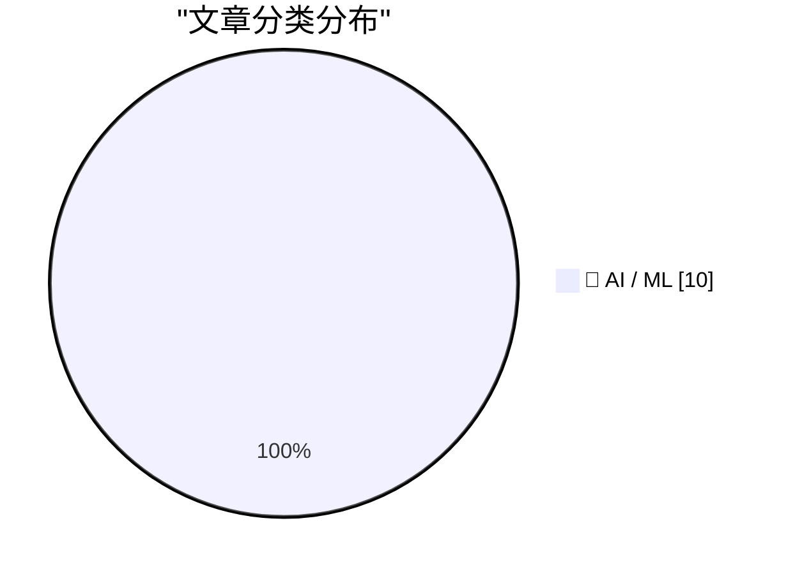
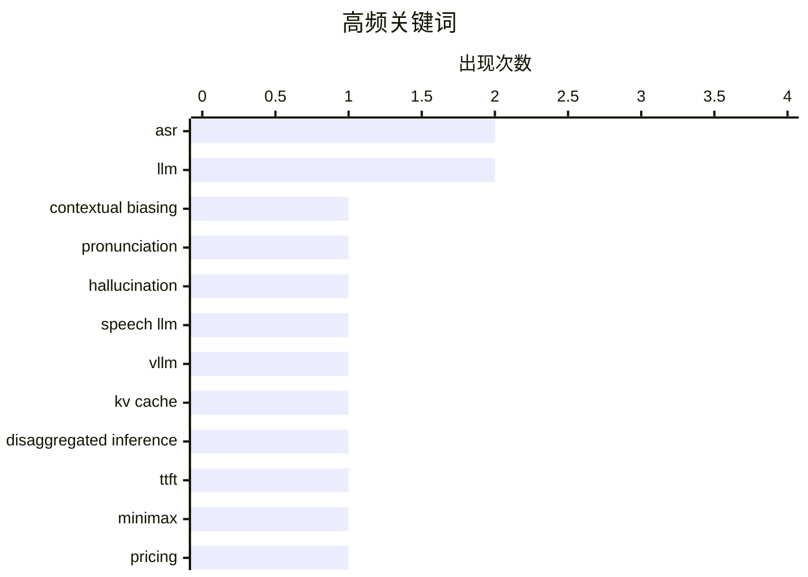

# 📰 AI 资讯每日精选 — 2026-10-20

> 汇聚 156+ 技术博客、X/Twitter、Hacker News、Reddit、Product Hunt、
> Lobste.rs、ClawFeed 日报及 GitHub Trending，经 AI 评分筛选。
>
> **本期内容**：🏆 今日必读 · 🌐 ClawFeed 日报 · 🔥 GitHub Trending · 📂 分类精选 · 📊 数据概览 · 🎯 项目相关情报

## 📝 今日看点

今日技术圈看点集中在三条主线：语音AI正从“能用”走向“可靠、低成本”，词表外词、幻觉抑制和专用芯片优化成为关注焦点。大模型推理与落地继续拼效率与成本，KV缓存传输优化、结构化输出和低价模型竞争共同推动部署门槛下探。多模态检索与视频理解加速工程化，低资源编程语言能力补强则显示模型评估正转向更细分的真实场景。整体看，今天的创新更强调系统级优化和可规模化落地，而非单纯参数或榜单突破。

---

## 🏆 今日必读

🥇 **PronCFT：面向LLM语音识别中词表外词上下文偏置的发音上下文微调**

[PronCFT: Pronunciation Contextual Fine-Tuning for Contextual Biasing of Out-of-Vocabulary Words in LLM-Based ASR](https://arxiv.org/abs/2610.25766) — arXiv Audio and Speech Processing · 40 分钟前 · 🤖 AI / ML · **一手来源**

> 基于LLM的ASR系统常将罕见和词表外（OOV）词替换为发音相似的常见词，原因包括模型未学会未见词的发音到拼写映射，以及可能偏好常见词而非实际所说词，作者称之为先验抑制。仅提供候选发音可能不够，因为模型可能将音素标注视为提升候选的标记。PronCFT提出发音上下文微调方法，旨在解决上述两个问题。

💡 **为什么值得读**: 针对LLM语音识别中OOV词替换这一具体失败模式，提出了同时处理发音映射学习和先验抑制的微调方案，适合关注上下文偏置技术的读者。

🏷️ ASR, LLM, contextual biasing, pronunciation

🥈 **通过小语言模型探测并缓解语音增强语言模型在自动语音识别中的幻觉**

[Probing and Mitigating Hallucinations in Speech-augmented Language Models for Automatic Speech Recognition via Small Language Models](https://arxiv.org/abs/2610.25351) — arXiv Audio and Speech Processing · 40 分钟前 · 🤖 AI / ML · **一手来源**

> 语音增强语言模型（SLM）将LLM的推理能力扩展到语音输入，但在自动语音识别（ASR）中仍易产生幻觉，影响实际可用性。该研究首先从因果角度探测SLM在ASR中的幻觉，并探索利用小语言模型来缓解该问题。

💡 **为什么值得读**: 聚焦SLM在ASR中的幻觉问题，提出用小语言模型进行探测与缓解，为提升语音增强语言模型可靠性提供了新思路。

🏷️ ASR, hallucination, speech LLM

🥉 **基于推送的KV传输：提升vLLM分离式推理的TTFT与TPOT**

[Push-based KV transfer to improve TTFT and TPOT for disaggregated inference in vLLM](https://aws.amazon.com/blogs/machine-learning/push-based-kv-transfer-to-improve-ttft-and-tpot-for-disaggregated-inference-in-vllm/) — AWS Machine Learning Blog · 12 小时前 · 🤖 AI / ML · **一手来源**

> vLLM的预填充-解码分离将LLM推理拆分到不同引擎实例，但必须在实例间传输KV缓存。本文介绍一种基于推送的NIXL连接器，将传输协调移出关键路径。在Amazon EC2 P5en实例搭配AWS EFA的基准测试中，TTFT最高提升3倍，TPOT提升30%。

💡 **为什么值得读**: 给出了基于推送的KV传输连接器在vLLM分离式推理中的具体性能数据，对优化LLM推理延迟的工程师有直接参考价值。

🏷️ vLLM, KV cache, disaggregated inference, TTFT

4️⃣ **MiniMax M3.1 Flash显示中国AI价格战远未见底**

[MiniMax M3.1 Flash shows China's AI price race has no floor in sight](https://the-decoder.com/minimax-m3-1-flash-shows-chinas-ai-price-race-has-no-floor-in-sight/) — The Decoder · 10 小时前 · 🤖 AI / ML · **可追溯二手**

> MiniMax的M3.1 Flash在Artificial Analysis Intelligence Index上比前代提升13分达到42分，成本减半。在DeepSWE v1.1编码基准上，它以每任务低于0.30美元的成本达到73.7%的得分，在性能和价格上与Deepseek V4.1 Flash 1017持平。文章认为这显示中国AI价格竞争仍未见底。

💡 **为什么值得读**: 用具体基准分数和每任务成本对比展示中国AI模型的价格竞争态势，适合关注模型性价比和行业趋势的读者。

🏷️ MiniMax, LLM, pricing, benchmark

5️⃣ **Amazon Bedrock上Anthropic Claude模型的结构化输出**

[Structured outputs for Anthropic Claude models on Amazon Bedrock](https://aws.amazon.com/blogs/machine-learning/structured-outputs-for-anthropic-claude-models-on-amazon-bedrock/) — AWS Machine Learning Blog · 5 小时前 · 🤖 AI / ML · **一手来源**

> Amazon Bedrock现已在bedrock-runtime和bedrock-mantle两个端点上为所有Anthropic Claude模型支持结构化输出。用户可通过JSON Schema输出格式和严格工具使用，直接获得符合定义结构的JSON，无需自定义解析、重试逻辑或后处理。

💡 **为什么值得读**: 对在Bedrock上使用Claude的开发者而言，结构化输出可省去解析和重试逻辑，直接获得模式合规的JSON。

🏷️ Claude, structured output, Bedrock, JSON Schema

---

## 🌐 ClawFeed 日报精选

> 来源：[ClawFeed](https://clawfeed.kevinhe.io) — AI 驱动的多源新闻聚合

# 📅 ClawFeed 日报 | 2026-10-19 (SGT)

> 聚合自 3 期已发布的简报：#1393 04:00（4h，自述覆盖 04:00-07:59）、#1397 12:00（4h，自述覆盖 12:00-15:59）、#1398 16:00（8h，自述覆盖 16:00-23:59）。
> ⚠️ 00:00-03:59 和 08:00-11:59 两档没有任何一期覆盖，这些时段没有素材，不代表没发生事情。三期自身也很不均：#1393 是 10:38 手动补跑，窗内素材一共只有 19 条；#1397 窗内 feed 99 条里 79 条在 15 点档，12:00-14:59 三个小时合计 20 条；#1398 窗内 feed 143 条里 99 条在 23 点档，16:00-19:59 四个小时合计只有 13 条。所以这份日报实际上主要反映的是 15 点档和 23 点档。全天没有新书签（书签页最新一条仍是 10-04）。
> 主线：国产模型的 Flash 版本接连更新（DeepSeek V4.1 Flash-1017 上线和实测、MiniMax 发布 M3.1 Flash）；agent 安全两件事（OpenCode 被盗 Key 后 OpenAI 退还额度、Cloudflare 开源安全审计 skill）；金融这边据 Bloomberg 摩根大通要把 JPM Coin 搬到以太坊，agent 用稳定币付钱的产品也在多点铺开。

---

## 🔥 当日最重要 5 条

1. **国产模型 Flash 版本接连更新：DeepSeek V4.1 Flash-1017 与 MiniMax M3.1 Flash**（#1397 + #1398 合并）：B.AI 平台（@BAI_AGI）宣布把 DeepSeek V4.1 Flash 升级到 1017 版本、不用改模型 ID；@NFT_Chen 转述 Ibragim 的实测，10 个日常真实编程任务各跑 3 次，V4.1 Flash 1017 在 Pi + high 档 30/30 全过，单任务不到 5 美分（原帖后半段被截断）。晚上 @lucataco 和 @qoder_ai_ide 引用 MiniMax 官方帖：登顶榜单、累计 200T+ token 的「Space Bunny」就是 M3.1 Flash 的早期版本，M3.1 Flash 达到前沿水平（这是 MiniMax 自己的说法），@lucataco 说权重 10 月 23 日放出；Qoder 第 0 天接入，并宣布 DeepSeek V4.1-Flash-1017 在 Qoder 里免费用到 10 月 24 日。
   来源: https://x.com/BAI_AGI/status/2112037060618199209 ｜ https://x.com/NFT_Chen/status/2112051416722526598 ｜ https://x.com/lucataco/status/2112198751360004460 ｜ https://x.com/qoder_ai_ide/status/2112210708259840091 ｜ https://x.com/qoder_ai_ide/status/2112211366954344459

2. **OpenCode 被盗 Key 事件后续，OpenAI 退还被盗刷额度**（#1397）：@aizhibeibei 转述，OpenCode 上周末被「大规模蒸馏攻击」入侵，1.4% 的 Console 用户绑定的外部模型 API Key 外泄；Codex 负责人 Tibo 发帖说 OpenAI 已和 OpenCode 合作，受影响的 OpenAI API 用户已恢复使用，被盗刷的额度全部退还。⚠️ 这是二手转述，原帖后半段被截断，素材里没有 Tibo 原帖。
   来源: https://x.com/aizhibeibei/status/2112038427474714803

3. **摩根大通把 JPM Coin 带到以太坊**（#1397）：@Cointelegraph 援引 Bloomberg，摩根大通要把 JPM Coin 放到以太坊上，面向机构客户。帖子只有这一句，没有时间表和细节。
   来源: https://x.com/Cointelegraph/status/2112090594763763946

4. **Cloudflare 开源安全审计 skill**（#1398）：@RoundtableSpace 说，Cloudflare 把催生它自家漏洞挖掘框架的安全审计 skill 开源了（GitHub cloudflare/security-audit-skill），coding agent 可以直接拿来审代码，分 6 个阶段，先摸清代码库，再按区域逐块找 bug（原帖后半段被截断，后几个阶段没抓到，以仓库为准）。同一天 #1397 里 @rohanpaul_ai 转的一项研究称，找漏洞的 AI agent 把 60.4% 的 token 花在理解代码、推理怎么触发漏洞上（帖子没写论文名）。
   来源: https://x.com/RoundtableSpace/status/2112125353594401162 ｜ https://x.com/rohanpaul_ai/status/2112091251155825108

5. **科技基金单周流出 52.1 亿美元，创 6 月以来最大**（#1393）：@fintechfrank 转述 Reuters，截至 10 月 14 日当周科技类基金净流出 52.1 亿美元；同一篇报道的标题是美国股票基金整体当周重新转为净流入（美债收益率从高位回落）。#1393 素材只有 19 条，这是那一期相对最值得看的一条。
   来源: https://x.com/fintechfrank/status/2111929661064364362

**⚠️ 未证实（素材里核实不了，只记录说法）**
- 奇绩创坛被 OFAC 制裁：@MaxForAI 称，根据美国财政部 OFAC 10 月 19 日的公告，奇绩的投资管理公司、人民币一期基金、人民币二期基金和致远企业管理主体共 4 家实体被列入制裁名单，同批还有上海至算科技。帖子没附公告链接、后半段被截断，素材里没有 OFAC 原文或其他来源印证（#1398）。https://x.com/MaxForAI/status/2112207390619889829
- 「NVIDIA 以 129.3 亿美元收购 Hugging Face」：只出现在 @maxhanet 引用的 @podesta_aldo 观点文章开头一句，没有任何官方或媒体来源，请当作未证实的说法（#1398）。https://x.com/maxhanet/status/2112207642680520948
- @MaxForAI 预告有一款模型「今天」发布、比 V4.1-Flash-1017 更强更便宜，没说是哪款；是不是 MiniMax M3.1 Flash，素材里没有确认（#1397）。https://x.com/MaxForAI/status/2112086356126232636

**次重要（备选）**
- Town（town.com）宣布 1.08 亿美元 B 轮，Forerunner Ventures 和 Menlo Ventures 领投，做「多人协作的工作 AI 助手」（#1398）。https://x.com/jgreze/status/2112184910702403754
- Starknet「要不要成为独立 L1」的非约束性投票目前 99.96% 的投票权赞成，10 月 22 日截止（#1397，投票开始的消息 10-15 日报收过）。https://x.com/StarkWareLtd/status/2112086887074861483
- Nebius 把 AI Builder Program 扩展到整个欧洲，总计 1000 万美元支持（算力补助、资金、社区项目）（#1397）。https://x.com/nebiusai/status/2112076353050648757
- Bitmine（$BMNR）上周又买入 12,535 ETH，共持有 604 万 ETH，约五周后可能达到持有以太坊供应量 5% 的目标（@CoinDesk，#1398）。https://x.com/CoinDesk/status/2112204627462520948

---

## 📰 当日核心主题

**① 模型：Flash 档位的价格和编程能力（#1397、#1398）**
DeepSeek V4.1 Flash-1017 上线、实测和 Qoder 限免，MiniMax M3.1 Flash 发布（见上）；@bindureddy 认为 Google 有机会把 Argon 蒸馏成超快小模型、定价只要 Luna 一半就能冲到 OpenRouter 第一（她的观点，#1393，https://x.com/bindureddy/status/2111936149627572506）；@turingbook 转「字节的回应」：总算力里只有约 10% 用于视频生成模型，帖子没给这句回应的出处（#1398，https://x.com/turingbook/status/2112208562529435710）；算力紧张的情绪信号：@elonmusk 发「租 AI/SI 算力是什么感觉」短视频，@benitoz 引用并点了 $NVDA，帖子本身没有数据（#1393，https://x.com/elonmusk/status/2111930742615802163 ｜ https://x.com/benitoz/status/2111942639935455272）。

**② agent 成队干活，人反而成了瓶颈（三期都有）**
@levie 认为 agent 集群会是很大的事，第一次让算力成为大量重要任务的关键变量（#1397，原帖截断，https://x.com/levie/status/2112051081014649303）；@rwayne 说一个 agent 还没 review 完、另一个已经产出新结果，人的注意力成了瓶颈（#1398，https://x.com/rwayne/status/2112185087240601883）；@mardehaym 介绍 Limestone 的「AI 软件工厂」，人只批 spec / plan 和看 PR（他自家公司的介绍，#1398，https://x.com/mardehaym/status/2112210483403264189）；20VC 访谈里 Harrison Chase 说公司约把工程师薪资的 30% 花在编程工具上、这个比例最近两个月反而下降而 token 用量在上升（#1393，https://x.com/HarryStebbings/status/2111913960215851192）；Grok Bot 实操续篇：@turingou 让 Grok Bot 找房、@dexteryy 用公网信息蒸馏「字节跳动全明星团队」群（#1398，延续 #1388 起的话题，https://x.com/turingou/status/2112176072234037279 ｜ https://x.com/dexteryy/status/2112174405187170579）；用 Claude 写小应用时发现 Mac 上跑着用户没装过的挖矿程序（#1397，https://x.com/kimmonismus/status/2112047187936907275）；安全方向见上 Cloudflare skill 和 60.4% token 研究。

**③ agent 付钱和稳定币（#1397、#1398）**
Privy 让开发者给 AI agent 配稳定币钱包、配合 Link Agent Wallet 和 Stripe Issuing 消费（https://x.com/segall_max/status/2112212169333018847）；Circle 全球营销负责人说 Virtuals Protocol 上 agent 的隐私 USDC 支付已通过 px402 上线（https://x.com/peterschroederr/status/2112204290744008742）；@belo_app 要做拉美第一家「agentic bank」（西语原帖为机器翻译，https://x.com/woloski/status/2112208117568020960）；@Cryptic_Web3 贴出 Circle 上半年数据：USDC 六个月链上转移超过 36 万亿美元、上半年营收约 14 亿美元（原帖截断，https://x.com/Cryptic_Web3/status/2112203240708194655）；JPM Coin 上以太坊（见上）。

**④ 加密与市场（三期都有）**
科技基金单周流出（#1393，见上）；Starknet 投票进展、Aztec 联合创始人 @Zac_Aztec 讲账户抽象让 passkey / 后量子签名都能用（#1397，https://x.com/Zac_Aztec/status/2112084639737372809）；韩国加密税要求推迟的呼声变大，金融官员周二与主要交易所会面（#1397，https://x.com/Cointelegraph/status/2112083875929227550）；财库公司：Bitmine 增持 ETH、Strive 增持 1,223 枚 BTC 至 36,818 枚、Super League 股东批准 Metaplanet 提案（#1398，https://x.com/CoinGapeMedia/status/2112206315221368997 ｜ https://x.com/Techub_News/status/2112201045614989589）；漏洞赏金两头：Cetus 在 HackenProof 把 Critical 赏金提到最高 100 万美元，白帽 @ma1fan 吐槽自评 Critical 的编译器 bug 被定级 Low（#1398，https://x.com/pikapikasui/status/2112203911004311682 ｜ https://x.com/ma1fan/status/2112203544350880105）；@cryptorover 的行情快讯：印尼股市 3 个交易日跌 20%、比特币收复 83,000 美元（喊单风格账号，数字以原文为准，#1397，https://x.com/cryptorover/status/2112078212251759091）；泰国警方逮捕涉嫌约 7,500 万美元跨境犯罪网络的中国籍嫌疑人（#1398，https://x.com/Cryptic_Web3/status/2112098150810873868）。

---

## 🔖 Bookmarks 精选

今天没有新加的书签：三期抓到的书签里最新一条仍是 10-04 的推文，三期都跳过了这一区块，本日报也没有可补选的内容。

---

## 👀 推荐关注汇总（去重，共 8 个；各期发布时都在浏览器里核实过「未关注」，本日报没有重新核实）

**AI builder / 投资 / 研究**
- @HarryStebbings（Harry Stebbings，约 70.5 万粉）：20VC 创始人、播客主持人，「编程工具占工程薪资 30%」那条的作者（#1393）。https://x.com/HarryStebbings
- @altryne（Alex Volkov，约 4.3 万粉）：AI 新闻播客 ThursdAI 主持人；你关注的人里有 203 位也关注了他（#1393）。https://x.com/altryne
- @jgreze（Jean-Denis Greze，约 6,700 粉）：Town 联合创始人兼 CEO、前 Plaid CTO，1.08 亿美元 B 轮那条的作者（#1398）。https://x.com/jgreze
- @dexteryy（Dexter Yang，约 2.3 万粉）：北京的软件开发者和产品设计者，Grok Bot「蒸馏团队」那条的作者；你关注的人里有 119 位也关注了他（#1398）。https://x.com/dexteryy
- @nebiusai（Nebius，约 4.1 万粉）：AI 云厂商官方号，欧洲 1000 万美元 AI Builder Program 的发布方（#1397）。https://x.com/nebiusai

**中文 AI 资讯**
- @aizhibeibei（约 5,600 粉）：中文 AI 资讯号，「OpenCode 被盗 Key 后续」那条的作者（#1397）。https://x.com/aizhibeibei
- @vintcessun（恒星sun，约 7,800 粉）：中文 AI 论文 / 开源 / Agent 速读号，ViT token 压缩论文那条的作者（#1398）。https://x.com/vintcessun

**加密 / 金融**
- @fintechfrank（Frank Chaparro，约 21.2 万粉）：GSR 战略传播负责人、The Crypto Tape 主持人；你关注的人里有 720 位也关注了他（#1393）。https://x.com/fintechfrank

**建议取关**：三期都没有提出取关建议。

---

## 💤 当日重复噪音模式

- **问候、生活和一句话回复**：三期都有，量最大；#1397、#1398 有大批早安、生活帖和互动号的一句话回复（如 @BTC99M、@furan86999、@KongBTC 在多期反复出现）。
- **喊单、个人交易和预测市场**：meme 币喊单（@Sofiia272 在 #1397、#1398 都出现）、挂单截图、Polymarket / Predict 类比赛和「找内幕钱包」教程。
- **项目方营销和付费推广**：vangrid 付费合作在 #1397、#1398 都出现；另有交易所活动（Gate WCTC、OKX、币安 AI Pro）、Token2049 活动复盘、返佣、抽奖、卖域名等。
- **政治和时事**：#1393 有法国暴乱、巴西政坛；#1397 有法国骚乱、中东旅行警告、韩国职场代际争论。
- **信息量少或被截断到看不出结论的帖子**：@elonmusk 关于 Grok Bot 的一句话转评在 #1393、#1397 都出现；泛泛的创业 / PM 观点视频和书籍链接。
- **同一话题延续**：DeepSeek V4.1-Flash-1017（#1397 → #1398）、Grok Bot（#1388 起，本日三期都有）已在上面合并；三期之间没有重复收录的条目。
---

## 🔥 GitHub Trending

> 今日热门开源项目（全语言 + Python）

| # | 项目 | 描述 | ⭐ 总星 | 📈 今日 | 语言 |
|---|------|------|---------|---------|------|
| 1 | [MadsLorentzen/ai-job-search](https://github.com/MadsLorentzen/ai-job-search) 🤖 | The job search that runs on your machine. AI job applicat... | 57.9k | +3856 | Python |
| 2 | [stablyai/orca](https://github.com/stablyai/orca) 🤖 | Orca is the place for working with a fleet of agents (e.g... | 98.5k | +1590 | TypeScript |
| 3 | [anomalyco/opencode](https://github.com/anomalyco/opencode) 🤖 | The open source coding agent. | 218.0k | +1311 | TypeScript |
| 4 | [Comfy-Org/ComfyUI](https://github.com/Comfy-Org/ComfyUI) 🤖 | The most powerful and modular diffusion model GUI, api an... | 139.9k | +1011 | Python |
| 5 | [Graphify-Labs/graphify](https://github.com/Graphify-Labs/graphify) 🤖 | Turn any codebase, with its docs, SQL schemas, configs, a... | 129.3k | +751 | Python |
| 6 | [anthropics/claude-plugins-official](https://github.com/anthropics/claude-plugins-official) 🤖 | Official, Anthropic-managed directory of high quality Cla... | 43.2k | +733 | Python |
| 7 | [akitaonrails/ai-memory](https://github.com/akitaonrails/ai-memory) 🤖 | Solution for long term memory for agent coding CLIs and t... | 11.5k | +666 | Rust |
| 8 | [HKUDS/CLI-Anything](https://github.com/HKUDS/CLI-Anything) 🤖 | "CLI-Anything: Making ALL Software Agent-Native" -- CLI-H... | 55.4k | +606 | Python |
| 9 | [google/artemis](https://github.com/google/artemis) 🤖 | ARTEMIS turns natural-language instructions into reliable... | 13.0k | +597 | Python |
| 10 | [ruvnet/ruflo](https://github.com/ruvnet/ruflo) 🤖 | 🌊 The original agent harness. Deploy intelligent multi-p... | 77.3k | +564 | TypeScript |
| 11 | [usestrix/strix](https://github.com/usestrix/strix) 🤖 | Open-source AI penetration testing tool to find and fix y... | 70.2k | +509 | Python |
| 12 | [Kruk2/jasna](https://github.com/Kruk2/jasna) | Video restoration tool | 3.0k | +498 | Python |
| 13 | [bobeff/open-source-games](https://github.com/bobeff/open-source-games) | A list of open source games. | 16.6k | +456 | Python |
| 14 | [666ghj/MiroFish](https://github.com/666ghj/MiroFish) | A Simple and Universal Swarm Intelligence Engine, Predict... | 80.7k | +386 | Python |
| 15 | [shiyu-coder/Kronos](https://github.com/shiyu-coder/Kronos) | Kronos: A Foundation Model for the Language of Financial ... | 41.8k | +363 | Python |

---

## 🤖 AI / ML

### 1. PronCFT：面向LLM语音识别中词表外词上下文偏置的发音上下文微调

[PronCFT: Pronunciation Contextual Fine-Tuning for Contextual Biasing of Out-of-Vocabulary Words in LLM-Based ASR](https://arxiv.org/abs/2610.25766) — **arXiv Audio and Speech Processing** · 40 分钟前 · ⭐ 23/30 · **一手来源**

> 基于LLM的ASR系统常将罕见和词表外（OOV）词替换为发音相似的常见词，原因包括模型未学会未见词的发音到拼写映射，以及可能偏好常见词而非实际所说词，作者称之为先验抑制。仅提供候选发音可能不够，因为模型可能将音素标注视为提升候选的标记。PronCFT提出发音上下文微调方法，旨在解决上述两个问题。

🏷️ ASR, LLM, contextual biasing, pronunciation

---

### 2. 通过小语言模型探测并缓解语音增强语言模型在自动语音识别中的幻觉

[Probing and Mitigating Hallucinations in Speech-augmented Language Models for Automatic Speech Recognition via Small Language Models](https://arxiv.org/abs/2610.25351) — **arXiv Audio and Speech Processing** · 40 分钟前 · ⭐ 23/30 · **一手来源**

> 语音增强语言模型（SLM）将LLM的推理能力扩展到语音输入，但在自动语音识别（ASR）中仍易产生幻觉，影响实际可用性。该研究首先从因果角度探测SLM在ASR中的幻觉，并探索利用小语言模型来缓解该问题。

🏷️ ASR, hallucination, speech LLM

---

### 3. 基于推送的KV传输：提升vLLM分离式推理的TTFT与TPOT

[Push-based KV transfer to improve TTFT and TPOT for disaggregated inference in vLLM](https://aws.amazon.com/blogs/machine-learning/push-based-kv-transfer-to-improve-ttft-and-tpot-for-disaggregated-inference-in-vllm/) — **AWS Machine Learning Blog** · 12 小时前 · ⭐ 25/30 · **一手来源**

> vLLM的预填充-解码分离将LLM推理拆分到不同引擎实例，但必须在实例间传输KV缓存。本文介绍一种基于推送的NIXL连接器，将传输协调移出关键路径。在Amazon EC2 P5en实例搭配AWS EFA的基准测试中，TTFT最高提升3倍，TPOT提升30%。

🏷️ vLLM, KV cache, disaggregated inference, TTFT

---

### 4. MiniMax M3.1 Flash显示中国AI价格战远未见底

[MiniMax M3.1 Flash shows China's AI price race has no floor in sight](https://the-decoder.com/minimax-m3-1-flash-shows-chinas-ai-price-race-has-no-floor-in-sight/) — **The Decoder** · 10 小时前 · ⭐ 25/30 · **可追溯二手**

> MiniMax的M3.1 Flash在Artificial Analysis Intelligence Index上比前代提升13分达到42分，成本减半。在DeepSWE v1.1编码基准上，它以每任务低于0.30美元的成本达到73.7%的得分，在性能和价格上与Deepseek V4.1 Flash 1017持平。文章认为这显示中国AI价格竞争仍未见底。

🏷️ MiniMax, LLM, pricing, benchmark

---

### 5. Amazon Bedrock上Anthropic Claude模型的结构化输出

[Structured outputs for Anthropic Claude models on Amazon Bedrock](https://aws.amazon.com/blogs/machine-learning/structured-outputs-for-anthropic-claude-models-on-amazon-bedrock/) — **AWS Machine Learning Blog** · 5 小时前 · ⭐ 23/30 · **一手来源**

> Amazon Bedrock现已在bedrock-runtime和bedrock-mantle两个端点上为所有Anthropic Claude模型支持结构化输出。用户可通过JSON Schema输出格式和严格工具使用，直接获得符合定义结构的JSON，无需自定义解析、重试逻辑或后处理。

🏷️ Claude, structured output, Bedrock, JSON Schema

---

### 6. TwelveLabs的Pegasus 1.5现已在Amazon Bedrock上可用

[Pegasus 1.5 from TwelveLabs is now available in Amazon Bedrock](https://aws.amazon.com/blogs/machine-learning/pegasus-1-5-from-twelvelabs-is-now-available-in-amazon-bedrock/) — **AWS Machine Learning Blog** · 11 小时前 · ⭐ 23/30 · **一手来源**

> TwelveLabs Pegasus 1.5现已在Amazon Bedrock上可用。该视频语言模型可将长视频转为结构化、带时间戳的元数据：定义关键片段后，以JSON返回所有匹配片段，并新增视频分割、带参考图像的多模态提示以及最长两小时视频的即时处理能力。

🏷️ video-language-model, Amazon Bedrock, multimodal, TwelveLabs

---

### 7. Deepgram如何利用AWS Trainium大规模优化语音AI

[How Deepgram optimized voice AI at scale with AWS Trainium](https://aws.amazon.com/blogs/machine-learning/how-deepgram-optimized-voice-ai-at-scale-with-aws-trainium/) — **AWS Machine Learning Blog** · 12 小时前 · ⭐ 23/30 · **一手来源**

> Deepgram与AWS Forward Deployed Engineering团队合作，将其Nova-3语音转文本模型移植到AWS Trainium2用于离线批量推理。文章涵盖向AWS Neuron栈的移植、内核级调优、数据并行Rust运行时，以及批量转录的吞吐量和成本结果。

🏷️ speech-to-text, AWS Trainium, Deepgram, inference

---

### 8. 推进低资源编程语言的编码能力

[Advancing coding in low‑resource programming languages](https://openai.com/index/low-resource-programming-languages) — **OpenAI News** · 16 小时前 · ⭐ 23/30 · **一手来源**

> OpenAI正在改进ChatGPT在低资源编程语言上的表现，并新增了针对软件工程、SQLite和COBOL迁移的评估。文章介绍相关改进工作。

🏷️ ChatGPT, code generation, low-resource languages, evaluation

---

### 9. 面向高效视觉文档检索的非平衡最优传输

[Unbalanced Optimal Transport for Efficient Visual Document Retrieval](https://arxiv.org/abs/2610.23929) — **arXiv Computer Vision** · 40 分钟前 · ⭐ 23/30 · **一手来源**

> 视觉语言模型（VLM）通过无OCR的多向量表示推进了视觉文档检索（VDR），但为保留密集视觉细节会生成过多token，严重限制检索可扩展性。现有压缩方法依赖孤立启发式，无法平衡token重要性、语义冗余和覆盖能力。本文提出一种视觉token压缩方法，基于非平衡最优传输。

🏷️ VLM, retrieval, optimal transport, document

---

### 10. 在 NVIDIA CUDA Tile 中用高性能前向传播内核加速 Mamba-2

[Accelerating Mamba-2 with High-Performance Forward Pass Kernels in NVIDIA CUDA Tile](https://developer.nvidia.com/blog/accelerating-mamba-2-with-high-performance-forward-pass-kernels-in-nvidia-cuda-tile/) — **NVIDIA Technical Blog** · 11 小时前 · ⭐ 23/30

> NVIDIA 技术博客介绍如何利用 CUDA Tile（cuTile）为 Mamba-2 实现高性能前向传播内核。cuTile 被描述为一种基于 Python 的 DSL 和 NVIDIA GPU 并行编程模型，可自动利用高级硬件能力。文章核心是借助该编程模型加速 Mamba-2 的前向计算，但摘要未给出具体性能提升数据、对比基线或实现细节。

🏷️ Mamba-2, CUDA, kernel, GPU

---

## 📊 数据概览

| 扫描源 | 抓取文章 | 时间范围 | 精选 |
|:---:|:---:|:---:|:---:|
| 109/156 | 8228 篇 → 2917 篇 | 24h | **10 篇** |

### 分类分布



### 高频关键词



<details>
<summary>📈 纯文本关键词图（终端友好）</summary>

```
asr                     │ ████████████████████ 2
llm                     │ ████████████████████ 2
contextual biasing      │ ██████████░░░░░░░░░░ 1
pronunciation           │ ██████████░░░░░░░░░░ 1
hallucination           │ ██████████░░░░░░░░░░ 1
speech llm              │ ██████████░░░░░░░░░░ 1
vllm                    │ ██████████░░░░░░░░░░ 1
kv cache                │ ██████████░░░░░░░░░░ 1
disaggregated inference │ ██████████░░░░░░░░░░ 1
ttft                    │ ██████████░░░░░░░░░░ 1
```

</details>

### 🏷️ 话题标签

**asr**(2) · **llm**(2) · **contextual biasing**(1) · pronunciation(1) · hallucination(1) · speech llm(1) · vllm(1) · kv cache(1) · disaggregated inference(1) · ttft(1) · minimax(1) · pricing(1) · benchmark(1) · claude(1) · structured output(1) · bedrock(1) · json schema(1) · video-language-model(1) · amazon bedrock(1) · multimodal(1)

---

## 🎯 项目相关情报

### Agent 基座安全与合规

> 暂无达到质量门槛的项目相关情报。

### 多 Agent 架构

> 暂无达到质量门槛的项目相关情报。

### ASR 与语音助手

#### [PronCFT：面向LLM语音识别中词表外词上下文偏置的发音上下文微调](https://arxiv.org/abs/2610.25766)

> **状态**：本期 Top 10 已收录

- **匹配类型**：直接相关
- **项目相关性**：8/10
- **可落地性**：7/10
- **为什么相关**：直接研究LLM-based ASR的上下文偏置，针对罕见词与OOV词被替换为近音词的识别错误，属语音识别模型范畴。
- **建议动作**：细读其发音上下文微调方法，评估用于自定义词表（如品牌名）ASR纠错的可行性，并与现有偏置方案对比。
- **来源**：arXiv Audio and Speech Processing · 一手来源

#### [通过小语言模型探测并缓解语音增强语言模型在自动语音识别中的幻觉](https://arxiv.org/abs/2610.25351)

> **状态**：本期 Top 10 已收录

- **匹配类型**：直接相关
- **项目相关性**：8/10
- **可落地性**：6/10
- **为什么相关**：文章研究语音增强语言模型在自动语音识别中的幻觉问题，用小型语言模型进行探测与缓解，属 ASR 可靠性评测。
- **建议动作**：阅读其幻觉探测与缓解方法，评估能否用于语音转写结果的可信度校验。
- **来源**：arXiv Audio and Speech Processing · 一手来源

### 商品包装 OCR

> 暂无达到质量门槛的项目相关情报。

---

*生成于 2026-10-20 04:40 | 汇聚 156 个技术博客、X/Twitter、Hacker News、Reddit、Product Hunt、Lobste.rs、ClawFeed 日报及 GitHub Trending，经 AI 评分筛选出 Top 10 精华内容*
