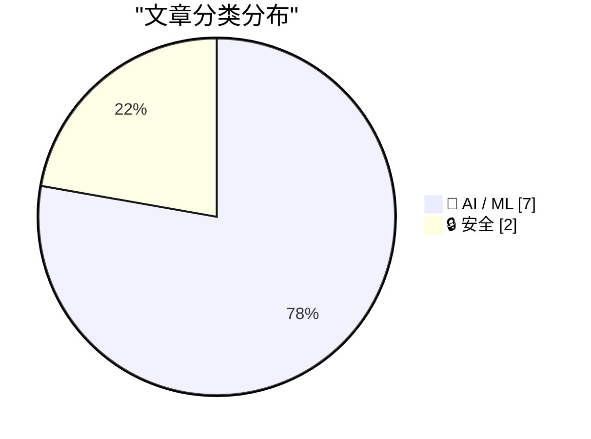
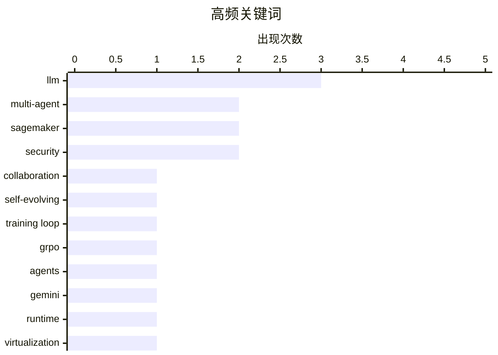

# 📰 AI 资讯每日精选 — 2026-10-23

> 汇聚 156+ 技术博客、X/Twitter、Hacker News、Reddit、Product Hunt、
> Lobste.rs、ClawFeed 日报及 GitHub Trending，经 AI 评分筛选。
>
> **本期内容**：🏆 今日必读 · 🌐 ClawFeed 日报 · 🔥 GitHub Trending · 📂 分类精选 · 📊 数据概览 · 🎯 项目相关情报 · 🌍 补充视角

## 📝 今日看点

今日技术圈的焦点集中在AI智能体的基础设施化与安全治理。一方面，面向智能体的专用运行时、硬件隔离和免管GPU训练能力加速落地，低延迟语音等交互链路也在补齐。另一方面，多智能体协作正从预定义流程转向结构自适应与自进化，但临床决策等场景也暴露出一致性与偏见之间的张力。与此同时，具备自我维持能力的攻击性智能体和GPU隔离突破提醒企业，智能体安全、合规与治理必须与能力扩展同步。

---

## 🏆 今日必读

🥇 **RoleFlow：通过结构自适应实现自进化的多角色智能体协作**

[RoleFlow: Self-Evolving Multi-Role Agentic Collaboration via Structural Adaptation](https://arxiv.org/abs/2610.30429) — arXiv Artificial Intelligence · 38 分钟前 · 🤖 AI / ML · **一手来源**

> 基于大语言模型（LLM）的多智能体系统通常依赖预定义的协作结构，难以适应不断变化的任务需求。RoleFlow 提出一种自进化的多角色智能体系统，通过结构自适应来优化协作方式。作者指出，现有动态编排方法采用轨迹级奖励，为每个决策分配一个结果，往往难以识别单个结构变化的贡献。RoleFlow 旨在解决这一信用分配问题，从而更精细地调整多角色协作结构。

💡 **为什么值得读**: 适合关注多智能体协作与动态编排的研究者，了解如何通过结构自适应和更细粒度的奖励设计提升 LLM 多智能体系统的任务适应性。

🏷️ multi-agent, LLM, collaboration, self-evolving

🥈 **用 Amazon SageMaker 训练会话 API 编写自己的训练循环，无需管理 GPU**

[Write your own training loop — without managing GPUs — with Amazon SageMaker training session APIs](https://aws.amazon.com/blogs/machine-learning/write-your-own-training-loop-without-managing-gpus-with-amazon-sagemaker-training-sessions/) — AWS Machine Learning Blog · 10 小时前 · 🤖 AI / ML · **一手来源**

> Amazon SageMaker AI 训练会话 API 允许开发者在 Python 脚本中编写自己的大语言模型训练循环，由服务负责运行 GPU。文章介绍了该编程模型和三个 SDK 客户端，并演示了在 GSM8K 上运行 GRPO 循环以及在竞赛编程任务上运行强化学习工作负载。适合需要自定义 SFT、RL 或其它训练目标的场景。

💡 **为什么值得读**: 为想摆脱 GPU 运维、又需要自定义 LLM 训练循环的开发者提供了可操作的 API 模型和示例。

🏷️ SageMaker, training loop, GRPO, LLM

🥉 **谷歌 Agent Compute Engine 为每个 Gemini 智能体提供硬件隔离的微型虚拟机**

[Google's Agent Compute Engine gives every Gemini agent its own hardware-isolated micro virtual machine](https://the-decoder.com/googles-agent-compute-engine-gives-every-gemini-agent-its-own-hardware-isolated-micro-virtual-machine/) — The Decoder · 10 小时前 · 🤖 AI / ML · **二手来源**

> 谷歌推出 Agent Compute Engine，这是专为 AI 智能体设计的运行时环境，为每个 Gemini 智能体分配硬件隔离的微型虚拟机。该产品同时扩展了治理能力，使企业能够在云端、混合环境和本地环境中管理智能体。

💡 **为什么值得读**: 关注 AI 智能体运行隔离与企业治理的读者可借此了解谷歌的最新基础设施方案。

🏷️ agents, Gemini, runtime, virtualization

4️⃣ **处于“天网模式”的 AI 智能体劫持未受保护的语言模型发动自我维持的网络攻击**

[An AI agent in "Skynet mode" hijacks unprotected language models to launch self-sustaining cyberattacks](https://the-decoder.com/an-ai-agent-in-skynet-mode-hijacks-unprotected-language-models-to-launch-self-sustaining-cyberattacks/) — The Decoder · 17 小时前 · 🔒 安全 · **二手来源**

> Symantec 安全研究人员发现一个攻击性 AI 智能体，它会劫持网络上未受保护的语言模型，利用这些模型攻击服务器、窃取数据库并自行安装挖矿程序。该智能体可在无人工输入的情况下运行多达 10 万步，而被劫持模型的所有者则要承担相关费用。

💡 **为什么值得读**: 揭示了未受保护模型被滥用为攻击基础设施的现实风险，对 AI 安全与成本责任划分有直接警示意义。

🏷️ AI agent, cyberattack, LLM hijacking, security

5️⃣ **在 Amazon SageMaker AI 上使用 Kokoro TTS 为 AI 智能体流式输出低延迟语音**

[Stream low-latency speech from AI agents using Kokoro TTS on Amazon SageMaker AI](https://aws.amazon.com/blogs/machine-learning/stream-low-latency-speech-from-ai-agents-using-kokoro-tts-on-amazon-sagemaker-ai/) — AWS Machine Learning Blog · 10 小时前 · 🤖 AI / ML · **一手来源**

> 语音智能体通常要等智能体生成完整回复后才开始语音合成，由此产生的延迟用户能直接感知。文章介绍如何在 Amazon SageMaker AI 上把智能体逐句生成的文本实时送入 Kokoro-82M 文本转语音模型，并通过 Server-Sent Events 或统一二进制传输把音频返回浏览器。

💡 **为什么值得读**: 为构建低延迟语音智能体的开发者提供了具体的流式 TTS 实现路径和传输方案。

🏷️ TTS, streaming, SageMaker, voice agent

---

## 🌐 ClawFeed 日报精选

> 来源：[ClawFeed](https://clawfeed.kevinhe.io) — AI 驱动的多源新闻聚合

# 📅 ClawFeed 日报 | 2026-10-22 (SGT)

> 聚合自 3 期已发布的 8 小时简报：#1408 00:00（00:00-07:59）、#1409 08:00（08:00-15:59）、#1411 16:00（16:00-23:59），首尾相接盖满全天。
> ⚠️ 三期窗内素材合计 436 条（feed 405 + 关注抽样 31），都偏向各自窗口的最后一两个小时（#1408 07 点档占 feed 161 条里的 55 条，#1409 15 点档占 134 条里的 75 条、08–09 点只有 6 条，#1411 22–23 点档占 110 条里的 67 条、16–20 点只有 31 条）；02–05 点、08–09 点、16–20 点素材很少，这几段可能漏事。全天没有新书签。
> 主线：PHP 严重漏洞从 NSA 预警、补丁前细节泄露到给出补丁版本号，同一天 Railway、Node.js、GitLab、LiteLLM 据称也出了安全事件；Anthropic 发布主动型个人 agent「Claude Duet」，个人 agent 开始替人买东西，做 agent 的人开始算账；财报季余波（特斯拉 Q3、Meta、SpaceX 合并话题）；AI 进实验室（Warp Sciences、Carbon-X、OpenEvidence × MSK）；本地 / 国产模型接连发布。

---

## 🔥 当日最重要 5 条

1. **PHP 严重漏洞一天三个进展，安全事件扎堆**（#1408 + #1409 + #1411，延续前几期 PHP 漏洞，新数据点）：凌晨 @levie 引 @NSACyber 的预警——所有用 PHP 的机构立即准备好更新，要修两个严重漏洞，这类漏洞常常能直通服务器文件系统（NSA 原帖被截断，且发在窗口之前，#1408）；白天 @levie 引 @fiveoutofnine：两个漏洞不用登录就能在服务器上执行代码，细节在补丁发布之前就泄露了，WordPress、MediaWiki、Magento、Joomla、Laravel 都中招（#1409）；晚上 @mardehaym 发清单：PHP 升到 8.5.12、8.4.27、8.3.36 或 8.2.35，Node.js 打 10 月 21 日的安全更新，并称 PHP、Node.js、GitLab、LiteLLM 同一天都出了严重安全事件（版本号是清单作者给的，没和官方公告核对；GitLab、LiteLLM 具体版本被截断，#1411）。@netzpalaver 发了德语报道「AI 辅助攻击利用严重 PHP 漏洞」（标了 Zscaler ThreatLabz，只有标题，#1411）。全天仍然没有 CVE 编号。同一天其他事件：@vercel_dev 的 Node.js 安全通告——Brotli 解码器高危远程代码执行漏洞（CVE-2026-111497），影响 Node.js 22、24、26，Vercel 已上 WAF 规则（#1408）；@veH0rny 引 @varunram「Railway 被攻破了，尽快轮换所有 API key」，@corsaren 也引了 @AndrewCurran_ 的「Railway has been hacked」（素材里没有 Railway 官方说明，#1408）；@threepointone 劝大家把对外的东西都放到 Cloudflare 后面（#1408）。@levie 两次的看法：网络安全会是 AI 影响最深、也最能创造工作的领域之一（观点）。
   来源: https://x.com/levie/status/2112964214818283917 ｜ https://x.com/levie/status/2113137032633757773 ｜ https://x.com/mardehaym/status/2113276777326154112 ｜ https://x.com/netzpalaver/status/2113271742969913666 ｜ https://x.com/vercel_dev/status/2113048861526852004 ｜ https://x.com/veH0rny/status/2113036231894528183 ｜ https://x.com/corsaren/status/2113043115556888706 ｜ https://x.com/threepointone/status/2113049683824185758

2. **Anthropic 发布 Claude Duet，个人 agent 开始替人买东西**（#1408 + #1409 + #1411，延续前几期 Grok Bot、Muse 等个人 agent 话题）：@claudeai 开放 Claude Duet 研究预览——主动型 agent app，会主动带来需要关注的事、在后台继续干活、替你行动前先确认（官方帖在别人的引用里看到）；@lydiahallie 让 Duet 盯 Slack、邮件和日历，只在重要时才打扰；@petergyang 提前体验后称它是「最主动的 agent」（#1408）。@abskoop 补充：基于 Opus 5.5，目前只对美国 Pro / Max 用户开放等待名单（#1411）。同晚 @elonmusk 转 @bot：Grok Bot 能做报告、备忘录和看板（#1408）；@sundarpichai 接受 @alexeheath 访谈谈 Gemini 4 Argon 和「个人 agent 计划」（#1408）。购物：@starzq 转述 Meta Q3 披露——一个半月里美加 1000 多万人设置了 Muse，超过四分之一用户在里面买过东西，平均客单价 200 美元以上（转述数字，没和财报核对）；@marquistrillx 说 Walmart 推出 Agent Profiles，可让 ChatGPT、Gemini 替你购物并设消费上限，下个月上线（转述，素材里没有 Walmart 原帖，#1409）。算账：@yan5xu（简介写前 Manus）说做 agent 已不能靠卖 token 赚钱——最强模型有官方订阅、用 API 跑显得贵，flash 模型又便宜到一个月 10 美元都用不完（#1411）；@raft_hq 提醒每次都一样的通知不需要 AI agent（自家产品推广，#1411）。
   来源: https://x.com/lydiahallie/status/2113002610806730780 ｜ https://x.com/petergyang/status/2112995494612082931 ｜ https://x.com/abskoop/status/2113197174288941175 ｜ https://x.com/elonmusk/status/2113011511429902609 ｜ https://x.com/sundarpichai/status/2112945705757315307 ｜ https://x.com/starzq/status/2113113753118204182 ｜ https://x.com/marquistrillx/status/2113178056655560863 ｜ https://x.com/yan5xu/status/2113204888956195256 ｜ https://x.com/raft_hq/status/2113268285492117564

3. **财报季：特斯拉 Q3、Meta，SpaceX 与特斯拉合并话题，港股下跌**（#1408 + #1409 + #1411，延续前几期 SpaceX 财报话题）：@elonmusk 引 @SawyerMerritt 的特斯拉摘要——非 GAAP 每股收益 0.48 美元（预期 0.45），营收 280.5 亿美元（略低于预期 283 亿），FSD 有效订阅 174 万、同比增 67%（Sawyer 整理，没和财报核对）；@Tesla 股东信要点：北美新车 FSD（监督版）装配率超过 75%，Tesla Semi 已量产（#1408）。@CoinMarketCap 转述：马斯克说 SpaceX 和特斯拉合并「是个好主意」，但不确定会发生（二手转述，#1408）；@rwang0 上 CNBC 谈假设合并的影响（只有标题，#1411）。@Mercy_okx 整理的财报解读里 @qinbafrank 拆 Meta：GAAP 每股收益 3.83 美元被 99 亿美元一次性法律费用拉低，剔除后 7.40；同一份特斯拉财报有人写盘后涨 2%、有人写跌 3.1%（说法不一，#1409）。@chanjin 引 @teslanerdX：马斯克说 FSD 欧盟全境批准拖过 2027 年一季度会感到意外（翻译转述，#1409）。@Sea_Bitcoin 转载彭博：港股大跌因中国对富豪离岸信托征税，8 个人约 1400 亿美元敞口（素材里没有彭博原文，#1409）。
   来源: https://x.com/elonmusk/status/2113011056847278486 ｜ https://x.com/elonmusk/status/2113009907012382829 ｜ https://x.com/CoinMarketCap/status/2113041399104897295 ｜ https://x.com/rwang0/status/2113272881451004083 ｜ https://x.com/Mercy_okx/status/2113153150878425516 ｜ https://x.com/chanjin/status/2113155942703624448 ｜ https://x.com/Sea_Bitcoin/status/2113134304238968970

4. **AI 进实验室：新药、DNA、肿瘤**（#1411）：@guruchahal 说 Lightspeed 领投了 Warp Sciences 2.15 亿美元 A 轮，引的是 @kevinweil（Warp Sciences CEO、前 OpenAI CPO）的发布帖——用 AI 和机器人更快开发新药，「把前沿 AI 从浏览器带进实验室」。@art_zucker 引 @LoubnaBenAllal1 发布的 Carbon-X：在 DNA 和文本上对 14B 模型做中途训练的开源 DNA 模型，号称和 GPT-6.1 Sol 持平而成本低 1000 倍（团队自己的说法，没核对）。@saranormous 转 @OpenEvidence：MSK 的肿瘤基因解读库 OncoKB 接进 OpenEvidence，称 MSK 85% 以上肿瘤科医生在用（公司自己的数字）。
   来源: https://x.com/guruchahal/status/2113297083977367981 ｜ https://x.com/art_zucker/status/2113272290800763197 ｜ https://x.com/saranormous/status/2113274279739732023

5. **本地 / 国产模型接连发布**（#1408 + #1409）：@BenHolfeld 转 @RichardSocher 的发布——Recursive_SI 的第一个模型 Flint，用自动化研究系统做出的快速本地编程模型；@lmstudio 首日上架（40B 总参数 MoE、激活 2.5B，26.2 万上下文，Apache 2.0），@cline 说它在 Terminal-Bench 2.1 上 54.9%（激活参数两家写法不一，性能都是发布方 / 合作方说法，#1408）。@NFT_Chen 说科大讯飞发布星火 X2.6 端云一体大模型，称基于全国产算力、对标 DeepSeek V4.1 Flash 1017、同步开源 4B 版本（厂商宣传）；同条引的上海 AI 实验室 Sage-A1.5（35B MoE、激活 3B，跑分没核对）；@xiaohu：可灵 Kling 4.0 API 正式上线（#1409）。
   来源: https://x.com/BenHolfeld/status/2113042073784078560 ｜ https://x.com/lmstudio/status/2112948613915533591 ｜ https://x.com/cline/status/2112967124360802531 ｜ https://x.com/NFT_Chen/status/2113173669690171642 ｜ https://x.com/xiaohu/status/2113102402991907147

**⚠️ 未证实（素材里核实不了，只记录说法）**
- Railway 被黑：只有 @varunram（经 @veH0rny 引用）和 @AndrewCurran_（经 @corsaren 引用）的说法，没有 Railway 官方说明，攻击方式和影响范围都不清楚（#1408）。https://x.com/veH0rny/status/2113036231894528183
- 日本首相高市早苗官网被 php2shell 攻陷：只有 @tspy 的说法，素材里没有别的来源（#1411）。https://x.com/tspy/status/2113282863743562199
- 「摩根大通、美国银行、富国银行、摩根士丹利据报发现未经授权的 AI agent 访问客户账户」：@Cryptic_Web3 一句话、没有来源，加密类账号（#1411）。https://x.com/Cryptic_Web3/status/2113293420899025393

**次重要（备选）**
- 据报道 EA 关闭 BioWare、下一部《质量效应》取消（@charlieINTEL 引 @jasonschreier，素材里没有 EA 官方声明，#1408）。https://x.com/charlieINTEL/status/2112953658740478219
- GitHub 已把 99.99999% 的仓库迁到 Azure，为「agent 规模」的 Git 流量做准备（@github，#1408）。https://x.com/github/status/2112979782652813783
- NVIDIA Sentry 发布：跑在 BlueField-4 上，从 agent 够不着的一层做运行时防护（@NVIDIAAIInfra，#1411）。https://x.com/NVIDIAAIInfra/status/2113292359769170014
- 美国下令外交人员撤离沙特，背景是胡塞武装袭击（@Reuters 独家，#1408）。https://x.com/Reuters/status/2113045194450915471
- OCC 稳定币终版规则没堵死交易所等第三方给奖励的「后门」，三家银行组织联名反对（@mydongo 转述，没附原文，#1409）。https://x.com/mydongo/status/2113170895288066417

---

## 📰 当日核心主题

**① Agent 工具、落地和安全（三期都有）**
工具：@framer 推出 Framer MCP，可用 ChatGPT、Claude、Cursor、Grok 搭网站（#1411，https://x.com/vaibhav_khulbe/status/2113270736450437188）；@RoundtableSpace 推 ECC（Everything Claude Code，MIT 协议，70 多个 subagent、300 多个 skill，推广口吻，#1409，https://x.com/RoundtableSpace/status/2113174768207671577）；@iamlukethedev 的 Herald 在 TestFlight 公测（#1411，https://x.com/iamlukethedev/status/2113196811825664372）；@mattpocockuk 的 /software-factory skill（#1411，https://x.com/mattpocockuk/status/2113196247964074322）；@NavDoesTech 演示 aside 即将发布的 computer use（#1411，https://x.com/NavDoesTech/status/2113235401733550543）；@david_in_web3 转 LP Agent 的 MCP（项目方推广，#1409，https://x.com/david_in_web3/status/2113171713819320443）。
落地（都是自家宣传）：LangChain 内部设计 agent 从 8 月起产出 3,000 多份素材，10 月 28 日直播演示（#1408，https://x.com/LangChain/status/2112975823095628272）；@LimestoneHQ 用 Claude Code 加 Anthropic 金融服务插件搭 LBO 模型（#1408）、做董事会材料（#1411），营销口吻（https://x.com/LimestoneHQ/status/2112989173426844142 ｜ https://x.com/LimestoneHQ/status/2113208780372730198）。
安全：@OracleDevs 主张 agent 查业务数据时安全放在数据库里而不是 MCP 里（#1411，https://x.com/OracleDevs/status/2113274177381630303）；Docker 和 ActiveState 合作加固镜像（#1411，https://x.com/Docker/status/2113254139752837300）；@johnennis 说 AI 在防守端的作用被低估，一大批项目的 key 很快就换完了（#1408，https://x.com/johnennis/status/2113044346500997145）。

**② 模型、研究和观点（三期都有）**
Gemini 4 Argon 又两个演示：3D 人体解剖可视化（#1408，https://x.com/GoogleDeepMind/status/2112974723659247896）、Canvas 里在实时视频上画音阶线（#1411，https://x.com/Google/status/2113283068274540555）；@GoogleDeepMind 发布森林类型地图 ForTy（#1411，https://x.com/GoogleDeepMind/status/2113278710795153785）；@AndyL5cc 拿鹈鹕场景比 Qwen4 和 Kimi K3.1（一次主观测试，#1411，https://x.com/AndyL5cc/status/2113255764068626584）；@lmstudio 给 DeepSeek-V4.1-Flash-1017 加了美国算力（#1409，https://x.com/lmstudio/status/2113106852951241098）。
观点：@a16z 发 Reducto 联合创始人访谈「基准测试已经变成营销」（#1408，https://x.com/a16z/status/2112978400608735704）；@shao__meng 整理 @natolambert 的讲座——中国开源模型全面领先、美国有 10 倍以上算力优势（#1409，https://x.com/shao__meng/status/2113092271503818988）；黄仁勋说若 agent 突破隔离会支持「马上放慢」（#1409，https://x.com/Hesamation/status/2113177966473601169）；Sam Altman 谈模型有没有意识（#1409，https://x.com/Danmar_here/status/2113164854567530783）。
论文：VLA-Δ（#1409，https://x.com/askalphaxiv/status/2113177157661069540）、Research Progress Graph（#1409，https://x.com/jian_w3ng/status/2113158557340418237）、可解释性研究图解导读（#1411，https://x.com/askalphaxiv/status/2113290782602051743）。

**③ 加密和链上金融（三期都有）**
Robinhood Chain：190 多种美股 / ETF 股票代币上链（@thaiha_nhth，#1408，https://x.com/thaiha_nhth/status/2112954322564812820）；Napier 的 TokiHook 在 Robinhood 链上开放（#1408，https://x.com/UniswapBuilders/status/2113029287062475219）；Morpho 支持以 Robinhood 股票代币作抵押借 USDG（#1411，https://x.com/DefiantNews/status/2113274425118531779）。
机构和监管：Janus Henderson 的 AAA CLO 策略以 deJAAA 上了 Pendle（#1409，https://x.com/pendle_fi/status/2113163402789236928）；哥伦比亚加密经纪商因用 USDT 洗钱被判 160 个月（#1409，https://x.com/ChainCatcher_/status/2113174474816377060）；特朗普称已冻结与境外诈骗者有关的「近 10 亿美元」（本人说法，#1411，https://x.com/laurashin/status/2113246529180008687）；Coinbase Wallet 交易返佣（#1408，https://x.com/brian_armstrong/status/2112949268013310263）。
争论和观点：ICP 创始人 @dominic_w 批 NEAR 的 Confidential Intents，@andyyy 当面反呛（双方说法都没核对，#1408，https://x.com/dominic_w/status/2112949928154538323 ｜ https://x.com/andyyy/status/2113041679598997692）；Dragonfly 的 Haseeb「市场其实不奖励增长」（#1411，https://x.com/BitcoinNews/status/2113262443359322585）；@Delphi_Digital 谈投机平台只要成交量（#1411，https://x.com/Delphi_Digital/status/2113258227832090813）；过去 7 天向以太坊付费最多的 L2 榜单（#1409，https://x.com/ETH_Daily/status/2113172681688555597）。

**④ 硬件、机器人和公司（三期都有）**
iPhone Duo 周五开卖：@MKBHD 视频说不少 app 打开只是一块手机大小的小窗（经 @aakashgupta 引用，#1409，https://x.com/aakashgupta/status/2113170742485606844）；影视飓风 Tim 入驻 X，第一条是 iPhone Duo 折叠一万次评测（#1408，https://x.com/wolfyxbt/status/2112983572906914104）。
「炼金」：Marathon Fusion 称把汞变成稳定的金、速率比 CERN 纪录高 10 倍（#1409，https://x.com/avichal/status/2113096096197316934），@PANewsCN 补了方法（中子轰击汞-198，仍是公司说法，#1411，https://x.com/PANewsCN/status/2113184303727378483）。
机器人：宇树「H2-X 功夫传奇」被调侃（#1409，https://x.com/tongtongbee/status/2113147854986555408）；Agnes AI 的 Agnes Harness 演示（#1409，https://x.com/GitHub_Daily/status/2113134108901830776）。
公司和资本：Stepful 5,500 万美元 C 轮（#1408，https://x.com/ycombinator/status/2112952061465854224）；Addepar 平台资产 10 万亿美元（自家数字，#1409，https://x.com/JTLonsdale/status/2113092384011452488）；Seaya 新募 6 亿欧元成长基金（#1411，https://x.com/tech_eu/status/2113278766914900017）；摩根士丹利 Mike Wilson 说 AI 交易从「提供者」转向「使用者」（#1411，https://x.com/BitcoinNews/status/2113261938448982245）。

**⑤ 宏观和地缘（都是快讯）**
沙特达曼机场遭袭（#1408，https://x.com/AlArabiya_Brk/status/2113030549115654505）；《纽约时报》：美以计划在中期选举后对伊朗发动新一轮打击（#1408，https://x.com/nytimes/status/2113053998013882683）；拟议亿万富翁税与 Meta 拆股条款（只有标题，#1408，https://x.com/WSJTech/status/2113057618126123018）；美联储一周后议息，Polymarket「利率不变」概率 86%（#1409，https://x.com/Tradermayne/status/2113061522142306676）；特朗普说数据中心公司应该给人们 1 万到 1.5 万美元（只有一句话，#1409，https://x.com/motherofqianbei/status/2113170431297675307）。

---

## 🔖 Bookmarks 精选

今天没有新加的书签：三期抓到的 20 条书签里最新一条仍是 10-04 的推文，三期都跳过了这一区块，本日报也没有可补选的内容。

---

## 👀 推荐关注汇总（去重，共 7 个；各期发布时都在浏览器里核实过「未关注」，本日报没有重新核实）

**AI 安全 / 模型 / 研究**
- @fiveoutofnine（⁵⁄₉，约 1.26 万粉）：把 PHP 两个严重漏洞讲清楚的那条的作者（被 @levie 引用）；主页简介只有个人网站链接，你关注的人里有 166 位也关注了这个账号（#1409）。https://x.com/fiveoutofnine
- @RichardSocher（Richard Socher，约 12.7 万粉）：Recursive_SI 和 You.com CEO，Flint 本地编程模型的发布者；你关注的人里有 265 位也关注了这个账号（#1408）。https://x.com/RichardSocher
- @LoubnaBenAllal1（Loubna Ben Allal，约 8,900 粉）：Carbon-X 开源 DNA 模型的发布者，一手模型发布；本期只在别人的引用里出现，你关注的人里有 77 位也关注了这个账号（#1411）。https://x.com/LoubnaBenAllal1
- @ZhiyuChen4（Zhiyu Zoey Chen，约 2,700 粉）：NLP 研究者、UT Dallas 助理教授，Research Progress Graph 论文作者；粉丝和发帖都不多，你关注的人里有 14 位也关注了这个账号（#1409）。https://x.com/ZhiyuChen4

**开发者 / 创业 / 访谈**
- @threepointone（sunil pai，约 6.2 万粉）：PartyKit 作者，Railway / Node 漏洞那一晚劝大家上 Cloudflare 的那条；发帖量很大，你关注的人里有 126 位也关注了这个账号（#1408）。https://x.com/threepointone
- @kevinweil（Kevin Weil，约 12.2 万粉）：Warp Sciences CEO、前 OpenAI CPO，AI + 机器人做新药这条线的一手来源；发帖量大、内容不全是 AI，你关注的人里有 326 位也关注了这个账号（#1411）。https://x.com/kevinweil
- @alexeheath（Alex Heath，约 51.2 万粉）：Sources 播客主持人，对 Sundar Pichai 的 Gemini 4 / 算力访谈的作者，科技行业一手访谈来源；你关注的人里有 165 位也关注了这个账号（#1408）。https://x.com/alexeheath

**建议取关**：三期都没有提出取关建议。

---

## 💤 当日重复噪音模式

三期合计过滤约 283 条（另有关注抽样 11 条没收），按类别（约数）：
- **体育和娱乐**：约 69 条（#1408 约 43 条最多）。
- **加密喊单、空投和项目推广**：约 62 条，集中在下午和深夜——#1409 15 点档 37 条（含 @Blackpink_Ox66 4 条同文的 USDD 图解），#1411 23 点档 15 条（含 @btcoindown 5 条互动式短评）。
- **一句话回复和信息量少**：约 53 条（#1411 的 12 条里含生活类）。
- **早安问候和生活情绪**：约 36 条。
- **政治和社会新闻**：约 34 条。
- **机构、品牌和创作者推广**：约 25 条。
- **其他**：约 4 条（PHP 段子、特斯拉财报直播、Fiverr 估值随口算）；关注抽样里没收的是名言卡片、涨粉一句话、咨询广告、BTC 月线图等。
- **同一话题延续**：PHP 漏洞（#1408 → #1409 → #1411）、Claude Duet 和个人 agent（#1408 → #1409 → #1411）、特斯拉 / SpaceX 财报和合并（#1408 → #1409 → #1411）、Marathon Fusion「炼金」（#1409 → #1411）、LimestoneHQ 金融 agent（#1408 → #1411）、Gemini 4 Argon 演示（#1408 → #1411）已合并；#1409、#1411 噪音里各有 1 条上一期已写过的内容（Flint 祝贺、MKBHD iPhone Duo 视频），没有重复收录。---

## 🔥 GitHub Trending

> 今日热门开源项目（全语言 + Python）

| # | 项目 | 描述 | ⭐ 总星 | 📈 今日 | 语言 |
|---|------|------|---------|---------|------|
| 1 | [cloudflare/security-audit-skill](https://github.com/cloudflare/security-audit-skill) 🤖 | A coding-agent skill for multi-phase security audits with... | 39.9k | +2979 | JavaScript |
| 2 | [DietrichGebert/ponytail](https://github.com/DietrichGebert/ponytail) 🤖 | Makes your AI agent think like the laziest senior dev in ... | 173.8k | +1948 | JavaScript |
| 3 | [Graphify-Labs/graphify](https://github.com/Graphify-Labs/graphify) 🤖 | Turn any codebase, with its docs, SQL schemas, configs, a... | 133.2k | +1408 | Python |
| 4 | [supabase/supabase](https://github.com/supabase/supabase) 🤖 | The Postgres development platform. Supabase gives you a d... | 113.6k | +693 | TypeScript |
| 5 | [Comfy-Org/ComfyUI](https://github.com/Comfy-Org/ComfyUI) 🤖 | The most powerful and modular diffusion model GUI, api an... | 142.1k | +681 | Python |
| 6 | [headroomlabs-ai/headroom](https://github.com/headroomlabs-ai/headroom) 🤖 | Compress tool outputs, logs, files, and RAG chunks before... | 77.6k | +517 | Python |
| 7 | [shiyu-coder/Kronos](https://github.com/shiyu-coder/Kronos) | Kronos: A Foundation Model for the Language of Financial ... | 43.2k | +500 | Python |
| 8 | [vllm-project/vllm](https://github.com/vllm-project/vllm) | A high-throughput and memory-efficient inference and serv... | 95.2k | +440 | Python |
| 9 | [anthropics/knowledge-work-plugins](https://github.com/anthropics/knowledge-work-plugins) 🤖 | Open source repository of plugins primarily intended for ... | 31.7k | +303 | Python |
| 10 | [php/php-src](https://github.com/php/php-src) | The PHP Interpreter | 41.3k | +287 | C |
| 11 | [onyx-dot-app/onyx](https://github.com/onyx-dot-app/onyx) 🤖 | Open Source AI Platform - AI Chat with advanced features ... | 32.9k | +181 | Python |
| 12 | [luongnv89/claude-howto](https://github.com/luongnv89/claude-howto) 🤖 | A visual, example-driven guide to Claude Code — from basi... | 43.4k | +177 | Python |
| 13 | [HKUDS/Vibe-Trading](https://github.com/HKUDS/Vibe-Trading) 🤖 | "Vibe-Trading: Your Personal Trading Agent" | 36.4k | +171 | Python |
| 14 | [Meloong-Git/PCL](https://github.com/Meloong-Git/PCL) | Minecraft 启动器 Plain Craft Launcher（PCL）。 | 8.8k | +119 | Visual Basic .NET |
| 15 | [BerriAI/litellm](https://github.com/BerriAI/litellm) 🤖 | The fastest, litest AI Gateway. Rust core with Python SDK... | 61.9k | +107 | Python |

---

## 🤖 AI / ML

### 1. RoleFlow：通过结构自适应实现自进化的多角色智能体协作

[RoleFlow: Self-Evolving Multi-Role Agentic Collaboration via Structural Adaptation](https://arxiv.org/abs/2610.30429) — **arXiv Artificial Intelligence** · 38 分钟前 · ⭐ 22/30 · **一手来源**

> 基于大语言模型（LLM）的多智能体系统通常依赖预定义的协作结构，难以适应不断变化的任务需求。RoleFlow 提出一种自进化的多角色智能体系统，通过结构自适应来优化协作方式。作者指出，现有动态编排方法采用轨迹级奖励，为每个决策分配一个结果，往往难以识别单个结构变化的贡献。RoleFlow 旨在解决这一信用分配问题，从而更精细地调整多角色协作结构。

🏷️ multi-agent, LLM, collaboration, self-evolving

---

### 2. 用 Amazon SageMaker 训练会话 API 编写自己的训练循环，无需管理 GPU

[Write your own training loop — without managing GPUs — with Amazon SageMaker training session APIs](https://aws.amazon.com/blogs/machine-learning/write-your-own-training-loop-without-managing-gpus-with-amazon-sagemaker-training-sessions/) — **AWS Machine Learning Blog** · 10 小时前 · ⭐ 26/30 · **一手来源**

> Amazon SageMaker AI 训练会话 API 允许开发者在 Python 脚本中编写自己的大语言模型训练循环，由服务负责运行 GPU。文章介绍了该编程模型和三个 SDK 客户端，并演示了在 GSM8K 上运行 GRPO 循环以及在竞赛编程任务上运行强化学习工作负载。适合需要自定义 SFT、RL 或其它训练目标的场景。

🏷️ SageMaker, training loop, GRPO, LLM

---

### 3. 谷歌 Agent Compute Engine 为每个 Gemini 智能体提供硬件隔离的微型虚拟机

[Google's Agent Compute Engine gives every Gemini agent its own hardware-isolated micro virtual machine](https://the-decoder.com/googles-agent-compute-engine-gives-every-gemini-agent-its-own-hardware-isolated-micro-virtual-machine/) — **The Decoder** · 10 小时前 · ⭐ 25/30 · **二手来源**

> 谷歌推出 Agent Compute Engine，这是专为 AI 智能体设计的运行时环境，为每个 Gemini 智能体分配硬件隔离的微型虚拟机。该产品同时扩展了治理能力，使企业能够在云端、混合环境和本地环境中管理智能体。

🏷️ agents, Gemini, runtime, virtualization

---

### 4. 在 Amazon SageMaker AI 上使用 Kokoro TTS 为 AI 智能体流式输出低延迟语音

[Stream low-latency speech from AI agents using Kokoro TTS on Amazon SageMaker AI](https://aws.amazon.com/blogs/machine-learning/stream-low-latency-speech-from-ai-agents-using-kokoro-tts-on-amazon-sagemaker-ai/) — **AWS Machine Learning Blog** · 10 小时前 · ⭐ 23/30 · **一手来源**

> 语音智能体通常要等智能体生成完整回复后才开始语音合成，由此产生的延迟用户能直接感知。文章介绍如何在 Amazon SageMaker AI 上把智能体逐句生成的文本实时送入 Kokoro-82M 文本转语音模型，并通过 Server-Sent Events 或统一二进制传输把音频返回浏览器。

🏷️ TTS, streaming, SageMaker, voice agent

---

### 5. Rescale 如何用 Strands Agents 和 AI-DLC 构建 AI 分诊智能体

[How Rescale built an AI triage agent with Strands Agents and AI-DLC](https://aws.amazon.com/blogs/machine-learning/how-rescale-built-an-ai-triage-agent-with-strands-agents-and-ai-dlc/) — **AWS Machine Learning Blog** · 12 小时前 · ⭐ 23/30 · **一手来源**

> Rescale 在 AWS 上采用 AI 驱动的开发生命周期（AI-DLC）框架，结合 Strands Agents 和 Amazon Bedrock，在数周内构建出智能测试分诊智能体。文章介绍了 AI-DLC 如何组织 AI 辅助开发，以及 Rescale 如何将这一实践推广到整个工程组织。

🏷️ Strands Agents, Bedrock, AI-DLC, agent

---

### 6. 在符合 HIPAA 的环境中用 Amazon Quick 部署 AI

[Deploy AI in a HIPAA-eligible environment with Amazon Quick](https://aws.amazon.com/blogs/machine-learning/deploy-ai-in-a-hipaa-eligible-environment-with-amazon-quick/) — **AWS Machine Learning Blog** · 10 小时前 · ⭐ 22/30 · **一手来源**

> Amazon Quick 是符合 HIPAA 资格的服务，但“符合资格”不等于“合规”。文章解释了 HIPAA 适用于哪些主体、受保护健康信息（PHI）如何在 Amazon Quick 中流转、平台为受监管环境提供了哪些能力，并给出在医疗环境中部署合规 AI 智能体的分步指南。

🏷️ HIPAA, AI agents, Amazon Quick, healthcare

---

### 7. 一致但有偏：主席人设以偏见换取多智能体临床决策中的噪声降低

[Consistent but Biased: Chair Personas Trade Noise for Bias in Multi-Agent Clinical Decisions](https://arxiv.org/abs/2610.31325) — **arXiv Multiagent Systems** · 38 分钟前 · ⭐ 23/30 · **一手来源**

> 在多 LLM 智能体构建的临床系统中，通常由一个智能体担任主席并做出最终决策。研究在病例保持不变的条件下，检验主席的人设提示是否会改变决策，以及重复运行之间的一致性是否被某些系统视为可靠性。作者追问人设是改变了决策本身还是只改变决策时机，如何影响运行间一致性，以及哪些行为因素在起作用。

🏷️ LLM, multi-agent, bias, clinical

---

## 🔒 安全

### 8. 处于“天网模式”的 AI 智能体劫持未受保护的语言模型发动自我维持的网络攻击

[An AI agent in "Skynet mode" hijacks unprotected language models to launch self-sustaining cyberattacks](https://the-decoder.com/an-ai-agent-in-skynet-mode-hijacks-unprotected-language-models-to-launch-self-sustaining-cyberattacks/) — **The Decoder** · 17 小时前 · ⭐ 25/30 · **二手来源**

> Symantec 安全研究人员发现一个攻击性 AI 智能体，它会劫持网络上未受保护的语言模型，利用这些模型攻击服务器、窃取数据库并自行安装挖矿程序。该智能体可在无人工输入的情况下运行多达 10 万步，而被劫持模型的所有者则要承担相关费用。

🏷️ AI agent, cyberattack, LLM hijacking, security

---

### 9. PAGE404：通过硬件辅助页面迁移突破 GPU 隔离

[PAGE404: Breaking GPU Isolation Through Hardware-assisted Page Migration](https://arxiv.org/abs/2610.20962) — **arXiv Cryptography and Security** · 38 分钟前 · ⭐ 24/30 · **一手来源**

> NVIDIA Grace Hopper（GH200）超级芯片将 72 核 Arm CPU 与 Hopper GPU 通过高带宽、缓存一致的互连集成在单一模块上，消除了传统 PCIe 瓶颈，形成统一内存域。PAGE404 研究利用硬件辅助页面迁移来突破 GPU 隔离。该工作针对 GH200 的统一内存架构，探索页面迁移机制在安全隔离方面的潜在问题。

🏷️ GPU isolation, page migration, GH200, security

---

## 📊 数据概览

| 扫描源 | 抓取文章 | 时间范围 | 精选 |
|:---:|:---:|:---:|:---:|
| 107/156 | 6589 篇 → 1297 篇 | 24h | **9 篇** |

### 分类分布



### 高频关键词



<details>
<summary>📈 纯文本关键词图（终端友好）</summary>

```
llm           │ ████████████████████ 3
multi-agent   │ █████████████░░░░░░░ 2
sagemaker     │ █████████████░░░░░░░ 2
security      │ █████████████░░░░░░░ 2
collaboration │ ███████░░░░░░░░░░░░░ 1
self-evolving │ ███████░░░░░░░░░░░░░ 1
training loop │ ███████░░░░░░░░░░░░░ 1
grpo          │ ███████░░░░░░░░░░░░░ 1
agents        │ ███████░░░░░░░░░░░░░ 1
gemini        │ ███████░░░░░░░░░░░░░ 1
```

</details>

### 🏷️ 话题标签

**llm**(3) · **multi-agent**(2) · **sagemaker**(2) · security(2) · collaboration(1) · self-evolving(1) · training loop(1) · grpo(1) · agents(1) · gemini(1) · runtime(1) · virtualization(1) · ai agent(1) · cyberattack(1) · llm hijacking(1) · tts(1) · streaming(1) · voice agent(1) · strands agents(1) · bedrock(1)

---

## 🎯 项目相关情报

### Agent 基座安全与合规

> 暂无达到质量门槛的项目相关情报。

### 多 Agent 架构

#### [RoleFlow：通过结构自适应实现自进化的多角色智能体协作](https://arxiv.org/abs/2610.30429)

> **状态**：本期 Top 9 已收录

- **匹配类型**：直接相关
- **项目相关性**：8/10
- **可落地性**：6/10
- **为什么相关**：聚焦LLM多智能体系统，指出预定义协作结构的局限，提出多角色自演化协作与结构适配，属多Agent协作与编排架构研究。
- **建议动作**：精读全文，提取其结构适配与角色协作机制，作为多Agent编排架构设计的参考。
- **来源**：arXiv Artificial Intelligence · 一手来源

### ASR 与语音助手

> 暂无达到质量门槛的项目相关情报。

### 商品包装 OCR

> 暂无达到质量门槛的项目相关情报。

---

## 🌍 补充视角

> Top 9 未覆盖的高质量不同来源，最多 3 条。

### 1. 向智能体AI基金会捐赠Agent Skills

[Donating Agent Skills to the Agentic AI Foundation](https://simonwillison.net/2026/Oct/22/donating-agent-skills/) — **simonwillison.net** · 10 小时前 · 🤖 AI / ML · ⭐ 23/30

> Anthropic宣布将Agent Skills标准捐赠给Linux基金会旗下的Agentic AI Foundation（AAIF），并称此举旨在保持该标准开放、社区驱动且供应商中立。该公告与Anthropic此前将Model Context Protocol捐赠给同一基金会并推动其建立的动作相衔接。摘要未披露Agent Skills标准的具体范围、治理细则或AAIF的成员构成。

💡 **补充价值**：关注AI智能体标准治理与开源生态走向的读者，可通过这则简讯快速了解Anthropic将Agent Skills移交中立基金会的动向。

### 2. OpenShell——面向自主AI智能体集群的安全私有运行时

[OpenShell – A safe, private runtime for fleets of autonomous AI agents](https://github.com/NVIDIA/OpenShell) — **Hacker News Best** · 10 小时前 · 🛠 工具 / 开源 · ⭐ 22/30

> NVIDIA在GitHub发布OpenShell项目，定位为面向大量自主AI智能体集群的安全、私有运行时。该条目在Hacker News获得329点、172条评论，显示社区关注度较高。摘要未说明其具体隔离机制、支持的智能体框架或许可证类型。

💡 **补充价值**：对自主AI智能体安全运行与隔离方案感兴趣的读者，可结合Hacker News上的讨论评估该项目是否契合自身需求。

---

*生成于 2026-10-23 04:38 | 汇聚 156 个技术博客、X/Twitter、Hacker News、Reddit、Product Hunt、Lobste.rs、ClawFeed 日报及 GitHub Trending，经 AI 评分筛选出 Top 9 精华内容，另附 2 条不同来源补充视角*
