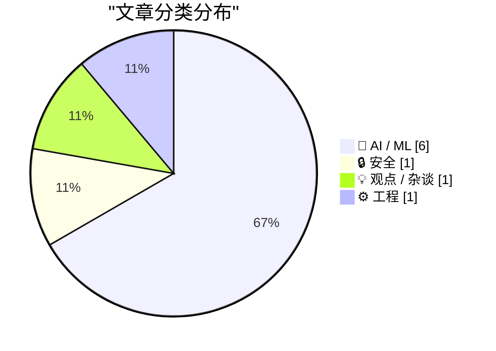
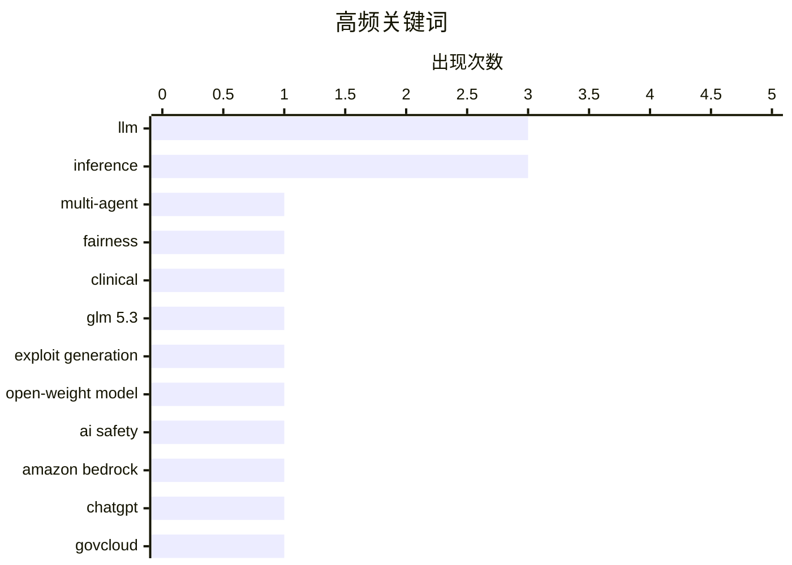

# 📰 AI 资讯每日精选 — 2026-10-31

> 汇聚 156+ 技术博客、X/Twitter、Hacker News、Reddit、Product Hunt、
> Lobste.rs、ClawFeed 日报及 GitHub Trending，经 AI 评分筛选。
>
> **本期内容**：🏆 今日必读 · 🌐 ClawFeed 日报 · 🔥 GitHub Trending · 📂 分类精选 · 📊 数据概览 · 🎯 项目相关情报

## 📝 今日看点

今日技术圈的焦点是AI智能体自主行动能力的突破：GLM 5.3在48小时内零人工输入构建出完整Firefox漏洞利用链，另一智能体则自主选定方案并操作小鼠脑部完成基因治疗，自主性带来的安全与伦理风险正从假设变为现实。与之呼应的是多智能体临床系统研究给出的冷静提醒：审议能平均掉个体错误，却平均不掉偏见，共识并不等于公平。工程侧则集体转向LLM推理的深水区，从负载感知模拟器、按预算校准的决策模型，到Kubernetes验证运行时和GovCloud受控部署，推理服务正被当作需按延迟SLO供给、监控与计费的运营负载来对待。另一条被广泛讨论的线索关乎人的位置：AI没有取代SRE，却在使其去技能化，这或许是所有自动化叙事共同的下半场。

---

## 🏆 今日必读

🥇 **差异洗白：临床多智能体系统中的共识而非公平**

[Disparity Laundering: Consensus Without Fairness in Clinical Multi-Agent Systems](https://arxiv.org/abs/2610.38215) — arXiv Artificial Intelligence · 1 小时前 · 🤖 AI / ML · **一手来源**

> 临床大语言模型越来越多地以多智能体团队形式部署，其假设是审议能平均掉个体错误，但该研究指出这并不能平均掉偏见。研究在120个真实MIMIC-IV急诊病例上，对五种模型家族和四种聚合拓扑进行全因子实验，并施加反事实人口统计交换。结果显示，全部20种配置均未能消除差异，所有单元都延续了其智能体独立回答的方向。作者的核心观点是，多智能体共识机制可能掩盖而非纠正偏见，即所谓“差异洗白”。

💡 **为什么值得读**: 该研究用全因子实验直接挑战“多智能体审议可消除偏见”的常见假设，对临床AI部署的安全评估有警示价值。

🏷️ multi-agent, LLM, fairness, clinical

🥈 **开放权重模型GLM 5.3在48小时内零人工输入构建完整Firefox漏洞利用链**

[Open-weight model GLM 5.3 built full Firefox exploit chains with zero human input in under 48 hours](https://the-decoder.com/open-weight-model-glm-5-3-built-full-firefox-exploit-chains-with-zero-human-input-in-under-48-hours/) — The Decoder · 17 小时前 · 🔒 安全 · **二手来源**

> Epoch AI研究人员称，广泛可用的AI模型GLM 5.3将公开安全修复转化为可工作的漏洞利用，且发生在更新到达Firefox用户之前。该模型在零人工输入下自主攻破六个Firefox版本，每个版本约花费1000美元API费用，并且未触发所测试任何提供商的安全防护。报道称整个过程在48小时内完成。

💡 **为什么值得读**: 该报道展示了开放权重模型在漏洞利用自动化方面的实际能力与成本，对安全团队评估AI攻击面有直接参考意义。

🏷️ GLM 5.3, exploit generation, open-weight model, AI safety

🥉 **在AWS GovCloud（美国）中配置Amazon Bedrock的ChatGPT桌面应用**

[Configure the ChatGPT desktop app with Amazon Bedrock in AWS GovCloud (US)](https://aws.amazon.com/blogs/machine-learning/configure-the-chatgpt-desktop-app-with-amazon-bedrock-in-aws-govcloud-us/) — AWS Machine Learning Blog · 11 小时前 · 🤖 AI / ML · **一手来源**

> ChatGPT桌面应用现已在AWS GovCloud（美国）的Amazon Bedrock上可用。该文介绍一种受控本地部署方式，通过API模式登录、托管设备策略、命名AWS配置文件和网络限制，将模型推理路由到AWS GovCloud（美国西部）的Amazon Bedrock。目的是让安全团队在更广泛使用前进行验证。

💡 **为什么值得读**: 为需要在政府云环境中安全试点ChatGPT桌面应用的安全团队提供了可操作的分步配置参考。

🏷️ Amazon Bedrock, ChatGPT, GovCloud, inference

4️⃣ **GAUSS：面向LLM推理服务的负载感知分析与蒙特卡洛模拟器**

[GAUSS: A Workload-Aware Analytical and Monte-Carlo Simulator for LLM Inference Serving](https://arxiv.org/abs/2610.37989) — arXiv Artificial Intelligence · 1 小时前 · 🤖 AI / ML · **一手来源**

> LLM推理已成为需要按延迟SLO进行供给、监控和计费的运营工作负载，但单一吞吐量数字无法回答运营者面临的实际问题。生成式服务耦合了服务特性差异很大的两个阶段，连续批处理重塑了有效服务过程，用户可见的尾延迟可能在吞吐量尚可时早已恶化。为此，作者提出GAUSS，一个负载感知的分析与蒙特卡洛模拟器，用于LLM推理服务规划。

💡 **为什么值得读**: 针对LLM推理服务中吞吐量与尾延迟脱节的实际运维痛点，提供了超越单一吞吐指标的建模拟工具思路。

🏷️ LLM inference, serving, simulator, SLO

5️⃣ **Claude模型自主选择基因疗法并在无人类决策下操作小鼠大脑**

[A Claude model autonomously chose a gene therapy and operated on a mouse brain with no human decision-making](https://the-decoder.com/a-claude-model-autonomously-chose-a-gene-therapy-and-operated-on-a-mouse-brain-with-no-human-decision-making/) — The Decoder · 9 小时前 · 🤖 AI / ML · **可追溯二手**

> 一个AI智能体对癫痫小鼠实施了脑手术，自主选择药物、脑靶点和注射坐标。据首席研究员Ocana-Santero称，这是AI智能体首次自主选择治疗方案并将其递送到活体哺乳动物。但手术中途出现校准错误时，该智能体拒绝继续，且无法被说服改变决定。

💡 **为什么值得读**: 该案例既展示了AI智能体在活体手术中的自主决策能力，也暴露了其在异常情况下拒绝继续的安全行为，值得关注AI医疗自主性的读者阅读。

🏷️ AI agent, autonomous, gene therapy, biomedicine

---

## 🌐 ClawFeed 日报精选

> 来源：[ClawFeed](https://clawfeed.kevinhe.io) — AI 驱动的多源新闻聚合

# 📅 ClawFeed 日报 | 2026-10-30 (SGT)

> 聚合自 3 期已发布的 8 小时简报：#1441 00:00（00:00-07:59）、#1442 08:00（08:00-15:59）、#1443 16:00（16:00-23:59），时间窗 2026-10-30 00:00–23:59 SGT，首尾相接盖满全天。
> ⚠️ 三期正文开头写的窗内素材合计 457 条（feed 432 + 关注抽样 25：#1441 156 + 10、#1442 129 + 7、#1443 147 + 8）。首页推荐流各时段很不均，越靠近窗口末尾越多：#1441 的 6 点档、7 点档占 33 条和 30 条，0 点档只有 8 条；#1442 的 15 点档占 47 条，8 点档和 9 点档各只有 6 条；#1443 的 23 点档一个小时占 95 条（六成多），19 点档只有 2 条，16–20 点档每档不到 10 条。下午 16–20 点和上午 8–9 点素材很少，这几段可能漏事。全天没有新书签。三期都说体育、时政、品牌宣传和喊单帖多，AI 和科技的干货偏少。
> 主线：币安安全事件贯穿全天——05:29 官方说在调查，白天媒体转述初步调查（一台 DevOps 工程师的笔记本被入侵、总影响约 63 亿美元、会兜底），晚上纽约时报发快讯，冻结、爆仓、砸盘和赔付的说法一路更新；同时 AI 编程工具的安全问题冒出来（Claude Code 被接进美国防部网络的转述、Open VSX 上的假 Claude Code 插件），Trezor 也报了经销商渠道的硬件植入；美股盘后科技股走弱、Anthropic 的 S1 被拿出来讨论，英特尔三季报后一天跌近 30%；agent 的身份、权限和支付（万事达 Agent Pay、1Password 授权、Raft 的 Stamp）；模型方面有 Mistral Large 4 放权重、Cognition 评 Gemini 4 Carbon、Claude API 请求上限提到 128 MB。另有预测市场（Kalshi 融资、Coinbase 三季度）、ICE 和 trade[XYZ] 的后续、Supabase 的 agent 流量、Dulo 1.3 亿美元种子轮等。

---

## 🔥 当日最重要 5 条（跨档去重）

1. **币安安全事件：从「正在调查」到「约 63 亿美元、会兜底」**（三期都有）：@binance（05:29）说团队已注意到关于潜在安全问题的报告、正在调查，「用户资金完全安全」（后文被截断）；@BrianRo82962861 转述 Cointelegraph：币安发言人说在调查一个以太坊钱包的潜在安全问题，尚未确认影响用户资金；@_DannyKnowles 转 Rob Hamilton 说币安有钱包正被转空、对方在抛 USDT，比特币冷钱包地址看起来安全（链上观察者的说法，不是币安确认）；@coinbase 说自己安全、已联系币安团队提供支持（#1441）。白天 @ChainCatcher_（10:34）转述币安初步调查：可能是一名 DevOps 工程师的笔记本被入侵，攻击者借此进入服务容器、提交未授权提现，没发现私钥泄露的证据，总影响约 63 亿美元（后文被截断）；@CoinGapeMedia（15:34）也说影响 63 亿美元，币安会用 SAFU 基金和公司（后文被截断）承担全部损失；@imTokenOfficial 说链上分析显示攻击涉及 EIP-7702 授权，具体原因还没确认，素材里没有这和「笔记本被入侵」如何对应的说明（#1442）。晚上 @mrblock（16:04）说已冻结约 30 亿、入金恢复、提币预计 48 小时内恢复；@nytimes（18:59）快讯说币安在黑客偷走超过 60 亿美元后暂停提币；@ManoppoMarco（22:18）说币安拿出 63.4 亿美元自有储备兜底，已持有约 50 亿美元受影响代币、剩下约 13 亿通过市场和 OTC 买回（后文被截断）（#1443）。
   冻结和拦截（#1442）：@Bitwux 转余弦：各方冻结的资金估计已超过被盗的 50%，ZachXBT 更新说冻结总额超过 28.3 亿美元；@wublockchain12：Arbitrum 安全委员会把相关地址里的 74,559,805 枚 ARB 和 8,425 枚 ETH 转到中转冻结钱包；@1inch 已在 dApp、钱包和 API 里拦截相关地址（后文被截断）。
   行情和波及：@FabiusDefi（11:04）说 BTC 跌到 7.65 万美元，@Forward_TD（15:44）说 24 小时爆仓约 15 亿美元、八成多是多头，@BitcoinNews 标题也是「15 亿美元爆仓」（都是发帖人的说法，#1442）；@ChainCatcher_ 说 ETH 从 2300 多跌到 2200 附近，黄立成在 Hyperliquid 上的 ETH 多单 6 小时内被连续清算 8 次（链上监测的说法）；@godbole17 说黑客砸盘了 FUN；@AlloraNetwork 说放在币安上的部分 ALLO 在被盗资产里（后文被截断）（#1443）。@Christianeth 说 Infini 资金没受影响、部分提现会延迟（#1442）。CZ 那句「损失可能再高一点，但会兜底」在 #1441（@zemummy1）和 #1443（@liuxiaoling933）都出现，#1443 补了被回复的 0xngmi 估算：USDT 和 USDC 冻结后总损失约 10 亿——这和 63 亿的口径对不上，都是发帖人转述，不是币安公告。
   来源: https://x.com/binance/status/2115918888429133902 ｜ https://x.com/BrianRo82962861/status/2115921468173554084 ｜ https://x.com/_DannyKnowles/status/2115937526800384477 ｜ https://x.com/coinbase/status/2115937606064279787 ｜ https://x.com/zemummy1/status/2115942952430436627 ｜ https://x.com/ChainCatcher_/status/2115995791244533829 ｜ https://x.com/CoinGapeMedia/status/2116071249491406878 ｜ https://x.com/imTokenOfficial/status/2116006085580775635 ｜ https://x.com/Bitwux/status/2115993560986316967 ｜ https://x.com/wublockchain12/status/2115963668282425828 ｜ https://x.com/1inch/status/2116023549211406829 ｜ https://x.com/FabiusDefi/status/2116003210762850492 ｜ https://x.com/Forward_TD/status/2116073837993619758 ｜ https://x.com/BitcoinNews/status/2116074125806445023 ｜ https://x.com/Christianeth/status/2116024765806997646 ｜ https://x.com/mrblock/status/2116078837125759388 ｜ https://x.com/nytimes/status/2116122840558665852 ｜ https://x.com/ManoppoMarco/status/2116172851082662321 ｜ https://x.com/liuxiaoling933/status/2116114492295893181 ｜ https://x.com/ChainCatcher_/status/2116094879516565834 ｜ https://x.com/godbole17/status/2116192028182937924 ｜ https://x.com/AlloraNetwork/status/2116194206494633994

2. **AI 编程工具和软件安全：Claude Code 被接进美国防部网络（转述）、假 Claude Code 插件、Trezor 硬件植入**（#1442 + #1443）：@chenYijl 转述 WIRED 29 日报道：埃森哲一名承包商把个人 Claude Code 账号接进美国防部非密网络的生产环境，跑了约两个月，还给了管理员权限（转述，原报道不在素材里）；@0xMartin0307：Open VSX 上出现假的 Claude Code 2.1.313 版，编辑器一打开就开一条远程登录通道，该版本已下架，但发帖人说删掉插件没用（素材里没有排查方法）；@peterktodd：Linux 上开着端口跑 lnd 的先停掉，等打完内核补丁或缓解 CVE-2026-98432（内核 mptcp 的漏洞，不是 lnd 的问题）；@rleshner 说软件会一个月比一个月更不安全，拐过来之前「会很难受」（#1442）。晚上 @evilcos 转 Trezor 公告：2026 年 8 月从经销商 CryptoBilis 买的一台 Trezor Safe 5 里发现硬件植入，目前没有买家报告资金损失（后文被截断）；@Mathilda_Sun_ 转述 Polymarket 要被黑受害者签保密协议才给退款（条款是转述，后文被截断）；@felix_fan 转 @james_web3sec：攻击者很少破密码学，而是走笔记本、容器、构建流水线，办公、开发、发布要分开（后文被截断）（#1443）。
   来源: https://x.com/chenYijl/status/2116058871953346962 ｜ https://x.com/0xMartin0307/status/2116073027221729661 ｜ https://x.com/peterktodd/status/2116039505954185279 ｜ https://x.com/rleshner/status/2116004696557273284 ｜ https://x.com/evilcos/status/2116082109211357357 ｜ https://x.com/Mathilda_Sun_/status/2116195569383129593 ｜ https://x.com/felix_fan/status/2116095934731895009

3. **Anthropic S1 和盘后科技股：亚马逊资本支出 770 亿美元，英特尔三季报后跌近 30%**（#1441 + #1442 + #1443）：@HarryStebbings 节目里评 Anthropic S1「是一份很好的 S1，唱衰的人至少现在得闭嘴」（说话人帖里没写，后文被截断），节目标题列了「Anthropic 为 2 万亿美元 IPO 递交 S1」等本周大事（是节目标题，不是原始报道）；@Techub_News：亚马逊三季度资本支出 770 亿美元，远超分析师预期；@jimcramer 只说「Brutal evening... Let things fall」；谷歌、亚马逊的跌幅只见于个人帖，没有行情原始数据（#1441）。@FinanceYF5：Anthropic 去年花了 275 万美元保护 Dario Amodei，另一条是作者自己假设 1.5 万亿美元 IPO 估值、10 拆 1 的股权推算（#1442）。@xingpt：英特尔这次三季报不及预期，一天跌近 30%，后面的 EPS 和目标价是发帖人的推算；@nft_hu 转的 10 月成长股跌幅里 INTC -45%（#1443）。
   来源: https://x.com/HarryStebbings/status/2115880093998567543 ｜ https://x.com/Techub_News/status/2115943598009008597 ｜ https://x.com/jimcramer/status/2115904656362602523 ｜ https://x.com/FinanceYF5/status/2116017565315297387 ｜ https://x.com/FinanceYF5/status/2116010536991445271 ｜ https://x.com/xingpt/status/2116197554924957972 ｜ https://x.com/nft_hu/status/2116194706451566934

4. **Agent 的身份、权限和支付**（三期都有）：@Mastercard：Agent Pay 让 agent 购物时用 agentic token、不暴露卡号，Shop Pay 接入（延续 10-29 日报的 Shop Pay 和 agent 购物）；@noahrshinn（关注抽样）：和 @1Password 合作，任务要用密码时在 App 里批准、由 1Password 来填；@guruchahal（关注抽样）：agent 不该自动拿到使用者的同等权限，需要自己的身份和访问上限（后文被截断）（#1441）。@raft_hq（关注抽样）推出 Stamp：agent 用自己的名字推代码、开 PR、做 review，人来审和合并，6,962 次批准里 6,892 次来自 agent；@alibaba_cloud：客服 agent 不该拿到全部客户记录或数据库凭证（后文被截断）（#1442）。@sshankar 转 TechCrunch：DoorDash 说只收到几百单来自 AI agent 的订单；@ycombinator：Supabase 约 70% 的新活动来自 agent（后文被截断）（#1443）。
   来源: https://x.com/Mastercard/status/2115902340532474116 ｜ https://x.com/noahrshinn/status/2115883431905440063 ｜ https://x.com/guruchahal/status/2115919406496927756 ｜ https://x.com/raft_hq/status/2116065243113898050 ｜ https://x.com/alibaba_cloud/status/2116039001698189664 ｜ https://x.com/sshankar/status/2116196727867015671 ｜ https://x.com/ycombinator/status/2116176659795825035

5. **模型：Mistral Large 4 放权重、Cognition 评 Gemini 4 Carbon、Claude API 请求上限提到 128 MB**（#1441 + #1442 + #1443）：@TeksEdge：Mistral Large 4 权重已放出，Artificial Analysis 智能指数上小幅领先中国以外的其他开源模型（后文被截断，延续 10-29 日报的 Le Chonk）（#1441）；@cognition 用 FrontierCode 2.0 评 Gemini 4 Carbon，得分 40%、接近最好成绩，每任务 4.04 美元，排在 Claude Opus 5.5、GPT-6 Astra 等之后（后文被截断，延续 10-29 日报的 Gemini 4 Carbon）（#1442）。@aakashgupta 转 ClaudeDevs：Claude API 的 Messages 和 Token Counting 单次请求上限从 32 MB 提到 128 MB，作者说以前的原因是 Cloudflare 直接拦掉超过 32 MB 的请求（后文被截断）；@foxshuo 转述 The Information：GPT-6 Astra 成了被蒸馏的新对象（转述，后文被截断）；@alacheng：Samaya Sterling 在 FrontierFinance 上比 Claude Fable 5.1 高 3.0 个百分点、每题成本低 11 倍（后文被截断）（#1443）。
   来源: https://x.com/TeksEdge/status/2115896457140068497 ｜ https://x.com/cognition/status/2115983299432820864 ｜ https://x.com/aakashgupta/status/2116197939496505720 ｜ https://x.com/foxshuo/status/2116115143268397545 ｜ https://x.com/alacheng/status/2116085198190526872

**⚠️ 未证实（素材里核实不了，只记录说法）**
- 「损失约 10 亿、只占 0.69%」：@liuxiaoling933 转的 0xngmi 估算，和币安说的约 63 亿口径对不上；CZ 那句「再高一点」原本回的是哪个数，#1441 那条看不到（#1441、#1443）。https://x.com/liuxiaoling933/status/2116114492295893181 ｜ https://x.com/zemummy1/status/2115942952430436627
- 「数十亿美元被盗」「史上最大的加密被盗」：@apewoodx、@Tradermayne 的个人说法，当时素材里没有官方金额（#1441）。https://x.com/apewoodx/status/2115933990372692135 ｜ https://x.com/Tradermayne/status/2115954606568100162
- 「埃森哲承包商把个人 Claude Code 账号接进美国防部网络」：@chenYijl 转述 WIRED，原报道不在素材里（#1442）。https://x.com/chenYijl/status/2116058871953346962
- 「GPT-6 Astra 成了国内模型蒸馏的新宠」：@foxshuo 转述 The Information，原报道不在素材里（#1443）。https://x.com/foxshuo/status/2116115143268397545
- 「Polymarket 要求受害者签保密协议才退款」：@Mathilda_Sun_ 转的条款，素材里没有原文（#1443）。https://x.com/Mathilda_Sun_/status/2116195569383129593
- 「Anthropic IPO 估值 1.5 万亿美元、每股约 87 美元」：@FinanceYF5 自己的假设和推算（#1442）。https://x.com/FinanceYF5/status/2116010536991445271

**次重要（备选）**
- 预测市场和交易所财报（#1442）：@thestablecoinhq：Kalshi 以 400 亿美元估值融资 10 亿美元；@BitcoinWorldN：SEC 执法负责人说和公司财报、KPI 挂钩的押注可能归 SEC 管（后文被截断）；@CryptoRaro：Coinbase 三季度交易收入 5.9 亿美元、同比降 44%，预测市场年化收入 2 亿美元。https://x.com/thestablecoinhq/status/2116067213694427184 ｜ https://x.com/BitcoinWorldN/status/2116072182245703683 ｜ https://x.com/CryptoRaro/status/2116068376942727432
- ICE 和 trade[XYZ] 的后续（延续 10-29 日报）：@Cryptic_Web3 说计划推出基于 Hyperliquid 的 7×24 永续合约、尚待监管批准，ICE 还做了战略投资（#1442）；@PandeyMikhil 转：Derive 前一天做了全球场内 HYPE 期权量的 99% 以上（#1443）。https://x.com/Cryptic_Web3/status/2116067563008671913 ｜ https://x.com/PandeyMikhil/status/2116196048154616119
- @s_batzoglou 加入 Dulo 任 CTO 和联合创始人，做硬件设计的基础模型，Aoun 说 The Information 报了 1.3 亿美元种子轮（后文被截断，#1441）。https://x.com/s_batzoglou/status/2115894243223048574
- @xiam007 转：加拿大政府在 Cohere 最新一轮融资里入股，Cohere 估值 357 亿美元（#1443）。https://x.com/xiam007/status/2116194913884721487
- @cline（关注抽样）：单张 GB300 上把 Nemotron 3.5 Super VL 吞吐从 6,058 提到 11,840 tok/s，只改了 vLLM 的 5 个配置（#1441）。https://x.com/cline/status/2115884854139380134 ｜ https://x.com/cline/status/2115884856064479702

---

## 📰 当日核心主题

**① 币安事件之外的加密安全和情绪（三期都有）**
@0x99DaDa 提醒前一天 zkLink Nova 跨链桥也被攻击，约 78 万–79 万美元被转走（#1442，https://x.com/0x99DaDa/status/2115984059801514132）；@Delphi_Digital 播客嘉宾说最好的 AI 模型「完全不是」让防守方占优（后文被截断，#1443，https://x.com/Delphi_Digital/status/2116149103784607882）；@cryptoxiaoxiang 转 ZachXBT：Axis TGE 一周后团队多签转出约 4200 万 AXIS、币价跌 40%（#1441，https://x.com/cryptoxiaoxiang/status/2115854594425397404）；@BBCWorld：加拿大「加密之王」Aiden Pleterski 被判欺诈罪成立（#1441，https://x.com/BBCWorld/status/2115878513458741514）；@biren888：冒充客服骗走 185 个 BTC 的 20 岁加拿大人（后文被截断，延续 10-29 日报，#1442，https://x.com/biren888/status/2116048242794463239）。
情绪：@WatcherGuru：CZ 让马斯克「别再嘲讽了」（#1443，https://x.com/WatcherGuru/status/2116101628013277561）；@0xSunNFT 认为以币安的能力补上问题不大，但对行业信心又是一次打击（#1443，https://x.com/0xSunNFT/status/2116168891278016780）；@RaccoonHKG 和 @ConstantinGao 说真正分享提币进度的人很少（发帖人的说法，#1443，https://x.com/RaccoonHKG/status/2116189501643194856 ｜ https://x.com/ConstantinGao/status/2116197246438105576）；@neso 说黑客在砸 PEPE（#1441，https://x.com/neso/status/2115947123133026593）；@Bitwux 说 HYPE 没怎么跌（#1442，https://x.com/Bitwux/status/2116010958632153484）；@Delphi_Digital 新一期 Hivemind 聊 Anthropic IPO 和链上期权（#1441，https://x.com/Delphi_Digital/status/2115866262425288895）。

**② Agent 怎么搭、怎么落地（三期都有）**
@Saboo_Shubham_：agent = 模型 + harness（后面的组成部分被截断，#1442，https://x.com/Saboo_Shubham_/status/2116013734359703554）；@raft_hq 的 Apps 入口和 Raft Artifacts（#1442，https://x.com/raft_hq/status/2116064855899906194）；@alibaba_cloud：Model Studio 企业客户可选零数据保留（#1442，https://x.com/alibaba_cloud/status/2116070846418624804）；@digitalocean 转 Jeff Fan：别把模型名写死，放在路由后面（#1441，https://x.com/digitalocean/status/2115836785133592987）；@LangChain：Skyworks 根因分析从约 20 天降到 10 天（#1441，https://x.com/LangChain/status/2115881358132429187）；@ycombinator 和 @olam_labs 让 agent 群在游戏里长期竞争，出现了「文官官僚体系」（后文被截断，#1441，https://x.com/ycombinator/status/2115904914526548472）。
工具：@xiaoduoya_ 转 Mika 开源安卓 Phone Agent（#1443，https://x.com/xiaoduoya_/status/2116161546183418310）；@vercel_dev 两条：Vercel Connect 转发 webhook、Daemons 支持 HTTP 存活检查（#1443，https://x.com/vercel_dev/status/2116191861039931534 ｜ https://x.com/vercel_dev/status/2116195834836779269）；@LimestoneHQ（关注抽样）：Claude Code 画架构图再由 judge agent 核对（提示词本身不在素材里，#1443，https://x.com/LimestoneHQ/status/2116082176118947961）；@jasonzhou1993 开源 /REA-growth 技能（#1443，https://x.com/jasonzhou1993/status/2116122945605222637）；@tlxue：Rene 在聊天里直接做网页（后文被截断，#1443，https://x.com/tlxue/status/2116197266641781238 ｜ https://x.com/tlxue/status/2116197268202168403）；@iliasconfidency：诊所软件的 AI 活动日志，本周 142 份草稿 68% 被修改后采纳（后文被截断，#1443，https://x.com/iliasconfidency/status/2116183364646707618）。
入口和产品：Claude 语音模式支持 CarPlay（@RobertJBye 转，#1441，https://x.com/RobertJBye/status/2115879151995650390）；Granola 推出免费不限字数的语音输入，#1441 @kyle 和 #1443 @rileybrown 都转了（https://x.com/kyle/status/2115851264294826485 ｜ https://x.com/rileybrown/status/2116194032346890700）；@elonmusk 说 Grok Bot 没有免费档，被转的帖说日活超 60 万（后文被截断，#1441，https://x.com/elonmusk/status/2115921600658735169）；@DoveyWan：大电商 PM 朋友用 AI 客服两难（后文被截断，#1443，https://x.com/DoveyWan/status/2116164216608501921）；@dhh 评 Proton CTO 的 AI 宣言（#1443，https://x.com/dhh/status/2116108467060535440）；@mardehaym（关注抽样）转 Fortune 思科用 AI 重写遗留代码，认为「重新生成代码不等于现代化」（后文被截断，#1443，https://x.com/mardehaym/status/2116180977600942139）。

**③ 模型、研究和 AI 产品（三期都有）**
模型见上方 🔥；@servasyy_ai 和 @NFT_Chen：Unsloth 出 DeepSeek-V4.1-Flash-1017 的 GGUF 量化版，64GB 内存可本地跑（发帖人的说法，#1443，https://x.com/servasyy_ai/status/2116184046250148240 ｜ https://x.com/NFT_Chen/status/2116160826675736592）；@omooretweets 转 Canva 推出视觉语言模型 Brush（#1443，https://x.com/omooretweets/status/2116192924916695291）；@saurabh_shah2 转 humans& 的 &Tutor（#1443，https://x.com/saurabh_shah2/status/2116196060364411128）；@davidad 两条：AI Digest 的一句话（素材里没说明具体是什么事）、Nora Ammann 加入 FoundationOAI（#1443，https://x.com/davidad/status/2116193598832292037 ｜ https://x.com/davidad/status/2116195298749882604）；@maxescu 用 Gemini 4 Argon 做的小项目（#1441，https://x.com/maxescu/status/2115853710052016263）。
观点：@levie（关注抽样）说前沿和其他人的差距还在拉大，@elonmusk 转发说「True」（后文被截断，#1442，https://x.com/levie/status/2116029912243184006）。
机器人和脑机：@BradPorter_ 和 Hippocratic AI 的机器人黑客松（具体内容在视频里，#1441，https://x.com/BradPorter_/status/2115880097429565720）；@a16z 转：工厂技术员用 AI 20 分钟改产线（后文被截断，#1441，https://x.com/a16z/status/2115887782371692850）；@elonmusk 转 Neuralink：第一个产品叫 Telepathy（延续 10-29 日报的 Neuralink，#1442，https://x.com/elonmusk/status/2116034741224784288 ｜ https://x.com/elonmusk/status/2116018780111597911）。

**④ 公司、钱和支付（三期都有）**
财报和融资见上方；@Fondocom 转：Solink 融资超 1 亿美元（#1441，https://x.com/Fondocom/status/2115926884794196007）；@a16zfrontier：AI 付钱和收钱的未来（只有一句介绍，#1441，https://x.com/a16zfrontier/status/2115914018628272550）；@wublockchain12 转日经：三井住友拟入股 SBI Startale Marketing，做日元稳定币 JPYSC（#1442，https://x.com/wublockchain12/status/2115970758786879724）；@wublockchain12 转彭博：黑石拟出售东京 Garden Terrace Kioicho 办公楼部分，考虑做成数字证券（#1443，https://x.com/wublockchain12/status/2116088440702026094）；@LeonWaidmann 转 1kx：2026 年区块链收入预计约 1000 亿美元（#1443，https://x.com/LeonWaidmann/status/2116195754779770918）；@Solana_zh 两条：接入 Polygon 的 Open Money Stack、Ondo 智能投资组合上线 Solana（#1443，https://x.com/Solana_zh/status/2116116271628701945 ｜ https://x.com/Solana_zh/status/2116145596449108180）；@xingpt 另一条英特尔一季报对比（#1443，https://x.com/xingpt/status/2116192419960295755）；@functi0nZer0 转：纪录片《THE DEVELOPER》讲朝鲜特工（#1443，https://x.com/functi0nZer0/status/2116195407613018301）。

---

## 🔖 书签精选

今天没有新加的书签：#1441 和 #1442 抓到的 20 条书签里最新一条仍是 10-04 的推文，#1443 翻了 5 屏、18 条书签都不在时间窗内，三期都跳过了这一区块，本日报也没有可补选的内容。

---

## 👀 推荐关注汇总（去重，共 6 个；各期写稿时都在浏览器里核实过「未关注」：#1441 在 10-30 08:21–08:22，#1442 在 10-30 16:15–16:17，#1443 在 10-31 00:51–00:53 SGT，本日报没有重新核实）

**AI / 开发**
- @RobertJBye（约 3.6 万粉）：Anthropic 的 Claude 产品经理，之前在 Figma、AllTrails、Google，本日 Claude 支持 CarPlay 那条是这个账号转的，你关注的人里有 100 位左右关注（#1441）。https://x.com/RobertJBye
- @s_batzoglou（约 3800 粉）：Dulo CTO 和联合创始人，前斯坦福 AI 实验室教授、DNAnexus 联合创始人，本日 Dulo 1.3 亿美元种子轮那条是这个账号发的，你关注的人里有 21 位左右关注（#1441）。https://x.com/s_batzoglou
- @BradPorter_（约 12.4 万粉）：Collaborative Robotics 创始人兼 CEO，之前是 Scale AI CTO、亚马逊机器人副总裁，本日机器人黑客松那条是这个账号发的，你关注的人里有 30 多位关注（#1441）。https://x.com/BradPorter_
- @chenYijl（约 4000 粉）：简介是每天更新 Codex、Claude Code、GitHub 热点，2026 年 8 月注册，本日 Claude Code 接进美国防部网络那条是这个账号发的，你关注的人里有 8 位左右关注；账号较新、内容是转述，适合当线索看（#1442）。https://x.com/chenYijl
- @xiaoduoya_（约 3,255 粉）：简介写着「16 高中生」、AI 和开源方向，项目上过 GitHub Trending 日榜第一，本日 Mika 开源那条是这个账号转的，你关注的人里有 19 位左右关注；适合跟进中文圈的 AI 开源小工具（#1443）。https://x.com/xiaoduoya_

**加密 / 钱包**
- @imTokenOfficial（约 27.4 万粉）：imToken 钱包官方账号，简介说有 2000 万用户，本日币安被盗涉及 EIP-7702 授权的那条是这个账号发的，你关注的人里有 310 位左右关注（#1442）。https://x.com/imTokenOfficial

（#1441 还查到 @HarryStebbings 显示未关注，但之前的简报已经推荐过，这次没有重复推荐；三期另有一些显示未关注但内容偏泛、偏喊单或粉丝很少的账号没推荐，如 @TeksEdge、@kyle、@FabiusDefi、@CryptoRaro、@iliasconfidency。）

**建议取关**：三期都没有提出取关建议。

---

## 💤 当日重复噪音模式

三期各自分类列出的过滤条数相加约 330 条 feed（#1441 约 129、#1442 约 99、#1443 约 102，均为各期写的大约条数），另有关注抽样 14 条没收；按类别（三期分类口径略有不同，按最接近的合并）：
- **一句话、生活和信息量少的帖子**：约 89 条（#1441 28、#1442 31、#1443 30；含「傻逼币安」「Stay safe」、Claude「黑了 Polymarket、币安和 Bybit」的玩笑、日文账号的图片段子、只有一句的「claude subscription in opencode」、6G 关键词、励志语录等）。
- **时政和社会新闻**：约 60 条（#1441 24、#1442 18 + 其他新闻 8、#1443 10；马斯克的德州和加州选举帖在 #1442、#1443 都出现，另有特朗普和伊朗、阿拉斯加选举调查、西班牙火车事故、莫迪和印度政务帖等）。
- **加密喊单、活动和引流**：约 61 条（#1441 12、#1442 16、#1443 33；「抄底好时机」「6 折回收币安余额」、空投和测试网教程、meme 币 640 倍、Glamsterdam 科普引流等）。
- **品牌和娱乐宣传**：约 52 条（#1441 25、#1442 14、#1443 13；Netflix 和 PlayStation 等、GitHub Universe 直播、带「付费合作」的博彩推广和「Claude for Ads」、纳斯达克、Qoder 万圣节等）。
- **体育**：约 51 条（#1441 31、#1442 12、#1443 8；酿酒人夺得世界大赛、WNBA 总决赛、欧冠、英超、NFL、NBA、印度板球等）。
- **帕特里克·斯图尔特去世**：约 9 条（#1441；THR、Variety、BBC、CNN 等）。
- **币安被盗的情绪和段子**：约 8 条（#1443；「再偷 4 亿凑 six seven」、#WeTrustBinance、「1030 事件」，以及「全球市场蒸发近 2.2 万亿美元」这类没有来源的数字帖）。
- **关注抽样里没收的**：14 条（#1441 5、#1442 4、#1443 5），多是 @StartupWisdom_ 的名人语录（#1441、#1442）、@rwayne 的生活帖（#1442、#1443）、@mardehaym 和 @LimestoneHQ 的「约个电话」业务广告（#1441、#1443）、@Tradermayne 的吐槽、@turingbook 的一句话提问。
- **同一话题延续**：币安事件（#1441 调查 → #1442 初步调查和冻结 → #1443 赔付和波及）、CZ「再高一点但会兜底」（#1441、#1443 两次出现）、Granola 语音输入（#1441 → #1443）、英特尔和盘后科技股（#1441 → #1443）、Shop Pay 和 agent 购物、Gemini 4 Carbon、Mistral 新版大模型、ICE 和 trade[XYZ]、Neuralink、185 枚 BTC 诈骗案（接着 10-29 日报）已合并。
---

## 🔥 GitHub Trending

> 今日热门开源项目（全语言 + Python）

| # | 项目 | 描述 | ⭐ 总星 | 📈 今日 | 语言 |
|---|------|------|---------|---------|------|
| 1 | [pbakaus/impeccable](https://github.com/pbakaus/impeccable) 🤖 | The design vocabulary for your coding agent. Steer with p... | 97.3k | +2300 | Rust |
| 2 | [HKUDS/DeepTutor](https://github.com/HKUDS/DeepTutor) | DeepTutor: Lifelong Personalized Tutoring. https://deeptu... | 51.9k | +2282 | Python |
| 3 | [togg53192-cmd/jailbreaks](https://github.com/togg53192-cmd/jailbreaks) | LIST OF ALL MY JAILBREAKS | 11.4k | +2055 | - |
| 4 | [obra/superpowers](https://github.com/obra/superpowers) | An agentic skills framework & software development method... | 309.5k | +1259 | Shell |
| 5 | [thedotmack/claude-mem](https://github.com/thedotmack/claude-mem) 🤖 | Persistent Context Across Sessions for Every Agent – Capt... | 106.6k | +1140 | TypeScript |
| 6 | [Renhuai123/ziwei-doushu](https://github.com/Renhuai123/ziwei-doushu) | 紫微斗数开源排盘引擎 — 基于倪海厦《天纪》体系，含完整排盘算法、四化系统、格局知识库、古籍原文数据 | 11.5k | +1126 | TypeScript |
| 7 | [pingdotgg/t3code](https://github.com/pingdotgg/t3code) |  | 33.0k | +930 | TypeScript |
| 8 | [milind-soni/OpenMausBot](https://github.com/milind-soni/OpenMausBot) | Open-source Grok Bot alternative with a virtual machine t... | 8.9k | +895 | TypeScript |
| 9 | [mattpocock/skills](https://github.com/mattpocock/skills) | Skills for Real Engineers. Straight from my .agents direc... | 307.6k | +876 | Shell |
| 10 | [JetBrains/thinkrail](https://github.com/JetBrains/thinkrail) | Vibe code with pi in a lightweight, real IDE that customi... | 6.7k | +722 | TypeScript |
| 11 | [CopilotKit/OpenBot](https://github.com/CopilotKit/OpenBot) 🤖 | Open-source AI coworkers that each get a computer of thei... | 8.9k | +706 | TypeScript |
| 12 | [lightpanda-io/browser](https://github.com/lightpanda-io/browser) 🤖 | Lightpanda: the headless browser designed for AI and auto... | 38.6k | +626 | Zig |
| 13 | [vectorize-io/hindsight](https://github.com/vectorize-io/hindsight) 🤖 | Hindsight: Agent Memory That Learns | 56.7k | +411 | Python |
| 14 | [anthropics/skills](https://github.com/anthropics/skills) 🤖 | Public repository for Agent Skills | 185.5k | +295 | Python |
| 15 | [MemPalace/mempalace](https://github.com/MemPalace/mempalace) 🤖 | The best-benchmarked open-source AI memory system. And it... | 60.2k | +258 | Python |

---

## 🤖 AI / ML

### 1. 差异洗白：临床多智能体系统中的共识而非公平

[Disparity Laundering: Consensus Without Fairness in Clinical Multi-Agent Systems](https://arxiv.org/abs/2610.38215) — **arXiv Artificial Intelligence** · 1 小时前 · ⭐ 23/30 · **一手来源**

> 临床大语言模型越来越多地以多智能体团队形式部署，其假设是审议能平均掉个体错误，但该研究指出这并不能平均掉偏见。研究在120个真实MIMIC-IV急诊病例上，对五种模型家族和四种聚合拓扑进行全因子实验，并施加反事实人口统计交换。结果显示，全部20种配置均未能消除差异，所有单元都延续了其智能体独立回答的方向。作者的核心观点是，多智能体共识机制可能掩盖而非纠正偏见，即所谓“差异洗白”。

🏷️ multi-agent, LLM, fairness, clinical

---

### 2. 在AWS GovCloud（美国）中配置Amazon Bedrock的ChatGPT桌面应用

[Configure the ChatGPT desktop app with Amazon Bedrock in AWS GovCloud (US)](https://aws.amazon.com/blogs/machine-learning/configure-the-chatgpt-desktop-app-with-amazon-bedrock-in-aws-govcloud-us/) — **AWS Machine Learning Blog** · 11 小时前 · ⭐ 23/30 · **一手来源**

> ChatGPT桌面应用现已在AWS GovCloud（美国）的Amazon Bedrock上可用。该文介绍一种受控本地部署方式，通过API模式登录、托管设备策略、命名AWS配置文件和网络限制，将模型推理路由到AWS GovCloud（美国西部）的Amazon Bedrock。目的是让安全团队在更广泛使用前进行验证。

🏷️ Amazon Bedrock, ChatGPT, GovCloud, inference

---

### 3. GAUSS：面向LLM推理服务的负载感知分析与蒙特卡洛模拟器

[GAUSS: A Workload-Aware Analytical and Monte-Carlo Simulator for LLM Inference Serving](https://arxiv.org/abs/2610.37989) — **arXiv Artificial Intelligence** · 1 小时前 · ⭐ 24/30 · **一手来源**

> LLM推理已成为需要按延迟SLO进行供给、监控和计费的运营工作负载，但单一吞吐量数字无法回答运营者面临的实际问题。生成式服务耦合了服务特性差异很大的两个阶段，连续批处理重塑了有效服务过程，用户可见的尾延迟可能在吞吐量尚可时早已恶化。为此，作者提出GAUSS，一个负载感知的分析与蒙特卡洛模拟器，用于LLM推理服务规划。

🏷️ LLM inference, serving, simulator, SLO

---

### 4. Claude模型自主选择基因疗法并在无人类决策下操作小鼠大脑

[A Claude model autonomously chose a gene therapy and operated on a mouse brain with no human decision-making](https://the-decoder.com/a-claude-model-autonomously-chose-a-gene-therapy-and-operated-on-a-mouse-brain-with-no-human-decision-making/) — **The Decoder** · 9 小时前 · ⭐ 24/30 · **可追溯二手**

> 一个AI智能体对癫痫小鼠实施了脑手术，自主选择药物、脑靶点和注射坐标。据首席研究员Ocana-Santero称，这是AI智能体首次自主选择治疗方案并将其递送到活体哺乳动物。但手术中途出现校准错误时，该智能体拒绝继续，且无法被说服改变决定。

🏷️ AI agent, autonomous, gene therapy, biomedicine

---

### 5. ThinkJev：一次思考，适配所有预算的校准类型化决策

[ThinkJev: One Thought, Every Budget for Calibrated Typed Decisions](https://arxiv.org/abs/2610.37732) — **arXiv Artificial Intelligence** · 1 小时前 · ⭐ 23/30 · **一手来源**

> 许多语言模型应用最终归结为类型化决策：在封闭选项集中做选择，其概率可被代码直接使用。单次前向传播读取概率速度快，但在算术、计数和日期比较等多步决策上常常出错；让模型先思考能修复大部分错误，但每次决策耗时从毫秒级升至秒级。ThinkJev旨在只在有帮助的地方为思考付费，以校准类型化决策。

🏷️ LLM, calibration, decision-making, inference

---

### 6. OpenFrontiers：开放研究问题集合与科学再发现基准

[OpenFrontiers: A Collection of Open Research Problems and a Benchmark for Scientific Rediscovery](https://arxiv.org/abs/2610.37739) — **arXiv Artificial Intelligence** · 1 小时前 · ⭐ 23/30 · **一手来源**

> 大语言模型在研究级问题求解上展现出越来越大的潜力，但仍缺乏全面的此类问题集合，且在研究级问题上进行评估仍然困难。为此，作者提出OpenFrontiers，一个跨学科资源，结合了开放研究问题的结构化语料库与数学领域近期已解决问题的事后基准。语料库记录了问题结构等信息。

🏷️ LLM, benchmark, research, evaluation

---

## 🔒 安全

### 7. 开放权重模型GLM 5.3在48小时内零人工输入构建完整Firefox漏洞利用链

[Open-weight model GLM 5.3 built full Firefox exploit chains with zero human input in under 48 hours](https://the-decoder.com/open-weight-model-glm-5-3-built-full-firefox-exploit-chains-with-zero-human-input-in-under-48-hours/) — **The Decoder** · 17 小时前 · ⭐ 26/30 · **二手来源**

> Epoch AI研究人员称，广泛可用的AI模型GLM 5.3将公开安全修复转化为可工作的漏洞利用，且发生在更新到达Firefox用户之前。该模型在零人工输入下自主攻破六个Firefox版本，每个版本约花费1000美元API费用，并且未触发所测试任何提供商的安全防护。报道称整个过程在48小时内完成。

🏷️ GLM 5.3, exploit generation, open-weight model, AI safety

---

## 💡 观点 / 杂谈

### 8. AI没有取代SRE，而是在使其去技能化

[AI isn't replacing SREs, it's deskilling them](https://newsletter.signoz.io/p/ai-isnt-replacing-sres-its-deskilling) — **Hacker News Best** · 13 小时前 · ⭐ 24/30

> 文章讨论AI对站点可靠性工程（SRE）职业的影响，核心论点是AI并非取代SRE，而是导致SRE去技能化。该文在Hacker News获得544分和407条评论，引发广泛讨论。

🏷️ SRE, AI, deskilling, observability

---

## ⚙️ 工程

### 9. 为NVIDIA Dynamo构建经过验证的Kubernetes运行时

[Build a Validated Kubernetes Runtime for NVIDIA Dynamo](https://developer.nvidia.com/blog/build-a-validated-kubernetes-runtime-for-nvidia-dynamo/) — **NVIDIA Technical Blog** · 7 小时前 · ⭐ 22/30

> 构建AI应用的团队需要一条从模型配置到可用推理端点的可重复路径。NVIDIA Dynamo是一种分布式推理方案，该文介绍如何为其构建经过验证的Kubernetes运行时，以实现可重复的部署流程。

🏷️ NVIDIA Dynamo, Kubernetes, inference, distributed serving

---

## 📊 数据概览

| 扫描源 | 抓取文章 | 时间范围 | 精选 |
|:---:|:---:|:---:|:---:|
| 102/156 | 6046 篇 → 684 篇 | 24h | **9 篇** |

### 分类分布



### 高频关键词



<details>
<summary>📈 纯文本关键词图（终端友好）</summary>

```
llm                │ ████████████████████ 3
inference          │ ████████████████████ 3
multi-agent        │ ███████░░░░░░░░░░░░░ 1
fairness           │ ███████░░░░░░░░░░░░░ 1
clinical           │ ███████░░░░░░░░░░░░░ 1
glm 5.3            │ ███████░░░░░░░░░░░░░ 1
exploit generation │ ███████░░░░░░░░░░░░░ 1
open-weight model  │ ███████░░░░░░░░░░░░░ 1
ai safety          │ ███████░░░░░░░░░░░░░ 1
amazon bedrock     │ ███████░░░░░░░░░░░░░ 1
```

</details>

### 🏷️ 话题标签

**llm**(3) · **inference**(3) · **multi-agent**(1) · fairness(1) · clinical(1) · glm 5.3(1) · exploit generation(1) · open-weight model(1) · ai safety(1) · amazon bedrock(1) · chatgpt(1) · govcloud(1) · llm inference(1) · serving(1) · simulator(1) · slo(1) · ai agent(1) · autonomous(1) · gene therapy(1) · biomedicine(1)

---

## 🎯 项目相关情报

### Agent 基座安全与合规

> 暂无达到质量门槛的项目相关情报。

### 多 Agent 架构

#### [差异洗白：临床多智能体系统中的共识而非公平](https://arxiv.org/abs/2610.38215)

> **状态**：本期 Top 9 已收录

- **匹配类型**：直接相关
- **项目相关性**：8/10
- **可落地性**：6/10
- **为什么相关**：直接研究临床多智能体团队在共识/审议过程中的公平性问题，揭示群体协商并不能消除偏差，属多 Agent 协作与共识机制评测。
- **建议动作**：跟踪其共识协议与评测指标，作为多 Agent 协作架构公平性评估参考。
- **来源**：arXiv Artificial Intelligence · 一手来源

### ASR 与语音助手

> 暂无达到质量门槛的项目相关情报。

### 商品包装 OCR

> 暂无达到质量门槛的项目相关情报。

---

*生成于 2026-10-31 05:26 | 汇聚 156 个技术博客、X/Twitter、Hacker News、Reddit、Product Hunt、Lobste.rs、ClawFeed 日报及 GitHub Trending，经 AI 评分筛选出 Top 9 精华内容*
